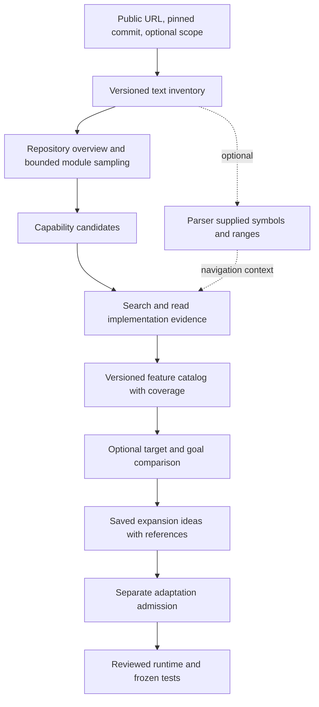

# Feature extraction roadmap

Researched October 30, 2026, America/New_York.

**Status: FE0–FE4 implemented and checked as a local public opt-in preview; FE5 live quality gates remain incomplete.**
Choose **All languages — text analysis preview** during source inspection. The generic
default remains disabled until the live semantic gates below pass. Optional parsers
(FE6) remain disabled. Upgrade code was originally inspected
at `68294517c3547aa8ecd7e4c7af587a481b34e86b`. Implementation and verification status
remain in [the development record](full-feature-development.md). This document owns the
design and acceptance criteria for general feature extraction.
The [October 31 validation record](full-feature-development.md#feature-extraction-implementation-and-validation)
retains the regression results, live comparison outcomes and unmet discovery gates.

## 1. Product decision

Let users understand a repository's capabilities and compare them with their own project
through a shared, read-only source-text workflow. A Python manifest, language runtime,
compiler, dependency installation, test adapter or language-specific parser must not be
an admission requirement for this workflow.

The intended journey is:

1. Inspect a public repository at a fixed commit and optional directory scope.
2. Discover meaningful capabilities using documentation and implementation evidence.
3. Investigate a capability and explain where and how it works.
4. Optionally compare it with a pinned target and the user's goal.
5. Save useful expansion ideas with source/target references and uncertainty.

Language parsers improve navigation and structural precision when available. The text
path remains usable without them. Models can misunderstand unfamiliar languages, and
bounded reads cannot establish every feature or prove that a capability is absent.

Execution remains a separate capability. Existing Python adaptation, acceptance tests,
license policy, patch review and publishing retain their own admission rules. A useful
cross-language idea does not establish that Upgrade can implement or test it.

Initial delivery uses the existing local public-URL workflow and Meta client. Private
analysis, local-folder/ZIP ingestion, new execution runtimes, automatic cross-language
ports, embeddings infrastructure and a complete runtime call graph are outside this
milestone. Existing identity, privacy and deployment boundaries still apply.

## 2. Research findings and their implications

The following sources were inspected before writing this plan. Findings describe those
sources; the implementation choices that follow are proposals for Upgrade.

| Primary source                                                                                                                                                                                                                                                                                                                                                                                                                                                                                       | Finding                                                                                                                                                                                                                                                            | Implication for this project                                                                                                                                                                                                       |
| ---------------------------------------------------------------------------------------------------------------------------------------------------------------------------------------------------------------------------------------------------------------------------------------------------------------------------------------------------------------------------------------------------------------------------------------------------------------------------------------------------- | ------------------------------------------------------------------------------------------------------------------------------------------------------------------------------------------------------------------------------------------------------------------ | ---------------------------------------------------------------------------------------------------------------------------------------------------------------------------------------------------------------------------------- |
| Graft at `a386620842c34f1f731bf6ffc91bdb1b101f31ba`: [model service](https://github.com/melvinthoompunkal/Graft/blob/a386620842c34f1f731bf6ffc91bdb1b101f31ba/graft-backend/services/claude_service.py), [tracer](https://github.com/melvinthoompunkal/Graft/blob/a386620842c34f1f731bf6ffc91bdb1b101f31ba/graft-backend/services/tracer_service.py), [ingestion](https://github.com/melvinthoompunkal/Graft/blob/a386620842c34f1f731bf6ffc91bdb1b101f31ba/graft-backend/services/github_service.py) | Initial features are extracted from the README. A separate model selects candidate files and traces their contents. Tree-sitter or regex supplies structural context. Larger payloads are chunked and synthesized. Name occurrences produce heuristic graph edges. | Reuse the discovery/retrieval/explanation pattern. Add implementation-led discovery, checked citations and explicit incomplete coverage. A README feature list or heuristic edge is insufficient evidence of implemented behavior. |
| Aider's [repository map documentation](https://aider.chat/docs/repomap.html)                                                                                                                                                                                                                                                                                                                                                                                                                         | A compact file/symbol map helps the model select further code. Relevant portions are selected under a token budget using graph ranking.                                                                                                                            | Provide a bounded repository overview and retrieve details on demand. Optional symbol maps can improve selection; a whole-repository source dump is unnecessary.                                                                   |
| Tree-sitter's [parser setup](https://tree-sitter.github.io/tree-sitter/using-parsers/1-getting-started.html) and [basic parsing](https://tree-sitter.github.io/tree-sitter/using-parsers/2-basic-parsing.html)                                                                                                                                                                                                                                                                                       | Parsing uses a language grammar; nodes expose byte offsets and row/column positions.                                                                                                                                                                               | A parser is a structural enhancement, distinct from executing the target program. Record grammar/query versions and convert positions carefully. Syntax alone does not establish runtime relationships.                            |
| GitHub Linguist's [classification process](https://github.com/github-linguist/linguist/blob/main/docs/how-linguist-works.md)                                                                                                                                                                                                                                                                                                                                                                         | Language detection combines filenames, shebangs, extensions and heuristics. Language statistics filter generated, vendored and other categories.                                                                                                                   | Avoid extension-only admission. Borrow classification ideas, while retaining documentation and declarative files needed for feature discovery. Language percentages do not describe product capabilities.                          |
| [RepoCoder, EMNLP 2023, version 3](https://arxiv.org/abs/2303.12570v3)                                                                                                                                                                                                                                                                                                                                                                                                                               | Iterative retrieval brings relevant cross-file context into repository-level code completion.                                                                                                                                                                      | Investigate candidate behavior through bounded follow-up retrieval. This is supporting evidence for the retrieval pattern, not a benchmark proving feature-extraction accuracy.                                                    |
| [Lost in the Middle, version 3](https://arxiv.org/abs/2307.03172v3)                                                                                                                                                                                                                                                                                                                                                                                                                                  | Controlled question-answering and retrieval experiments found sensitivity to where evidence appears in long contexts.                                                                                                                                              | Evaluate retrieval and evidence selection instead of treating context-window size as completeness. The study used different models/tasks; its measured results are not estimates for Upgrade's current model.                      |
| OpenClaw [manifest](https://github.com/openclaw/openclaw/blob/dda109cacbbefd3a6dfcc442ac97e2107b6c62c8/package.json), [README](https://github.com/openclaw/openclaw/blob/dda109cacbbefd3a6dfcc442ac97e2107b6c62c8/README.md), [gateway entry](https://github.com/openclaw/openclaw/blob/dda109cacbbefd3a6dfcc442ac97e2107b6c62c8/src/gateway/server.ts) and [method registry](https://github.com/openclaw/openclaw/blob/dda109cacbbefd3a6dfcc442ac97e2107b6c62c8/src/gateway/server-methods.ts)      | At this research pin, the manifest declares a JavaScript executable. Read TypeScript excerpts show lazy gateway startup and composition of core/plugin method descriptors. The tree contains multiple application/package areas.                                   | Use OpenClaw as the primary large-repository acceptance case. These are candidate behaviors from a small static sample, not a completed Upgrade catalog or proof of their full execution paths.                                    |

The local Graft checkout matched the audited commit above. OpenClaw research used the
separate pin `dda109cacbbefd3a6dfcc442ac97e2107b6c62c8`, resolved during this research;
it is not the `a4f5986c` snapshot in the user's screenshot. Only selected files and tree
metadata were read. No repositories were executed, dependencies installed, paid model
jobs started or GitHub resources modified for this research.

The design inference is that source text, controlled retrieval and model reasoning can
provide a common discovery baseline. Precision and coverage must be measured locally;
none of these sources establishes exhaustive, equally accurate analysis of all languages.

## 3. Current constraints that implementation must change

This is broader than removing the missing-manifest warning.

| Current implementation                                                                                                                                                                                                                                                      | Constraint                                                                                                                                                      | Required change                                                                                                                       |
| --------------------------------------------------------------------------------------------------------------------------------------------------------------------------------------------------------------------------------------------------------------------------- | --------------------------------------------------------------------------------------------------------------------------------------------------------------- | ------------------------------------------------------------------------------------------------------------------------------------- |
| [Repository snapshots](../backend/app/tools/repositories.py), `TEXT_SUFFIXES`, `_inventory`                                                                                                                                                                                 | Source suffixes are Python-oriented; other files are classified as text. The entry cap also counts exclusions, so early excluded paths can exhaust enumeration. | Version the inventory policy, classify readable text broadly, and distinguish metadata enumeration, admitted contents and exclusions. |
| [Project support](../backend/app/project_support.py), [Python adapters](../backend/app/project_adapters.py)                                                                                                                                                                 | `inspect_project` requires `pyproject.toml`, a static project name and bounded Python AST indexing before evidence analysis.                                    | Introduce independent text-analysis support; retain strict Python checks for Python structure/execution.                              |
| [Project store](../backend/app/projects.py)                                                                                                                                                                                                                                 | Root suggestions depend on `pyproject.toml`; reopening rebuilds the inventory and checks its digest.                                                            | Make roots optional scopes, add general root hints, and reopen using the pin's original inventory policy.                             |
| [Discovery](../backend/app/catalog_discovery.py), [catalog controller](../backend/app/catalog_workflow.py)                                                                                                                                                                  | Paths, symbol tools, production evidence and preflight require Python. Seed packets contain at most 60 initial lines per file.                                  | Add general retrieval and text-backed cards, including evidence beyond file heads.                                                    |
| [Evidence session](../backend/app/tools/evidence.py), [model tools](../backend/app/evidence_tools.py)                                                                                                                                                                       | Range validation is largely general, but named symbols, dependencies and supported traces are Python-specific.                                                  | Extract shared text provenance checks; dispatch optional structural and dependency checks by profile.                                 |
| [Evidence contracts](../backend/app/evidence_contracts.py), [catalog contracts](../backend/app/catalog_contracts.py)                                                                                                                                                        | Existing cards and consumers assume Python symbols/import classifications.                                                                                      | Add explicitly versioned analysis contracts; preserve old meanings.                                                                   |
| [Relevance controller](../backend/app/relevance_workflow.py), [analysis](../backend/app/relevance_analysis.py)                                                                                                                                                              | Source/target sessions run `python_facts`; target selection and positive evidence require `.py`.                                                                | Use the shared text profile for both repositories and retrieve target counterparts by behavior.                                       |
| [Catalog identity](../backend/app/catalog_store.py), [assessment identity](../backend/app/relevance_store.py)                                                                                                                                                               | Identity records include Python analyzer/profile/manifest assumptions.                                                                                          | Introduce new identities covering inventory, retrieval, evidence schema and optional parser versions.                                 |
| [Adaptation admission](../backend/app/adaptation_inputs.py)                                                                                                                                                                                                                 | Supported cards and assessed criteria feed a stricter implementation workflow.                                                                                  | Reject generic analysis cards at this boundary unless independently admitted through a reviewed adaptation profile.                   |
| [Artifact reader](../backend/app/api/artifacts.py), [artifact helpers](../backend/app/selection_artifacts.py)                                                                                                                                                               | Saved reference traversal and feature parsing use existing strict contracts.                                                                                    | Dispatch readers, downloads and reference lookup by saved schema/profile.                                                             |
| [Project form](../frontend/src/features/new-run/ProjectRun.tsx), [inspection](../frontend/src/features/new-run/ProjectPin.tsx), [discovery controls](../frontend/src/features/catalog/CatalogStart.tsx), [comparison](../frontend/src/features/catalog/AssessmentPanel.tsx) | Copy, counts, root hints and eligibility checks expose Python assumptions.                                                                                      | Present analysis availability separately from structural and test support.                                                            |
| [Support matrix](../backend/app/support_matrix.py), [API capabilities](../backend/app/api/routes.py)                                                                                                                                                                        | Advertised capabilities emphasize the execution profile.                                                                                                        | Advertise the analysis profile separately without broadening execution or hosted certification claims.                                |

Preserve the existing queue, owner-scoped storage, immutable catalog revisions,
explicit continuation, saved-result browsing and shared Meta budgets. A second analysis
application or separate provider stack would duplicate working foundations.

## 4. Proposed architecture

### 4.1 Inspect and inventory readable source

Define `repository-text-v1` as a new analysis profile. Availability requires a valid,
accessible pinned snapshot and admitted readable contents. An absent manifest or
unknown language is not an analysis failure. Derive a display name from repository and
scope when static metadata is missing.

Separate these inventories and counters:

- Tree metadata: paths, object types, object IDs and sizes within the enumeration budget.
- Content eligibility: readable files admitted by the versioned content policy.
- Materialized evidence: exact bytes fetched/read under content and job budgets.
- Exclusions and deferrals: reason, affected scope and whether more enumeration remains.

Include common source extensions across languages, extensionless source identified
through filename/shebang/content hints, and bounded unknown-extension text. Keep docs,
manifests, templates, SQL, UI styles and other declarative implementation available.
Initially decode UTF-8 strictly; disclose other encodings instead of silently changing
the text being cited. Treat unsupported compound formats such as notebook cell mappings
as explicit exclusions until exact source-location support exists.

Record file roles such as source, test, documentation, manifest, generated, vendor and
unknown, together with the classification basis. Roles are retrieval hints, not proof
of behavior. A directory name alone must not establish that a capability is implemented.
Generated/vendor classification may lower priority or exclude contents with a receipt;
repository-provided attributes must not override access or sensitive-path rules.

Retain path normalization, immutable Git bytes, ordinary-blob checks, binary detection,
sensitive-path exclusions and content/storage limits. Analysis must not check out and
run project hooks, install packages, import modules, start language servers, or execute
repository build scripts. Parsers, if enabled, are application-owned dependencies.

Root selection becomes optional narrowing. Manifest names from different ecosystems
can suggest scopes, but no particular manifest is mandatory. Keep original monorepo
paths in every exported reference. The selected `project_root` is the hard read
boundary. A catalog's narrower discovery `scope` selects seed areas; follow-up reads
may inspect related files within that project root, with expansion disclosed in coverage.
If the user requires a hard directory boundary, use that directory as `project_root`;
missing dependencies outside it remain unexamined.

Large-repository handling is part of this work. Avoid selecting content solely by the
first paths in a recursive listing. Budget tree traversal separately and prioritize
overview metadata and representative source areas. If enumeration is incomplete,
persist a resumable traversal frontier or offer a smaller scope; do not report a complete
inventory. If cloning itself exceeds storage limits, give that resource reason. A
smaller analysis scope does not automatically reduce today's clone transfer. Evaluate
pinned selective/lazy blob acquisition if OpenClaw cannot fit the existing fetch limit;
measure it before adopting it, rather than silently raising global quotas.

### 4.2 Build an overview and discover candidates

Construct a compact overview from repository purpose, selected directory structure,
available manifest metadata, documentation headings, representative implementation
windows and optional symbol summaries. Treat manifest contents as data; never evaluate
dynamic metadata to fill an overview field.

Run two discovery passes within the same job budget:

1. Documentation-guided candidates: use README/module docs to identify advertised behavior.
2. Implementation-guided candidates: sample production areas independently to find
   undocumented behavior and check whether documented candidates have code counterparts.

Sampling must distribute attention across modules rather than spend the whole allowance
on a large docs directory. Store the selection reason and which modules remain unsampled.
Explain features as behaviors, such as routing messages or normalizing URLs. Functions,
classes, configuration keys and test helpers are not automatically separate features.

Candidates start unverified. Merge only when behavior and implementation anchors agree;
names alone cannot merge unrelated implementations. Preserve aliases and parent/child
relationships, reject cycles, and keep ambiguous duplicates visible for investigation.
Within a catalog lineage, continuation retains existing IDs and records merge mappings.
Do not promise identical feature IDs from independent nondeterministic discovery jobs.

### 4.3 Retrieve and trace supporting code

Provide controller-owned tools for bounded path listing, literal text search, line-range
reads and optional symbol inspection. Search only admitted pinned contents, with fixed
query/result/byte/time limits. The model does not receive arbitrary shell commands,
filesystem access or arbitrary remote URLs.

Start with deterministic filename/path and lexical retrieval. Search behavior terms,
identifiers and literal import/export references; inspect neighboring ranges and related
tests where useful. Handle nonliteral/dynamic relationships as uncertain. Retrieve
additional bodies when initial file heads are insufficient. Embeddings and graph ranking
are possible later optimizations, each requiring a measured quality benefit.

Keep original path, line range and snapshot identity on every chunk. Without a parser,
use overlapping line windows; with a parser, prefer bounded syntax regions. Large files
need an explicit unread-range ledger and continuation, not permanent first-N-line
truncation. A summary may guide retrieval, but final claims must cite original source.

A deep trace explains the observable capability, its apparent entry/declaration points,
implementation steps, dependencies observed in read code, related tests, limitations and
missing evidence. Read-only trace results must never imply that tests or execution ran.
Dependency observations distinguish import text, manifest declarations and inferred
relationships. Unresolved imports remain unresolved; generic analysis cannot enforce
Python's standard-library rules or claim complete dependency closure.

### 4.4 Validate evidence and represent uncertainty

For every citation, the controller verifies the admitted project/root, repository,
commit, inventoried blob, ordered in-bounds range and coverage by actual read windows.
It computes excerpt hashes from pinned bytes. Source and target roles must not be
interchangeable. Search hits count as read evidence only when their exact returned
ranges are logged through the same protocol.

Keep three independent dimensions:

| Dimension              | Meaning                                                                                                                                                                     |
| ---------------------- | --------------------------------------------------------------------------------------------------------------------------------------------------------------------------- |
| Evidence status        | Existing `unverified`, `supported`, `partial`, `unsupported` states, with an explicit v2 profile. `supported` means a static explanation has cited implementation evidence. |
| Structural validation  | `text_only`, `parser_validated`, or `mixed`, derived from the actual anchors; detailed per-anchor parser status remains available.                                          |
| Execution verification | `not_run` for this workflow. Only a separate execution receipt can establish a tested result.                                                                               |

Documentation-only claims remain unverified before tracing and partial/unsupported
after an incomplete or unsuccessful trace. Test names, comments and imports alone
cannot substantiate an implemented capability. Supported traces require read production
implementation and an entry/declaration anchor relevant to the described behavior.
Declarative source may implement a feature without a function; require the operative
declaration and explanatory context rather than inventing a symbol. Ambiguous file roles
or missing operative code keep the result partial.

Parser absence does not invalidate exact text citations. A model-provided symbol name
is only a display claim until a registered parser validates its identity and boundaries.
Parser failure falls back with a disclosed reason; it must not silently retain a
parser-validated label. Likewise, valid line citations do not mechanically prove the
model's interpretation. Semantic quality requires the evaluation in section 8.

### 4.5 Compare behavior with a target

Use the same overview/retrieval/evidence path for the target, including targets written
in a different language. Retrieve likely counterparts using the goal, source behavior,
architectural role and code terms. Expand the current path-substring/file-head approach
when it misses a counterpart. Record what was searched and read.

Retain the existing target outcomes: already present, potential gap, unknown, and no
target. A potential gap means the examined evidence suggests an opportunity; it never
proves repository-wide absence. Source-only analysis explains capabilities, while
goal-only relevance does not claim target integration evidence.

Useful expansion ideas retain the current output: existing target behavior, proposed
extension, benefit, concrete integration locations, constraints, uncertainty and exact
source/target references. Mark conceptual cross-language transfer explicitly. Rank
ideas by disclosed semantic relevance separately from implementation eligibility;
an unsupported target runner must not suppress a useful recommendation.

For generic cards, implementation fit may remain unassessed. Do not fabricate a positive
stack/dependency score or reinterpret semantic relevance as passing acceptance gates.

## 5. Contract and compatibility design

Names below are proposed contracts, not existing APIs. Keep current route families and
job kinds unless implementation exposes a specific incompatibility.

| Proposed contract               | Required contents and ownership                                                                                                                                                                                                         |
| ------------------------------- | --------------------------------------------------------------------------------------------------------------------------------------------------------------------------------------------------------------------------------------- |
| `ProjectSupportV2`              | Analysis profile/availability/reasons; detected languages and readable-source counts; structural coverage; optional manifest observations; independent execution/adaptation profiles and reasons. Availability is computed server-side. |
| `TextRefV2`                     | Project/snapshot/root identity, repository-relative path and inclusive line range. Server validation binds it to the admitted pin and adds blob/excerpt hashes.                                                                         |
| `SymbolAnchorV2`                | Optional association with a text reference, qualified name, parser/grammar/query versions and validation result. Only the controller can label it parser-validated.                                                                     |
| `FeatureCardV2`                 | Behavior, entry/declaration and implementation references, dependency observations, cited tests, included/excluded behavior, notices, evidence status, structural validation and missing evidence. Test execution stays `not_run`.      |
| `CoverageV2`                    | Tree enumeration state, admitted/deferred/excluded paths, sampled modules, exact read ranges, partially read files, remaining frontier and reached limits. Controller-derived.                                                          |
| Catalog/assessment v2 envelopes | Explicit schema/analyzer/prompt/retrieval versions, independent semantic/adaptation status, actual usage and schema-dispatched detail/download payloads.                                                                                |

Preserve the strict existing `Ref`, `FeatureCard` and retry/Python validators for legacy
and reviewed adaptation workflows. Introduce a separate v2 read/trace path rather than
weakening `validate_trace` globally. Provider response schemas must pass the same strict
schema preflight and real structured-response checks as existing contracts.

Migration requirements:

1. Persist inventory policy and analysis profile with each new pin. Missing version
   fields on historical records mean the known legacy Python policy, not generic support.
2. Reopen old pins using their original policy or frozen validated inventory. Changing
   the suffix list globally currently changes the digest and invalidates saved pins.
3. A broader inventory of the same commit creates a new project selection and catalog;
   never rewrite historical inventories, references, features or recorded spend.
4. Dispatch jobs/readers by saved profile. Preserve working legacy execution paths.
   An incompatible queued job or continuation stops before inference with a clear
   version reason and an explicit start-new action. No automatic paid replay.
5. Version cache identities by content policy, inventory digest, scope, scan options,
   retrieval/chunking policy, evidence schema, prompts, model and enabled parser versions.
   Target/goal context remains part of assessment identity. Keep owner/access scoping.
6. Update API types, storage readers, evidence inspectors, feature downloads, run exports
   and review views together. Old payloads remain readable without model calls. Use the
   existing database migration mechanism if physical tables/indexes need changes.
7. At adaptation admission, generic analysis remains unsupported until an explicit
   reviewed adaptation profile revalidates source evidence, target scope, reuse and tests.
   A Python file inside a multilingual repository is not sufficient admission evidence.

## 6. Browser behavior

The source form continues to start with inspection followed by feature discovery. Show
detected languages, readable-source counts, snapshot, chosen scope and partial-inventory
reasons. Replace Python-only root advice with optional directory narrowing and manifest
hints. An absent `pyproject.toml` must not disable text-based discovery or comparison.

Keep user-facing distinctions short: **Ready for feature discovery**, **Code cited**,
**Structure checked**, **Tests not run**, and specific scope/resource limitations.
Do not display **Browse only** solely because the language lacks a parser or runner.
Docs-only snapshots can produce advertised candidates, with their evidence status clear.

Feature details show behavior, implementation evidence, source tests as citations,
notices, missing evidence and optional parser coverage. Saved filters, pagination,
reopening and downloads remain inference-free. Implementation controls use the separate
adaptation reason, while useful recommendations remain visible.

The existing **Structure only** mode may retain its Python definition report initially,
provided that limitation is explicit and does not gate general discovery. A generic
overview can be added through the new profile; do not relabel the old report as semantic
feature extraction. The Scrapy example keeps its existing bounded retry contract.

## 7. Implementation sequence

FE0–FE4 now have implementation and controlled checks; see the development record and
[text-analysis guide](text-analysis.md) for the shipped boundaries. FE5 is not a release
receipt until the live samples and semantic review pass. FE6 is optional and does not
block the text-based release.

| Milestone                                 | Deliverable and main code areas                                                                                                                                                          | Exit evidence                                                                                                                                                                         |
| ----------------------------------------- | ---------------------------------------------------------------------------------------------------------------------------------------------------------------------------------------- | ------------------------------------------------------------------------------------------------------------------------------------------------------------------------------------- |
| FE0: regression corpus and boundaries     | Add independent Git fixtures for parserless source, mixed languages, misleading docs, large files and target overlap. Finalize versioned evidence/support contracts and legacy dispatch. | Fixtures fail under current Python-only discovery; existing Python/adaptation meanings are captured.                                                                                  |
| FE1: general inspection and evidence      | Version inventory/reopen policies in `repositories.py` and `projects.py`; add text support, root hints, bounded retrieval tools and v2 provenance/coverage validation.                   | A no-manifest repository can be pinned and read; exact citations validate with all parsers disabled; old pins reopen unchanged; snapshot limits are reported accurately.              |
| FE2: discovery and deep traces            | Implement overview/module sampling, two-pass candidates, controlled retrieval, generic cards, deduplication, checkpoints and continuation in the F4 services.                            | Discover a feature beyond the first 60 lines and one absent from docs; documentation-only claims never become code-supported; interrupted jobs retain honest partial state and usage. |
| FE3: semantic target comparison           | Extend F5 retrieval/contracts to generic source/target evidence; keep semantic ranking separate; explicitly fence F7 generic-card admission.                                             | Parserless and cross-language comparisons distinguish overlap, potential gap and uncertainty without a runner; generic cards cannot enter patch execution.                            |
| FE4: complete browser and saved-data flow | Update inspection/discovery/comparison UI, generated API types, artifact readers, exports and cache dispatch. Reconcile capability and operator documentation.                           | Browser flow works for non-Python input; old and new results reopen/download without inference; unsupported implementation does not hide ideas.                                       |
| FE5: evaluate and enable                  | Run the offline acceptance matrix, bounded live samples and actual saved-result browser checks. Resolve OpenClaw fetch/scope limits before claiming support.                             | Retain exact pins, policies, model receipts, manual semantic review, regression results, coverage and spend. Enable the generic local default only after the required gates pass.     |
| FE6: optional parser improvements         | Retain Python AST precision; evaluate pinned Tree-sitter grammar/query bundles, initially for JavaScript/TypeScript where useful. Add only measured enhancements.                        | Parsing improves navigation/range precision on the corpus. Missing, malformed or timed-out parsers fall back; discovery still works when the enhancement is disabled.                 |

FE0/FE1 changes must establish historical-policy dispatch before a new inventory policy
is used by default. Schema/read compatibility and adaptation fencing are continuous
requirements across milestones, not cleanup postponed until release.

## 8. Acceptance and semantic evaluation

### 8.1 Deterministic offline checks

Use real temporary Git repositories and controlled model responses for controller
guarantees. Do not rely on fixture prose alone to establish live semantic usefulness.
Extend [project tests](../backend/tests/test_projects.py), [support tests](../backend/tests/test_project_support.py),
[catalog tests](../backend/tests/test_catalogs.py), [evidence tests](../backend/tests/test_evidence.py),
[relevance tests](../backend/tests/test_relevance.py), [adaptation tests](../backend/tests/test_adaptation.py)
and the corresponding frontend project/catalog/relevance suites.

Required cases:

- A TypeScript/JavaScript repository without Python or a Python manifest can reach
  discovery, deep trace, comparison, saved browsing and JSON export.
- Python without `pyproject.toml` and parserless Go or Rust text use the same baseline
  path. No per-language execution adapter or mandatory grammar is introduced.
- A mixed frontend/backend repository preserves related cross-file behaviors and
  distinguishes unrelated same-named functions. Non-function declarations are citeable.
- A misleading README, documentation-only claim and test-only helper do not produce
  supported implementation cards; undocumented production behavior can be discovered.
- A relevant body after line 60 and after an oversized chunk is recoverable through
  retrieval/continuation. Unsampled modules and unread ranges remain visible.
- Missing manifests, dynamic metadata and parser errors do not block safe text analysis.
  Binary/non-UTF-8 files, blocked paths, symlinks and submodules have explicit outcomes.
- Foreign commit/root/role references, nonexistent paths, out-of-bounds or unread lines,
  stale hashes and invented parser validation are rejected.
- Missing tests, incomplete dependencies and generated/vendor exclusions are disclosed.
  No result claims test execution or complete dependency resolution.
- Existing target behavior, unrelated goals, useful potential gaps and insufficient
  evidence remain distinct, including a source/target pair in different languages.
- Generic cards fail adaptation admission; current reviewed Python admission and frozen
  acceptance still enforce their original conditions.
- Legacy pins/results retain identity and references; cache/profile changes cannot reuse
  incompatible results or silently replay inference.
- Job budgets, cancellation, owner isolation, idempotency, continuation and saved-result
  browsing retain their existing guarantees. Analysis starts no target executable,
  package installer or Docker suite.

### 8.2 Bounded live evaluation

Use a declared scope and fixed SHA for every repository. Include OpenClaw TypeScript,
the inspected Graft JavaScript frontend and an existing Python source/target example.
Exercise the first two with optional parsers disabled. Fixtures additionally establish
the no-manifest and unfamiliar-language paths. Register expected scoped behaviors and
supporting code before running the model so that outputs cannot define their own gold set.

Initial product acceptance targets, not published benchmark claims:

| Measure                 | Initial gate                                                                                                                                                                                           |
| ----------------------- | ------------------------------------------------------------------------------------------------------------------------------------------------------------------------------------------------------ |
| Citation provenance     | 100% of exported references pass exact snapshot/range/read validation.                                                                                                                                 |
| Semantic precision      | Manually review at least 20 supported cards across the scoped corpus; at least 90% accurately describe the behavior supported by their cited code. Record every error and actual sample size.          |
| Scoped discovery recall | Recover at least 80% of a preregistered set of at least 10 capabilities within the deliberately examined scopes. Report matches, misses and duplicates; do not extrapolate to whole-repository recall. |
| Evidence honesty        | No documentation-only card is promoted to code-supported; no runtime/test/dependency-closure claims are fabricated.                                                                                    |
| Target comparison       | Reviewed overlap, unrelated-goal, useful-extension and unknown-evidence cases all receive the appropriate outcome with justified references.                                                           |
| Operational behavior    | Actual spend stays within declared limits; cancellation/failure saves partial work; reopening, filtering and downloads trigger zero inference.                                                         |

If a bounded run produces fewer than the required reviewed cards, the quality gate
remains incomplete. Further evaluation uses explicit new jobs/continuations within
normal quotas. Record relevance and evidence precision separately; a useful idea does
not excuse a false implementation claim.

OpenClaw acceptance starts from the research pin above or a newly declared full SHA.
Reviewers should investigate candidate behaviors such as gateway startup and method
registration against their full relevant code, rather than assume the short research
excerpts establish a complete trace. Root inspection should reach a bounded overview
and source sampling when resources permit. If resource limits prevent it, retain the
failure and deliver a scoped acquisition strategy before claiming OpenClaw support.
This document alone supplies no live feature-extraction receipt.

### 8.3 Receipts and application checks

Retain commit/root/policy identities, candidate and validated counts, exact reads,
exclusions, parser status, failures, continuations, returned model IDs, actual usage and
manual semantic-review decisions. Include code/build hashes for implementation receipts.

Run focused affected backend/browser suites, the normal backend regression gate,
frontend TypeScript/production build, lint/format checks and relevant migration/export
checks for the implementation. Test target applications only through a separately
admitted execution workflow; feature-extraction validation does not require doing so.

## 9. Budgets and release boundaries

Retain the current discovery defaults of 32 seed files and up to 8 deep traces, bounded
by 32 model attempts, 400,000 returned input tokens, 40,000 returned output tokens and
1,200 seconds. Preserve the eight-hint response bound, explicit continuation and
reserved final structured-answer turn. Nested retrieval/synthesis shares this budget.
Do not create a fresh allowance for each chunk, feature, tool or comparison substep.

Inventory metadata, content reads and model context are separate budgets. Current
inventory limits are 4,000 entries and 50 MiB of text, with a 2 MiB per-file bound;
public snapshot storage is capped at 200 MiB. Existing evidence sessions cap read text
at 500,000 bytes and individual windows at 200 lines / 24,000 bytes. Retain these
ceilings initially and document any independently measured policy change. Replace the
Python-only 200-file/2 MiB AST admission rule with optional parser work limits.

For v2, propose an additional ceiling of 64 distinct files exposed per evidence session,
counting initial packets and follow-up retrieval together. Source/target comparison
must declare each session's allowance and retain the shared job token/time/request
limits. This new ceiling is a design default to validate in FE0/FE5, not a measured
capacity claim. Report seed files scanned separately from files retrieved for tracing.

Charge indexes, cached excerpts and traversal state to existing storage reservations
and retention. Log returned evidence and rejected tool requests. Treat repository text,
goals, comments and manifests as untrusted input to the model; existing read-only tool
and publication boundaries remain in force. Broader text admission must preserve the
current disclosure about code sent to the model and must not extract configuration
values or credentials into reports.

The first release target is local public analysis. Generic local support does not
certify hosted admission, private analysis, PR publishing or a new target runtime.
Operators must continue to use the existing deployment/access gates for those modes.
Optional parsers may ship later; they must not become an accidental prerequisite for
the shared feature-extraction workflow.
