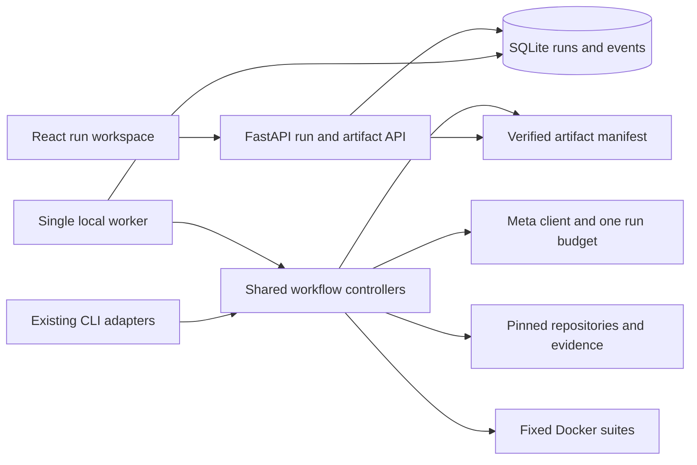

# Upgrade frontend and integration plan

Date: October 27, 2026, America/New_York.

Original status: proposed implementation plan, October 27, 2026.
Implementation update, October 28: the local React workspace, typed run API, SQLite
queue/history, evidence inspector, tests/logs, exports, and diagnostic entry points
are implemented. See [the browser workspace guide](frontend.md) for startup and exact
boundaries. The packages and acceptance matrix below remain the original target
criteria. The subsequent [foundation implementation receipt](../audit/full-feature-foundations/report.md)
closes U0 and adds shared CLI/API exclusion, owner-aware API/session boundaries and a
GitHub repository-index preview. Hard-kill Docker cleanup, the general catalog and
Phase 5 patch/verification remain pending. The [full feature plan](full-feature-development.md)
supersedes the original account/private-repository exclusions below.

Build one local application where a developer supplies a source repository, chooses a
target, describes a goal, and follows the evidence through analysis, selection, and,
when implemented, a tested adaptation. Every current capability must be accessible;
new capabilities must become available when their controller support is delivered.

## 1. What the Graft inspection established

Inspected the local `.research/Graft` checkout at
`a386620842c34f1f731bf6ffc91bdb1b101f31ba`. These findings come from source inspection,
not a fresh browser execution or live API test of Graft.

Graft contains two separate products:

| Interface | Actual flow | Useful pattern | Upgrade decision |
|---|---|---|---|
| Primary workspace | Enter GitHub URL and optional token; ingest; select an extracted feature; enter a question; trace; download a bundle | Immediate feature list and detail view | Keep the browse-and-inspect interaction inside a run; add an explicit target and goal |
| Traces page | Expand traces held in the current React session | Implementation references, dependencies, explanation | Make these evidence views within a saved run |
| Repository map | Select a traced feature; pan/zoom through nodes; step through a guided walkthrough | Guided explanation linked to files and symbols | Start with an accessible evidence tree; add a map only when actual relationship data supports it |
| Bundles page | Download ZIPs assembled from source slices, filtered manifests, environment templates, and instructions | Clear access to exported material | Export Upgrade's evidence bundles and later its patch; describe exactly what each contains |
| Separate demo app | Browse/search pre-analyzed repositories and open feature details; a separate live form extracts feature descriptions | Search, readable feature descriptions, useful empty states | Use actual saved Upgrade runs as history; keep recorded examples explicitly identified |

The primary `App.jsx` keeps session identity, features, traces, navigation, and request
status in component state. Its refresh operation fetches session metadata, not complete
trace objects; its backend store is an in-memory dictionary. Reopening the browser is
therefore not a dependable way to recover a complete workspace.

The map creates an edge between successive `call_chain` entries in `computeLayout`.
That rendering is not proof of a runtime call graph. The demo live analyzer returns
`traces: {}` after README-based extraction, so its feature list does not establish code
tracing. Upgrade should preserve its stronger evidence distinctions in the interface.

Graft's inspected design uses dark surfaces, neon green, glow effects, an animated grid,
Space Grotesk/Inter, and uppercase monospace labels. Upgrade will use a new palette,
typography, layout, and component styling. Graft is a functional reference.

Local inspection sources:

- [Primary app and requests](../.research/Graft/graft-frontend/src/App.jsx)
- [Repository input and features](../.research/Graft/graft-frontend/src/components/FeatureSidebar.jsx)
- [Trace workspace](../.research/Graft/graft-frontend/src/components/TraceWorkspace.jsx)
- [Map implementation](../.research/Graft/graft-frontend/src/components/RepoMapPage.jsx)
- [Bundle interface](../.research/Graft/graft-frontend/src/components/BundlesPage.jsx)
- [Theme](../.research/Graft/graft-frontend/tailwind.config.js)
- [API routes](../.research/Graft/graft-backend/routers/repo.py)
- [Session storage](../.research/Graft/graft-backend/store/session_store.py)
- [Demo router](../.research/Graft/graft-demo/backend/routers/demo.py)
- [Demo live analysis](../.research/Graft/graft-demo/backend/services/analyze_service.py)

## 2. Product structure

Use three primary destinations: **New run**, **Runs**, and **System checks**.
Opening a run gives it a stable URL and a single workspace with these views:

| View | Main question | Contents |
|---|---|---|
| Overview | What happened, and what can I do next? | Goal, pinned inputs, current stage, outcome, selected behavior, next action |
| Features | What was considered, and why? | All analyzed cards, actual eligible count, ratings, failed gates, selection and rejections |
| Evidence | Where does that conclusion come from? | Source implementation/tests/notices, target profile, dependencies, citations, read coverage |
| Tests | Which behavior was observed? | Isolation, original baseline, retry diagnostic, and later acceptance/regression captures |
| Changes | What code changed? | Later patch, file/line scope, adaptation mapping, dependency delta, repair history |
| Exports | What can I inspect or download? | Reports, trace bundles, captures, notices, and later `changes.patch` |

Keep progress visible above these views. Details open in a shared evidence inspector,
so the user can follow a citation without losing their selected candidate or test case.
Do not require a separate page for every artifact or agent.

In the first release, Changes explains that this analysis run made no code changes.
It has no simulated patch editor or nonfunctional implementation button.

## 3. Input flow

### Default path: source, target, goal

The new-run screen contains three required input groups and one primary action:

| Input | Initial behavior | Validation and guidance |
|---|---|---|
| Source repository | Public GitHub URL; an explicit example action fills Scrapy | Apply existing repository URL rules; reject embedded credentials and unsupported origins |
| Target project | Selector populated from backend registrations | Initially only `crawler-demo`; show Python/HTTPX and committed-input semantics |
| Goal | Multiline description in the user's words | Require a nonempty bounded value; example: improve recovery from temporary HTTP errors |
| Primary action | **Find a suitable feature** | Starts the real selection workflow once; states that model analysis and Docker tests will run |

An expandable **Analysis options** area exposes source commit pinning and the supported
analysis scope. Initially the scope is a read-only description: one bounded retry slice.
Display the source SHA default used by the controller. A different source revision can
be traced, but the current acceptance/source-use registration may prevent selection.
Explain this before submitting a selection run.

The Scrapy example fills its reviewed URL and SHA together. If the user changes the
repository, clear that example SHA and require the custom repository's full commit SHA
with an inline explanation. Do not send Scrapy's SHA to an unrelated repository.
A future server-side branch/ref resolver can simplify this after its retrieval contract
is implemented and the resolved immutable SHA is recorded.

Show target HEAD and whether local target changes will be excluded, with a checked-at
timestamp. Recheck when execution pins the input; the run's recorded SHA is authoritative.
Do not auto-commit changes or imply that unsaved work was analyzed.

Feature descriptions supplied by the user belong in the goal today. A future structured
feature-focus list requires a real planner/tracer input contract first. Such entries
are discovery hints, never pre-approved catalog cards. Do not add a feature input that
the backend silently ignores.

No Meta/GitHub secret input, arbitrary host path picker, custom shell command, editable
runner policy, or private-repository toggle belongs in this first form. System checks
explain the existing local configuration process without exposing secret values.

Public GitHub targets are a later input extension: add a target-source selector only
after public-target retrieval and a reviewed compatible runner registration exist.
Developer-side registration remains the path for additional local projects. Both
extensions must retain pinned commits, baseline checks, and explicit unsupported results.

### Preflight and submission

1. Load supported actions and registered targets without paid inference.
2. Validate inputs inline, preserving the form when validation fails.
3. Show configuration/image readiness separately from last successful connectivity tests.
4. Submit with an idempotency key; return a run ID immediately after durable enqueue.
5. Navigate to that run and follow its stages. Refreshing the page rejoins the run.

Missing prerequisites name the corrective action: configure the local Meta key, start
Docker, or build the reviewed image. An absent key must not prevent viewing old results.
Preflight is advisory; the controller still performs its authoritative execution checks.

When patching is implemented, add an explicit run mode, **Build and test the best fit**.
Its description explains that changes are prepared in managed storage. This mode follows
selection directly into acceptance preparation and implementation within one owned run.
The default analysis mode still ends at selection. Avoid a separate cross-run receipt
import/continuation mechanism in the initial UI integration.

## 4. Visual direction and wireframes

Use a light review workspace with calm surfaces and one restrained rose accent. Its
characteristic element is an aligned comparison: source behavior, the target's existing
behavior, and the proposed change share the same evidence context.

| Token | Proposed value | Purpose |
|---|---|---|
| Canvas | `#F4F6F9` | Cool neutral page background |
| Surface | `#FFFFFF` | Form, code, and inspection surfaces |
| Text | `#252B36` | Main text and numerical results |
| Secondary text | `#596473` | Supporting descriptions and metadata |
| Divider | `#D9DFE7` | Quiet grouping and table separation |
| Accent | `#98465C` | Primary action, active location, focus, selected evidence |

Use IBM Plex Sans for interface text and IBM Plex Mono for code, SHAs, and aligned
numbers. Package approved font assets locally during implementation. Use sentence case,
14–16px body text, a restrained 24–32px page title, and a consistent 4/8px spacing scale.
Use 6px controls and 10px elevated inspector/dialog corners; let table rows share a
surface rather than placing every result in a separate card.

Status must remain understandable through words and icons without color. Keep one
dominant action per view. Use short motion to explain opening a drawer or changing a
selection, respect reduced motion, and keep long-running progress textual. The user's
ease-of-use requirement takes precedence over decorative motion in the design skills.

### New run, desktop

```text
+-------------------+-------------------------------------------------------+
| Upgrade           | New run                                               |
|                   | Find a useful feature for your project.               |
| New run           |                                                       |
| Runs              | Source repository             Target project          |
| System checks     | [GitHub URL             ]     [Crawler demo       v]  |
|                   | [Use Scrapy example]          Python / HTTPX          |
| Recent runs       |                                                       |
|   Crawl recovery  | What would you like to improve?                       |
|   Baseline check  | [Goal                                               ] |
|                   | [                                                   ] |
|                   | > Analysis options                                    |
|                   |                                                       |
|                   | [Find a suitable feature]                             |
+-------------------+-------------------------------------------------------+
```

### Run workspace, desktop

```text
+-------------------+-------------------------------------------------------+
| Upgrade           | Crawl recovery                 [Selected for analysis] |
|                   | Source: scrapy@...    Target: crawler-demo@...         |
| New run           | Inputs / Checks / Analysis / Selection                 |
| Runs              |                                                       |
| System checks     | Overview  Features  Evidence  Tests  Changes  Exports  |
|                   |-------------------------------------------------------|
| Recent runs       | Selected behavior: bounded HTTP retries               |
|   Crawl recovery  |                                                       |
|                   | Source behavior           Target behavior              |
|                   | Retries transient errors  Stops after first 503       |
|                   | [Implementation]          [Observed diagnostic]        |
|                   |                                                       |
|                   | Proposed change: adapt retry policy inside fetch.     |
|                   | No implementation was performed in this analysis run. |
|                   |                                                       |
|                   | [Inspect evidence]          [Download report]         |
+-------------------+-------------------------------------------------------+
```

The selected result above is a layout example. Actual scores, SHAs, counts, and statuses
must come from the opened run. The recorded Stage 4 live score must never become a UI default.

### Feature inspection

```text
| Features considered: actual count     [Search] [All decisions v]            |
|----------------------------------------------------------------------------|
| Feature                   Decision       Score     Main reason              |
| Bounded retries           Selected       from API  Captured target gap      |
| ...only actual analyzed candidates...                                      |
|----------------------------------------------------------------------------|
| Selected feature details                      | Evidence inspector          |
| Five ratings with explanations                | Source or target            |
| Ten gates with pass/fail/unknown reasons       | File, SHA, symbol, lines    |
| Existing dependencies / proposed edit scope   | Stored excerpt              |
| Included and excluded behavior                | Citation and capture links  |
```

At narrow widths, collapse the navigation into a labeled menu, stack source and target,
and open evidence as a full-width panel with a visible Back action. At 390px, only code
and data tables may scroll horizontally. Preserve the selected view in the URL.
Keyboard focus must return to the originating citation when its inspector closes.

## 5. Capability coverage: every feature has a place

Existing means controller/CLI support exists, not that an HTTP endpoint already exists.

| Capability | Product entry | Existing implementation | Integration requirement |
|---|---|---|---|
| Meta connectivity/schema/tool probe | System checks: Run Meta check | `app.smoke` | Explicit job; show timestamp and observed result; never run on page load |
| Docker/image readiness | System checks and form prerequisite summary | Runner/image validation | Lightweight readiness plus recorded actual isolation results |
| Current local crawler baseline | System checks: Test local fixture files | `app.baseline` | Clearly label working-file inputs and expected missing-retry diagnostic semantics |
| Committed target baseline | System checks: Test committed target | `app.pinned_baseline` | Show SHA, prefix, hashes, suites, and dirty-input exclusion |
| Standalone source trace | New run: Trace source only, secondary mode | `app.source_trace` | Existing source/registered-target inputs; code-backed trace and notices |
| Combined profiling and selection | New run primary mode | `app.fit_select` | Shared service; all same-run evidence and one budget |
| Source/target snapshots | Run overview and Evidence | Repository manager/inventories | Safe summary with full SHA, prefix, inventory limits, and preservation results |
| Target architecture/capabilities/gaps/style | Evidence: Target profile | `TargetProfiler`, `TargetProfile` | Distinguish inferred gaps from captured observations |
| All actual feature cards | Features | `SourceTrace.features` | Currently one card; future catalog up to eight; filters never conceal analyzed totals |
| Fit criteria and selection | Features and Overview | `FitMatcher`, `FitResult` | Controller totals/order; show all rejections and gate evidence |
| Excerpts, symbols, source tests, coverage | Evidence inspector | Evidence sessions/trace bundles | Read-backed excerpts; code references and executed target tests have different labels |
| Dependencies and source notices | Evidence and Exports | Feature cards/profile/notice artifacts | Separate source dependencies from intended target dependency use |
| Captured tests | Tests | Existing runner captures | Cases, status, logs, duration, image and input binding |
| Reports and artifact downloads | Exports | Artifact store/run reports | Download only completed, registered artifacts; identify missing outputs |
| Call IDs, usage, budget, controller versions | Run details, expandable | Meta ledger/current reports | Preserve technical evidence without dominating the default result |
| Saved runs, refresh, deep links | Runs and workspace | Not yet implemented | SQLite, durable queue, API, URL-based selection |
| Additional local/public target inputs | Target selector, when supported | Only the local crawler registration exists | Extend retrieval and compatible runner registration before enabling new input types |
| Broader feature comparison (4B) | Features, when enabled | Pending | Independently trace additional slices; expose real analyzed and eligible counts |
| Repository-aware planning | Run activity and optional plan details | Synthetic smoke plan only | Real planner integration before presenting planning as a production stage |
| Acceptance contract and valid red | Tests, future adaptation mode | Diagnostic exists; final contract pending | Versioned behavior, frozen tests, source/target binding, valid assertion red |
| Patch generation/application | Changes, future adaptation mode | Pending Phase 5 | Safe managed-worktree patch tool and actual scope/dependency enforcement |
| Verification and capped repairs | Tests and Changes, future adaptation mode | Pending Phase 5 | Same frozen tests, regressions, controller verdict, at most three repair rounds |

Environment-variable inventories from Graft are not an existing Upgrade artifact.
If later analysis supports them, show cited names and uncertainty only; never values.
Do not fill missing fields with invented requirements. Likewise, an empty dependency
list is not proof that a future adaptation adds no runtime dependency.

## 6. User-facing outcomes and progress

Keep these distinctions visible:

| Controller result or condition | User-facing presentation | Next useful action |
|---|---|---|
| `selected` | Suitable feature found; analysis complete | Inspect rationale/evidence; download analysis |
| `no_safe_fit` | No suitable feature found | Read rejection reasons; create a revised run |
| `unsupported_target` | Target environment is unsupported | Explain supported registrations and required extension |
| Ordinary baseline failure | Existing tests failed before adaptation | Inspect cases/logs; fix target separately |
| Valid retry diagnostic red | Missing retry behavior observed | Show expected assertion failures and passing controls |
| Diagnostic already passes | Target already satisfies this retry diagnostic | Explain that this gap is absent; no forced selection |
| Invalid evidence or changed inputs | Evidence could not be validated | Identify failed check; retain intact partial exports |
| Missing configuration/provider failure | Analysis could not start or continue | Configuration/network guidance and sanitized diagnostic |
| Budget exhausted | Analysis stopped at its allowance | Show actual usage/limit and available evidence |
| Interrupted | Run stopped before completion | Inspect partial results; explicitly start a new run |
| `verified`, future | Adaptation verified | Patch, acceptance/regression results, notices and report |

Human stages are Inputs, Checks, Analysis, Selection, and, for adaptation mode, Build
and verify. Technical substages remain expandable. Display the current operation and
elapsed time; do not invent a completion percentage or an ETA from stage counts.

An API run record uses separate `status` (`queued`, `running`, `finished`), `stage`,
nullable `outcome`, and nullable sanitized `error`. Include `kind`, `schema_version`,
`revision`, timestamps, actual counts, and completed artifact summaries. Preserve raw
controller outcomes in the final report. A finished selection is never relabeled verified.
Unknown/unavailable data is explicit; it is not a zero count or a passing check.

## 7. Backend architecture and API bridge

The current web application exposes `/health` only. Do not attach Graft's old ingestion
routes to new buttons or invoke CLI commands through browser-supplied shell strings.
Move orchestration behind shared typed functions so terminal and browser use the same
controllers, checks, error handling, artifacts, and model budgets.



### Shared services

- Replace argparse/global-path ownership at the service boundary with a typed request
  and execution context: run ID, owned directory, event sink, and run allowance.
- Keep `SourceTracer`, `TargetProfiler`, `FitMatcher`, `RepositoryManager`, and the runner
  as canonical implementations. Do not create parallel web versions of their policies.
- Extract report finalization and capture decoding as clear boundaries while resolving
  the audit findings. A single large controller with more optional mode branches would
  make failure handling harder to maintain.
- Emit sanitized events at real boundaries and after completed artifacts. Keep stage
  changes, run projection updates, and their sequence events consistent in storage.
- Preserve CLI output/exit semantics. All workflow entry points use the same execution
  lock when they operate on the registered target.
- Keep one attempt/token/time allowance across the entire workflow. When planning,
  implementation, and repairs are added, measure their combined budget headroom and
  report exhaustion explicitly; a new stage or browser request must not reset it.

### Durable local execution

Use the standard-library SQLite driver with explicit schema migrations and a single
worker process. Start with one active workflow and a small bounded queue. Atomically
claim queued work, record ownership/heartbeat, and reconcile stale running jobs at
restart only after establishing that the prior owner has stopped. Release or clean up
owned Docker processes before a replacement run. Never automatically repeat paid
inference or resume a partially applied patch after a crash.

Persist `runs`, sequenced `run_events`, and `artifacts`; store artifact bytes in existing
run directories. Prevent duplicate submissions with a unique idempotency key and request
fingerprint. A repeated key with different inputs is a conflict. Treat run type as a
small discriminated request union for the existing workflows, not a generic command runner.

This worker design is a local project decision. FastAPI's background-task documentation
discusses separate processing tools for larger jobs; request-response completion alone
does not provide the durable lifecycle required here.
[FastAPI background tasks](https://fastapi.tiangolo.com/tutorial/background-tasks/)

### Initial endpoints

| Route | Contract and purpose |
|---|---|
| `GET /api/capabilities` | Supported workflow kinds/scopes, patch support, model configuration presence, readiness and timestamped check summaries |
| `GET /api/targets` | Registered IDs, display names, stack, runner, committed-input semantics and current target disclosure |
| `POST /api/runs` | Validated workflow request; idempotent durable enqueue; `202` with run ID and location |
| `GET /api/runs?cursor=...` | Paginated run summaries and outcomes |
| `GET /api/runs/{id}` | Authoritative run projection, current revision and last event sequence |
| `GET /api/runs/{id}/events?after=...` | Ordered bounded event page with next cursor; no loss on reconnect |
| `GET /api/runs/{id}/artifacts` | Manifest-backed descriptors: opaque ID, label, kind, size, digest, availability |
| `GET /api/runs/{id}/artifacts/{id}` | Validated artifact download; ID lookup, containment and integrity checks |

Request kinds initially cover fit selection, source trace, pinned baseline, local fixture
baseline, and Meta smoke. Each kind has only its applicable fields. Later adaptation
requests must be rejected by the API until the verified implementation capability exists.

An event includes sequence, run ID, timestamp, stage, kind, readable message, and registered
artifact IDs. Poll active runs at approximately one-second intervals with bounded backoff;
retain the last sequence, deduplicate events, abort stale requests on navigation, and stop
polling terminal runs. A lost connection leaves the run running and shows reconnection
status. SSE is optional after polling, refresh, and recovery are dependable.

Build a typed UI summary from validated artifacts. Keep large logs and excerpts lazy.
Generate an evidence index from already validated references and stored read-backed
excerpts, assigning stable reference IDs. The browser requests those IDs, not arbitrary
paths or line reads. This also makes local target citations usable without GitHub URLs.

Use the local server boundary already intended by Upgrade: loopback binding, same-origin
production requests, strict development-origin handling, and validation of state-changing
requests. Resolve public repository inputs through existing retrieval rules. Treat model
and repository text as text; do not execute embedded HTML. Never send provider keys to
the frontend, local storage, event feed, or artifact downloads.

## 8. Frontend implementation structure

Use React with Vite and Tailwind, matching the project's planned architecture. Create
a new `frontend/` rather than importing Graft's app root or theme. Its inspected stack
is React 18.3.1, Vite 6.0.7, Tailwind 3.4.16; those are historical checkout versions,
not a recommendation to copy an old lockfile unchanged. Confirm supported compatible
versions and Node requirements at implementation time, then commit a reproducible lock.

Use TypeScript for API DTOs and UI state. Generate transport types from FastAPI's API
schema; retain distinct domain contracts for model proposals versus authoritative results.
Check installed dependencies before imports. Use one icon family (`@phosphor-icons/react`)
if installed; do not copy Graft's remote Material Symbols font.

```text
frontend/
  src/
    app/                  shell, routing, design tokens
    api/                  fetch client and generated transport types
    features/new-run/     form and prerequisite summary
    features/runs/        history, workspace, polling and local UI reducer
    features/evidence/    cards, profile, reference inspector and coverage
    features/tests/       suite/case results and lazy log viewer
    features/changes/     adaptation diff and repair views, when supported
    features/system/      readiness and explicit diagnostic jobs
    components/           small accessible controls used across features
  tests/                  browser workflows and visual checks
backend/app/
  api/                    run, capability, target, and artifact routes
  orchestration/          shared execution context and worker integration
  storage.py              SQLite lifecycle, event and artifact records
```

Use URL state for run, view, feature, and reference selection; server state comes from
the API. A focused reducer owns drawer/filter/form presentation state. Avoid duplicating
the backend's result state machine in React. Reducers are appropriate when related state
updates otherwise become scattered across event handlers.
[React reducer guidance](https://react.dev/learn/extracting-state-logic-into-a-reducer)

In development, proxy `/api` and `/health` through Vite. For a local production build,
serve compiled assets and explicit SPA routes after the API routes; unknown `/api/*`
requests must still produce API errors, not `index.html`. Browser refresh on a run URL
must work. No server-side rendering framework or second demo application is necessary.
Vite documents both production build assets and backend integration options.
[Vite backend integration](https://vite.dev/guide/backend-integration.html)

## 9. Prerequisites and delivery order

This plan does not silently approve or implement the pending Phase 5 backend work.
Ship a usable selection UI first. The full adaptation experience depends on a separately
implemented and verified patch controller, regardless of frontend readiness.

| Package | Work | Completion evidence |
|---|---|---|
| U0: resolve Stage 4 audit | Require integration file in edit scope; bind typed behavior to acceptance; hash/validate captures before decoding; dependable finalization; containment before writes; actual report counts | Regression cases close S4-A01 through A06; sanitized failures and intact partial receipts |
| U1: expose shared workflows | Typed requests/context, progress sink, unchanged CLI adapters, capability/target contracts | CLI and service results agree; shared budget and preservation checks survive failures |
| U2: persist and serve runs | SQLite, worker ownership/queue, event cursors, run/artifact routes, local serving | Duplicate submit, refresh, restart, corrupt artifact, and queue-limit cases pass |
| U3: build main experience | Tokens, shell, new-run form, history, progress, selection overview | Real selection run can be started and reopened through the browser |
| U4: cover the full existing toolset | Feature/gate details, profile/citations, tests/logs, exports, system checks, standalone trace/baselines | Every existing capability in section 5 is reachable and uses actual artifacts |
| U5: enable adaptation when ready | Integrate real planner, frozen behavior/acceptance, patch scope, verification/repair artifacts | One real source-to-target red-to-green run; UI exposes controller verdict and actual repairs |
| U6: finish usability and reliability | Keyboard/mobile, loading/empty/error/reconnection, deep links, production serving, browser smoke | Acceptance matrix below passes; fresh real evidence checked independently |

Dependencies: U0 precedes dependable workflow exposure; U1 precedes U2; U3 uses U2's
real contracts. U4 completes the existing feature coverage. U5 depends on both the
Phase 5 backend and U4. U6 applies throughout, with a final complete-flow pass.
Optional 4B enriches Features independently; the interface must remain useful with one
candidate and must never fabricate three. The first usable browser release is U0–U4
plus the relevant U6 checks. Do not postpone it for a feature catalog or visual map.

Planning estimate for one implementer, excluding new Phase 5/4B domain logic and external
service delays: U0 3–5 hours, U1–U2 7–11, U3–U4 8–12, U6 4–6; approximately **22–34
focused hours**. U5 UI work after stable backend contracts adds approximately 3–5 hours;
implementing Phase 5 itself requires a separate estimate. These are engineering estimates,
not measured run latency or delivery guarantees.

## 10. Acceptance and verification

Use deterministic API fixtures for browser development, visibly scoped to tests/design
previews. Release evidence must include actual Meta/Docker execution. The latest recorded
259 backend passes are historical context, not evidence that this proposed frontend works.

| Scenario | Required result |
|---|---|
| First visit, configured system | Source/target/goal are clear; one obvious primary action |
| Missing key or Docker/image | Actionable prerequisite state; historical runs still readable |
| Invalid URL, unknown target, excessive goal | Inline error, preserved inputs, no queued workflow |
| Double click or retried create request | One owned run and one set of model calls |
| Active run refresh / lost network | Same run restored; ordered event catch-up; no duplicate execution |
| Server/worker restart | Completed results remain; stale work reconciled as interrupted without automatic paid replay |
| Successful current selection | Actual selected card/score/gates; analysis-only outcome; no verified badge |
| One candidate / fewer than three eligible | Honest counts and available rows; no placeholder winners |
| Zero candidates before inference failure | Zero analyzed in JSON and visible summary |
| No fit / already-present retry | Meaningful explanation and complete actual rejections; no manufactured patch |
| Expected diagnostic failures | Separate from ordinary baseline failure; case identities and controls inspectable |
| Provider/budget/output/evidence failure | Specific sanitized cause; inspectable intact partial outputs |
| Citation and local target evidence | Correct repository, SHA, symbol and lines; navigation back restores context |
| Coverage limits | Read-window limits and unexamined areas visible; no full-coverage claim |
| Tampered/link-redirected artifact | Rejected before unsafe write/download; no public host path disclosure |
| Source bundle download | Only manifest-approved outputs, complete notices, no `.git`, secrets, or unrelated clones |
| Complete tool coverage | Trace-only, both baseline modes, and explicit Meta check work from their designated entries |
| Future verified adaptation | Frozen valid red, green acceptance and regression, actual scope checks, protected tests unchanged |
| Future repair exhaustion | No more than three fixes; failure and any patch clearly unverified |
| Keyboard and 390/768/1440px views | All actions reachable; visible focus; readable excerpts; no hidden navigation |
| Production deep link / API miss | Run refresh loads UI; unknown API route remains a proper API error |

Backend checks cover service parity, storage transitions, endpoint validation and artifact
boundaries. Browser smoke tests cover meaningful workflows with Playwright's awaited
auto-retrying assertions rather than fixed sleeps. Capture screenshots of the new-run,
selection, evidence, test, empty, error, and narrow-screen states for visual review.
[Playwright assertions](https://playwright.dev/docs/test-assertions)

Finally, start one fresh real browser-driven selection, verify its artifact hashes,
snapshot/capture bindings, score, original-target preservation, and counts, and retain
its report. When U5 is delivered, repeat with an actual adaptation and independently
verify unchanged-test red-to-green evidence. Never substitute a historical recorded run
for a new live success claim.

## 11. Scope choices and references

Keep a separate marketing site, curated repository gallery, arbitrary private repository
credentials, PR publishing, merging, deletion of run worktrees, interactive graph physics,
and model-generated shell commands outside this integration. Add cancellation only when
controller cancellation can settle model/Docker work and publish a truthful final state;
closing the page is not cancellation. Keep reports and evidence until explicit retention
work exists; no timer may remove an active worktree.

If Graft component code is reused, preserve its complete MIT notice in the distributed
notices. Reuse small presentational patterns with new DTO adapters and styles, not the
old monolithic state, ingestion API, provider implementation, or source-slicing bundler.
The new UI should expose Upgrade's actual provenance and verification guarantees.

Project sources:

- [Current application capabilities](../README.md)
- [Current web entry point](../backend/app/main.py)
- [Current selection orchestration](../backend/app/fit_select.py)
- [Stage 4 behavior and limits](stage4.md)
- [Stage 4 implementation plan and later-stage handoff](../audit/stage4-plan.md)
- [Six outstanding Stage 4 findings](../audit/stage4-review/report.md)
- [Original run/API and adaptation design](../tech_breakdown.md)
- [Project frontend design skill](../skills/codex_frontend.md)
- [Project design process skill](../skills/claude_frontend.md)
- [Project code-quality skill](../skills/code_quality_skill.md)
- [Project smoke-test workflow](../skills/smoke_test_skill.md)

The `.research`, `audit`, and `skills` paths are ignored local context; their links are
available in this workspace. The tracked plan and usage documentation remain reviewable
without treating those historical/local files as implemented frontend behavior.
