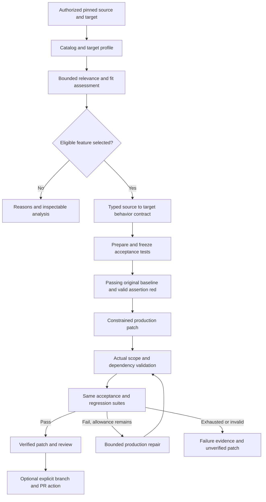

# Full feature development

Planning baseline: October 28, 2026, America/New_York.

This is the development plan for turning Upgrade's working crawler analysis prototype
into a product that connects GitHub accounts, analyzes supported user repositories,
offers a usable feature catalog, and eventually produces verified changes. It records
current implementation separately from proposed work. Creating this plan does not
implement authentication, close audit findings, register a GitHub App, or certify a
new live model run.

## 1. Product outcome and scope

The intended experience is:

1. Sign in with GitHub and explicitly grant access to selected repositories.
2. Choose a target repository and branch; Upgrade resolves an immutable commit.
3. Choose a public source repository, or an authorized private source repository.
4. Browse **All features** or **Relevant to your project**, with search, categories,
   clear coverage, and manageable pages of results.
5. Inspect one feature's behavior, implementation evidence, dependencies, notices,
   target fit, and limitations without leaving the current browsing context.
6. Request deeper analysis or select one eligible feature for adaptation.
7. Review a generated patch and real acceptance/regression results; optionally create
   a pull request through a separate explicit action.

There are two release gates. **Connected analysis** delivers steps 1–5 and deeper
analysis against supported projects. **Verified adaptation** adds safe implementation,
frozen tests, capped repair, and patch review. A connected-analysis release must label
its boundary and must not claim that a selected feature has been implemented.

This expands the earlier MVP scope. Account systems, private-repository access, broad
catalog browsing, and PR integration were previously excluded in
[tech_breakdown.md](../tech_breakdown.md), section 3, and parts of the
[frontend integration plan](frontend-integration-plan.md), section 11. Those exclusions
explain the current implementation; they are superseded by this plan for the proposed
product. One source, one target, and one implemented feature per adaptation run remain
deliberate boundaries. Cross-language transfers, framework migrations, automatic
merging, production deployment of generated code, and arbitrary dependency installation
remain outside the first full release.

## 2. Evidence reviewed and current implementation

Status here is based on source inspection and existing receipts. Historical test and
live-run results are identified as such; no new model/Docker verification was performed
while preparing this plan.

| Capability | Current status | Development still required |
|---|---|---|
| Meta integration | Implemented: settings, strict output schemas, bounded tools, per-attempt accounting, shared budget, sanitized failures | Extend existing budgets to discovery, planning, implementation, and repairs without resetting them between stages |
| Source retrieval | Public HTTPS GitHub URL and explicit commit SHA; independent managed Git storage | Authorized private retrieval, branch/ref resolution, size/time limits before expensive processing, access rechecks |
| Source tracing | Real code-backed trace of one Scrapy retry slice | General discovery and tracing; the current prompt, focus paths, symbols, and validation are retry-specific |
| Target selection | Only the bundled `crawler-demo` registration | Repository picker, supported project roots, stack detection, generic target snapshots and adapters |
| Evidence | Bounded reads, Python AST/symbol checks, exact read-backed citations, coverage and notices | Preserve these guarantees for catalogs and other repositories; add language support only with real analyzers |
| Baseline execution | Reviewed offline Docker runner and fixed crawler suites | Supported user-project runner profiles, prepared dependencies, project-specific baseline and acceptance binding |
| Target profiling | Working crawler-oriented architecture, capabilities, gaps, style and integration analysis | Remove crawler assumptions; separate static-only analysis from executable/verified support |
| Fit assessment | One real candidate; model ratings and controller-owned scores, ten gates, ordering and rejections | Multiple candidates, target/goal-specific assessments, generalized acceptance and source-use policy |
| Feature browsing | Local search and decision filter over `run.features` | Source catalog, relevant/all modes, server search/filter/sort, pagination, lazy details and stable deep links |
| Frontend/API | Implemented local React workspace and typed FastAPI bridge | Authentication-aware onboarding, repository/catalog routes, explicit access and support states |
| History/events | SQLite, persisted runs, ordered events, idempotent enqueue and one API worker | Ownership, query-level pagination, global history search, bounded event UI and job lifecycle hardening |
| Artifact access | Manifest-backed downloads, hash-checked excerpts, host-path redaction | Owner authorization, private cache controls, retention/deletion and authorization after access revocation |
| GitHub login/tokens | Absent | GitHub App authorization, sessions, token storage/rotation, installations and revocation |
| Repository planner | Smoke planner uses synthetic inputs | Real pinned-inventory planner and versioned execution/behavior contract |
| Acceptance preparation | Existing hand-authored crawler diagnostic | Source/goal-derived final behavior contract and frozen, independently prepared acceptance tests |
| Patching/repair | Absent; current Changes view explains analysis only | Constrained patch tools, actual diff/dependency checks, unchanged-test red-to-green, regression and capped repairs |
| PR publishing | Absent | Reviewed branch/PR action, repository write permissions, idempotency and stale-base handling |
| Hosted operation | Local application only | Production auth, ownership, worker isolation, quotas, observability, backups and deployment verification |

Important implementation anchors:

- [NewRun.tsx](../frontend/src/features/new-run/NewRun.tsx) keeps a target selector
  but explicitly submits `target: 'crawler-demo'`.
- [API contracts](../backend/app/api/contracts.py) restrict targets with
  `Literal["crawler-demo"]`; [target registration](../backend/app/tools/repositories.py)
  rejects other target IDs.
- [SourceTracer](../backend/app/tracer.py) requests exactly one Scrapy retry feature.
  Entering a different public URL does not make this a general source-analysis tool.
- [FitMatcher](../backend/app/fit_matcher.py),
  [TargetProfiler](../backend/app/target_profiler.py), and
  [SelectionBaseline](../backend/app/selection_baseline.py) contain reviewed crawler,
  source, notice, diagnostic, or integration assumptions. Replacing one form field
  cannot generalize this pipeline.
- [SourceTrace](../backend/app/evidence_contracts.py) and selection contracts allow
  at most eight cards/candidates. That is batch capacity, not implemented discovery
  or a suitable database-wide catalog limit.
- [RunStore](../backend/app/api/storage.py) has no user ownership. History listing
  reads/sorts all summaries before [routes](../backend/app/api/routes.py) slice them;
  [History.tsx](../frontend/src/features/runs/History.tsx) searches only loaded runs.
- [Features.tsx](../frontend/src/features/evidence/Features.tsx) filters and renders
  the supplied array. [useRun.ts](../frontend/src/features/runs/useRun.ts) polls the
  full detail projection and accumulates events. These are adequate for the small
  current result, but need different payload boundaries for large catalogs.
- [main.py](../backend/app/main.py) has loopback host restrictions and specific SPA
  routes; [routes.py](../backend/app/api/routes.py) has local-origin submission checks.
  These are local protections, not a multi-user authorization system. The health
  response also retains an outdated static `phase: "source_tracing"` label.

### Existing verification, with its limits

The [Stage 4 completion receipt](../audit/stage4-report.md) records a real selected
retry candidate at 93/100, with 29 artifacts and 50 citations checked at that time.
It establishes working bounded selection, not patch generation or catalog discovery.

The newer [frontend verification receipt](frontend-verification.md), dated October 28,
records 259 pre-existing backend tests plus 19 web API tests, 26 Playwright checks,
a production build, and a fresh Docker baseline through the browser API. It explicitly
records **no fresh paid Meta inference for frontend delivery** and does not close the
Stage 4 audit. Opening a historical selection in the browser is useful integration
evidence, but does not establish a fresh browser-driven end-to-end model success.

## 3. Audit reconciliation and missed work

### Earlier findings that were resolved

Do not copy the old audits' open-status language into a new backlog without reading
later receipts. [Phase 3's resolution table](../audit/phase3-report.md) records:

| Finding | Current recorded resolution |
|---|---|
| Phase 1 M1: setup overwrites `.env` | Conditional creation preserves existing configuration |
| Phase 1 M2: smoke workflow inside provider transport | Probe contracts/orchestration moved to smoke modules |
| Phase 1 M3: lost failure telemetry/invisible retries | Failed-call metadata and explicit attempt ledger with shared budgets |
| Phase 1 L1: incompatible strict schemas accepted | Local strict-schema compatibility checks before requests |
| Phase 1 L2: mutable collections in frozen contracts | Immutable tuples with deliberate JSON array serialization |
| Phase 2 M1: log I/O failures can appear successful | Owned stream drains, required logs/hashes, fault-probe coverage |
| Phase 2 M2: equivalent origins stop traversal | Canonical HTTPX origin identities and traversal cases |
| Phase 2 L1: linked export roots bypass checks | Physical root/ancestor validation before resolution |

Keep these regression protections when refactoring. Their original findings remain
historical records in [audit/report.md](../audit/report.md) and
[the Phase 2 audit](../audit/phase2-audit/report.md).

### Six Stage 4 findings still open

The [Stage 4 review](../audit/stage4-review/report.md) lists four Medium and two Low
findings. Inspection of the current implementations still shows the reported patterns.
The frontend worker's generic exception handler can record a failed queue item, but
does not repair the controller's capture validation or missing disk receipt.

| ID | Priority and required change | Completion evidence |
|---|---|---|
| S4-A01 | Medium: require the claimed integration file in actual proposed production scope, or an explicitly supported extension mechanism | A disconnected helper plan is rejected; a connected plan passes the structural check |
| S4-A02 | Medium: bind assessment to a typed, versioned behavior contract; validate method, statuses, attempt bound, final-error and parsing rules | Infinite/unrelated retry behavior cannot pass acceptance readiness; no prose regex gate |
| S4-A03 | Medium: verify bound raw capture bytes before JSON/dataclass decoding; strictly validate metadata and translate shape errors | Missing/extra fields and changed bytes yield `invalid_evidence` through CLI and API, with sanitized retained results |
| S4-A04 | Medium: define one dependable finalization/error boundary, with JSON failure publication independent of optional Markdown | Markdown-only write failure retains JSON; an unwritable output root yields a sanitized terminal diagnostic |
| S4-A05 | Low: validate physical root and existing ancestors before artifact creation/replacement | Junction/link redirection is rejected before an outside write; document concurrent local-tampering limits |
| S4-A06 | Low: derive human-report counts from recorded data | Pre-inference failure shows zero consistently in JSON, Markdown and UI |

Close all six with focused regression cases before enabling generated patch execution.
Close the evidence/finalization/containment defects before a connected private-data
release relies on the same stores. Keep original audit receipts unchanged and write
a new closure receipt with reproduction results and the relevant commit identity.

### Frontend packages: delivered versus incomplete

| Earlier package | Reconciled status |
|---|---|
| U0 audit remediation | Still open; shipping UI did not close it |
| U1 shared workflows | Typed workflow inputs and canonical service reuse delivered; execution context/path ownership, progress consistency and shared CLI/API locking still need work |
| U2 durable local API | Delivered locally; not a distributed or tenant-aware execution platform |
| U3 main experience | Delivered for the registered sample and current analysis workflows |
| U4 existing tool coverage | Delivered locally: trace, fit, baseline modes, explicit Meta check, evidence and exports |
| U5 adaptation | Pending Phase 5 backend and actual patch/verification artifacts |
| U6 usability/reliability | Build, mobile/keyboard/browser checks and real API Docker baseline recorded; fresh browser-driven paid selection, production auth and large-data checks remain |
| Optional 4B | Not delivered; real additional slices/comparison still required |

### Documentation and operational omissions

Several lower tables in [tech_breakdown.md](../tech_breakdown.md), the historical
[frontend integration plan](frontend-integration-plan.md), and
[stage4.md](stage4.md) still describe API/UI as future work, despite the newer delivered
frontend. Update current-status tables and cross-links in a dedicated documentation
pass; preserve dated historical receipts. Use [frontend.md](frontend.md), the current
source, and this reconciliation when deciding what remains.

Also carry these gaps into development rather than treating them as closed by tests:

- CLI workflows do not share the API worker's execution lock. A hard stop can leave
  owned Docker processes; persisted queue state does not make paid inference resumable.
- Current history import automatically discovers local receipts without assigning an
  account. Existing data must not become visible to every future signed-in user.
- Run detail embeds cards, references, tests, calls and artifact descriptors together;
  history filtering and queue scans are not database-paginated at scale.
- Existing coverage names examined files, which can still contain unread lines. Read
  citations and static AST overlap do not prove semantic completeness or runtime order.
- Current acceptance/source-use/runner policy is specifically registered to the sample.
  General repository support requires supported adapters and contract preparation.
- No production authentication, owner checks, account deletion/retention, private-data
  model consent, request quotas or hosted worker isolation has been delivered.
- Existing receipts do not establish a current dependency-vulnerability review, all
  supported model variants, or production load behavior. Add release-specific checks.

## 4. What to reuse from `.research/Graft`

Inspected research checkout: `a386620842c34f1f731bf6ffc91bdb1b101f31ba`.
Research is local reference material and is ignored by Git; it is not an installed
Upgrade dependency or evidence that Upgrade has these capabilities.

| Graft reference | What it actually does | Use in Upgrade |
|---|---|---|
| [FeatureSidebar.jsx](../.research/Graft/graft-frontend/src/components/FeatureSidebar.jsx) | URL plus optional password-style token field; renders every feature with `features.map(...)` | Reuse the list/detail separation as an idea; replace manual token onboarding and whole-list rendering |
| [models/requests.py](../.research/Graft/graft-backend/models/requests.py) | Accepts an optional `github_token` in ingestion requests | Evidence of manual token support, not an OAuth login/session system |
| [github_service.py](../.research/Graft/graft-backend/services/github_service.py) | Uses request token or server `GITHUB_TOKEN`, fetches metadata, puts token in a clone URL | Reuse metadata/access-state ideas; implement a separate credential broker without tokens in URLs/arguments/remotes |
| [session_store.py](../.research/Graft/graft-backend/store/session_store.py) | Stores analysis sessions and raw token references in an in-memory dictionary | Do not reuse as user authentication, durable storage or tenant authorization |
| [claude_service.py](../.research/Graft/graft-backend/services/claude_service.py) | Extracts feature hints from README and chunks large trace inputs | Use bounded discovery followed by code corroboration; preserve explicit partial coverage rather than treating README claims or truncated files as proof |
| [App.jsx](../.research/Graft/graft-frontend/src/App.jsx) | Holds feature/trace/token state and ingestion actions in one app component | Keep Upgrade's typed API and routed features instead of copying monolithic state |

No GitHub authorization/callback flow or per-user repository authorization layer was
found in the inspected Graft routes/frontend. Its `session_id` identifies an analysis
session, not an authenticated browser account. Graft's `ANTHROPIC_API_KEY` belongs to
its historical provider implementation; Upgrade continues using its existing Meta
adapter and `MODEL_API_KEY`. Do not introduce an Anthropic requirement for this plan.
Preserve [Graft's MIT notice](../.research/Graft/LICENSE.md) if source code is reused.

## 5. GitHub login, credentials and repository access

### Decision: GitHub App plus a backend-owned browser session

Use one GitHub App for user authorization and repository installation. Users sign in
on GitHub; Upgrade never collects GitHub passwords or asks ordinary users to generate
personal access tokens. Start with read-only repository access. GitHub Apps support
fine-grained permissions and repository selection, which match this product's needs.
[GitHub App/OAuth comparison](https://docs.github.com/en/apps/oauth-apps/building-oauth-apps/differences-between-github-apps-and-oauth-apps).

Signing in and installing/granting repository access are separate states. A user may
be signed in with no installation, with only some repositories selected, or while
organization approval is pending. Do not promise access to every repository visible
in their GitHub account. List the repositories both that user and the app can access.
[User access and installation intersection](https://docs.github.com/en/apps/creating-github-apps/authenticating-with-a-github-app/generating-a-user-access-token-for-a-github-app).

### Credentials and configuration needed

The following names are proposed new backend configuration unless marked existing.
Only the Meta key is part of the current configuration. Values must be provided
locally or through the deployment secret store; no credential values belong in docs.

| Item | Who supplies it | Purpose and storage |
|---|---|---|
| `GITHUB_APP_ID` | App owner after GitHub App registration | Non-secret identifier for app authentication |
| `GITHUB_APP_SLUG` | App owner | Non-secret identifier used to build installation/settings links |
| `GITHUB_CLIENT_ID` | App registration | Non-secret identifier used by the authorization flow |
| `GITHUB_CLIENT_SECRET` | App owner generates it | Backend-only authorization-code exchange/refresh credential |
| `GITHUB_PRIVATE_KEY_PATH` or secret-store reference | App owner generates a private key | Backend signs app JWTs to obtain installation tokens; keep key outside repository/artifacts |
| `GITHUB_WEBHOOK_SECRET` | Operator generates it | Authenticate webhook deliveries; separate from client/session secrets |
| `TOKEN_ENCRYPTION_KEY` or managed key reference | Operator | Authenticated encryption for stored user/refresh credentials; version keys for rotation |
| `APP_BASE_URL`, `GITHUB_CALLBACK_URL`, allowed origins/hosts | Operator | Exact environment-specific URLs; validated configuration, no arbitrary return URL |
| `MODEL_API_KEY` | Operator; existing setting | Meta inference only; not a GitHub credential and never forwarded to target runners |
| Session identifier and CSRF secret | Generated by Upgrade | Opaque random per-session browser credential; store only session-token hashes server-side |
| GitHub user/refresh tokens | Issued after each user's authorization | Encrypted backend-only credentials; never returned in API DTOs |
| Installation access token | Minted by backend as needed | Short-lived, selected-repository credential for approved background fetches |

A separate OAuth App is unnecessary for this design. A user-supplied `GITHUB_TOKEN`
is unnecessary for normal sign-in. If a developer-only PAT fallback is later needed,
keep it opt-in and separate from normal product onboarding and owner authorization.

Use expiring user tokens. GitHub currently documents eight-hour user tokens and
six-month refresh tokens; refresh replaces the old pair. Installation tokens expire
after one hour. Persist the returned expiration timestamps and treat token strings as
opaque; never assume a fixed length or prefix.
[User-token refresh](https://docs.github.com/en/apps/creating-github-apps/authenticating-with-a-github-app/refreshing-user-access-tokens),
[installation-token generation](https://docs.github.com/en/apps/creating-github-apps/authenticating-with-a-github-app/generating-an-installation-access-token-for-a-github-app).

### App registration and permissions

Create separate development and production registrations/configuration. Register the
exact authorization callback and post-install setup URL. For Vite development, choose
one canonical origin, for example `http://127.0.0.1:5173`, and proxy `/api` so callback
and session cookies use that origin. Do not alternate casually between `localhost`
and `127.0.0.1`. Production uses its HTTPS origin. Webhook development can use an
explicitly configured relay/tunnel; authentication must not depend solely on delivery
of a webhook to the developer machine.

| Permission | Initial analysis release | Later verified publishing |
|---|---|---|
| Repository metadata | Required baseline metadata access | Retain |
| Contents | Read | Add write only for publishing branches/commits |
| Pull requests | Not needed to analyze code | Write for explicit PR creation |
| Organization members, administration, workflows, secrets | Not requested by default | Add only for a separately justified implemented capability |
| Account email | Not needed for identity; use numeric GitHub user ID | Optional only if a product requirement appears |

Request the minimum supported permissions. A permission upgrade needs the affected
installation's approval; a user with insufficient repository rights cannot publish
just because the app has a write permission.
[Choosing GitHub App permissions](https://docs.github.com/en/apps/creating-github-apps/registering-a-github-app/choosing-permissions-for-a-github-app).

### Login and session flow

1. `GET /api/auth/github/start` creates a short-lived, single-use server-side auth
   transaction containing random state, PKCE verifier, expiry and an allowlisted
   relative return destination; redirect to GitHub using PKCE S256.
2. `GET /api/auth/github/callback` validates transaction expiry, state, browser binding
   and single use, then exchanges the code on the backend with the verifier and client
   secret. Abort on denial, replay, mismatch or provider error. GitHub documents the
   web application flow and PKCE parameters.
   [GitHub user authorization](https://docs.github.com/en/apps/creating-github-apps/authenticating-with-a-github-app/generating-a-user-access-token-for-a-github-app).
3. Retrieve the authenticated profile. Upsert identity by immutable numeric GitHub
   user ID; treat login/display name as changeable attributes. Do not auto-link by email.
4. Encrypt the credential pair and expiry values. Rotate the application session ID;
   place only an opaque session cookie in the browser, never a GitHub bearer token.
5. Use `HttpOnly`, host-only, `SameSite=Lax` cookies and `Secure` on HTTPS; allow the
   documented loopback HTTP exception only in development. Enforce server-side expiry,
   logout invalidation, session rotation and CSRF validation for state-changing actions.
6. `GET /api/session` returns safe user and connection state. Show **Connect repositories**
   if signed in without a usable grant; preserve the unfinished source/target/goal form.
7. Refresh expiring GitHub credentials on the server under a per-user lock. Replace the
   stored token pair atomically; refresh failure requires reconnecting rather than an
   infinite retry loop. Keep application-session expiry independent of provider expiry.
8. Separate **Sign out** from **Disconnect GitHub**. Sign out invalidates that browser
   session. Disconnect revokes/removes that user's authorization, stops new private-data
   work, cancels their affected queued work, and offers the defined deletion options.
   It must not uninstall an organization's shared app for everybody.

Proposed initial policy: auth transactions expire after ten minutes; application
sessions have a seven-day absolute expiry and a 24-hour idle expiry. These are product
defaults to validate during authentication implementation, not current behavior.
Reject untrusted redirect destinations; redact callback codes and sensitive headers
from proxy/access logs. Login, list browsing and result reopening must not trigger Meta.

### Installation, repository discovery and private Git access

- Use user-authorized `GET /user/installations` and
  `GET /user/installations/{installation_id}/repositories` to establish the user's
  accessible intersection. Validate any installation ID returned through a setup URL
  against that identity; a callback query parameter is not proof of ownership.
  [Installation API](https://docs.github.com/en/rest/apps/installations).
- Follow GitHub's pagination until an explicitly bounded sync completes; store sync
  progress and continuation. Search the authorized local index on the server. A picker
  page containing 30 results must not imply that only 30 repositories exist.
  [GitHub pagination](https://docs.github.com/en/rest/using-the-rest-api/using-pagination-in-the-rest-api).
- Offer owner/organization, repository-name and visibility filters, accessible refresh,
  last-sync time, private badges and **Manage repository access**. Distinguish no grants,
  admin approval pending, repository not granted, archived/read-only and rate-limited.
- Key repositories by numeric GitHub repository ID, not just `owner/name`; handle
  rename, transfer, deletion, access loss and account-switch invalidation.
- Recheck current user entitlement and installation permissions before enqueue, private
  fetch, job start, publishing results and PR creation. Background installation tokens
  have broader capabilities than a particular user, so never use installation membership
  alone as authorization. Mint tokens restricted to the required repository IDs.
- Extend the current credential-free Git wrapper through one controlled broker. Keep
  canonical remotes credential-free; supply a short-lived credential through a dedicated
  ephemeral askpass/credential channel. Do not put tokens in clone URLs, command arguments,
  `.git/config`, reports, tracebacks or shared environment. Destroy broker state afterward.
  GitHub supports installation tokens for HTTPS Git with Contents permission.
  [Installation Git authentication](https://docs.github.com/en/apps/creating-github-apps/authenticating-with-a-github-app/authenticating-as-a-github-app-installation).
- Implement signed webhook handling for installation changes, repository grant changes,
  relevant repository changes and authorization revocation. Verify the raw-body HMAC
  with constant-time comparison, deduplicate delivery IDs and enqueue processing.
  [Webhook validation](https://docs.github.com/en/webhooks/using-webhooks/validating-webhook-deliveries).
- On revocation/suspension, invalidate access and cached grants immediately when known.
  Also use bounded freshness/reconciliation checks so missed webhooks cannot preserve
  authorization indefinitely. Affected in-flight jobs must settle safely and cannot
  publish through stale permissions. Reauthorize access to existing private artifacts;
  being their original requester must not bypass current repository access policy.
- Handle primary and secondary rate limits using returned headers, backoff and bounded
  retries; coalesce refreshes. Rate limits vary by authentication type and endpoint.
  [GitHub rate limits](https://docs.github.com/en/rest/using-the-rest-api/rate-limits-for-the-rest-api).

## 6. Supporting real target and source projects

Replace the sample-only registration with an authorized repository snapshot contract:
repository ID, owner scope, role (`source`/`target`), requested ref, resolved SHA,
project-root prefix, manifest hashes and supported analysis/execution profile. Resolve
refs once at submission and persist the actual SHA; display branch and SHA together.
Never silently switch an active run to a newer branch head.

Repository authorization and executable support are independent. A connected repository
may be readable but unsupported for tests or adaptation. Implement three capability
levels: **browse/index**, **evidence-backed analysis**, and **verified adaptation**.
Show the actual level and blocking reason before a user spends model budget.

Implementation work:

1. Add typed repository/project selection and a stable server-owned target identifier.
   Replace hard-coded target values across form state, request schemas, worker dispatch,
   Git registration, profiler, baseline binding, score gates, tests and examples.
   Source-only discovery/trace requests must work without a target; target selection
   becomes required only for target relevance, fit assessment and adaptation.
2. Support monorepo root selection from inspected manifests. Preserve repository-relative
   versus project-relative paths explicitly and include the prefix in every binding.
3. Introduce versioned target adapters: manifest parser, supported language/runtime,
   entry-point discovery, dependency checks, baseline registration, prepared runner and
   acceptance capabilities. Begin with reviewed Python profiles and a second independent
   Python repository that has no `Crawler.fetch` integration point.
4. Keep the sample adapter as a regression fixture and **Try an example** option. It
   must not masquerade as the user's default connected project.
5. Bound fetch storage, object size, files, text bytes, AST parsing and wall time. The
   present inventory defaults cap 4,000 entries and 50 MiB text; record exclusions and
   limits instead of bypassing them to make a large repository appear supported.
6. Preserve commit pinning, independent clones/worktrees, secret/binary/link/submodule
   exclusions, physical containment and safe reads. Source code is analyzed as data.
7. Do not execute repository setup commands, Dockerfiles, hooks, arbitrary scripts or
   package-manager lifecycle hooks on the host. Dependencies need a separate reviewed,
   isolated preparation/build path, pinned inputs and network policy; the execution
   phase remains credential-free and offline for the initial profiles.
8. Validate actual baseline coverage for each profile; disabling `conftest`/plugins as
   the fixture does may make another project's tests unsupported. Report unsupported
   requirements instead of skipping them and declaring green.
9. Generalize source notices and adaptation policy with a versioned allowed-use policy.
   GitHub visibility is not reuse permission. Unknown/incompatible notices block
   adaptation while an analysis view may still explain the restriction.

Do not generalize by deleting current hard gates. Introduce profile-specific evidence
and behavior registrations, then demonstrate equivalent rejection and preservation
properties on independent projects.

## 7. Feature discovery and the meaning of “all features”

The product lists behavior-level capabilities, such as request retry or command parsing.
It must not turn every function, class or README bullet into a supported feature.
Broad capabilities can contain related subfeatures, but parent/child entries need
explicit grouping so the list is not inflated by duplicates.

**All features** means all entries discovered in the selected catalog snapshot and
scope. Display **All discovered features** in the explanatory text. A bounded automated
scan cannot guarantee that it found every semantic capability in a large repository.
The UI must show the scan's scope, completion state, exclusions and continuation.

### Discovery and validation pipeline

1. Build a pinned, bounded inventory and deterministic indexes of manifests, symbols,
   routes/commands, tests and documentation. Do not send the entire repository to a model.
2. Generate candidate hints from README/docs and structural entry points. Persist each
   hint's discovery references and label it **Unverified** until code corroborates it.
3. Group candidates by capability and module. Deduplicate using entry-point/symbol
   identity and cited behavior, not name similarity alone; retain aliases and hierarchy.
4. Trace bounded batches against code, tests, dependency imports and notices. Preserve
   current read-window and SHA/path/symbol validation. A documentation-only claim stays
   unverified/partial; a source-test citation does not claim the test was executed.
   If configuration requirements are extracted, extend the schema with cited variable
   names and uncertainty only, never values. Graft's environment-variable output is
   not an implemented Upgrade capability, and absent metadata does not prove no setup
   is needed. Dependency lists likewise do not prove complete dependency closure.
5. Publish validated FeatureCards separately from lightweight discovery candidates.
   Store per-feature coverage, missing evidence and failure reason. One failed trace
   need not discard other valid catalog entries, but cannot become an eligible candidate.
6. Freeze an immutable catalog revision with completed batches, counts and exclusions.
   A scan can be queued, running, complete-for-declared-scope, partial, failed or canceled.
   Store budget/limit/unsupported reasons separately from semantic evidence status.
7. Offer an explicit **Continue discovery** action for unexamined areas within supported
   limits. It creates an accountable job/revision with a stated additional budget; it
   never silently restarts or overwrites an earlier successful catalog.

Catalog identity includes source repository ID/SHA, owner/access scope, inventory and
analyzer versions, discovery scope, prompt/schema versions and returned model identity.
Feature identity is stable within this lineage and is not just a mutable display slug.
Changed-SHA versions may record correspondence, but must revalidate evidence. Never
reuse citations or relevance decisions merely because two features have the same name.

### Bounded work and cache rules

- Keep the current maximum-eight structured trace/assessment batches. Add a separate
  paginated catalog contract instead of raising the legacy `SourceTrace` cap and
  making one enormous model response.
- Proposed initial defaults: discovery publishes at most 500 candidate records per
  job, a catalog supports up to 5,000 entries, and one deep assessment job handles at
  most eight candidates. These are engineering starting limits to benchmark, not
  claims that model discovery has achieved that scale. Reaching a cap yields explicit
  partial coverage and the applicable supported continuation/limit message.
- Rank lightweight hints first; deep trace the initial bounded shortlist or an
  explicitly requested feature. All mode can show unverified hints, with their status,
  without paying for a deep trace of every entry just to populate a list.
- Cache safe source-only artifacts by the complete identity above. Target analysis
  also includes target SHA/prefix, adapter and baseline/runner identity. Relevance and
  fit include normalized goal, policy and assessment versions.
- Private caches are owner/access-scoped and encrypted as required. No cross-user cache
  hit, repository title, feature count, excerpt or existence check may disclose a private
  repository. Public reuse requires a deliberately public artifact, not a private run
  whose source happens to be public.
- Reopening or filtering saved results performs zero model calls. Retrying discovery,
  expanding scope or changing a goal is a distinct explicit operation with its own
  request fingerprint, stage ledger and visible relationship to earlier spend.

## 8. “All features” versus “Relevant to your project”

Use one catalog and separate target-specific assessment records. Avoid two independently
generated feature lists that drift apart or lose membership when the user toggles modes.

| Concern | All features | Relevant to your project |
|---|---|---|
| Membership | All discovered entries in the selected catalog revision and filters | Entries meeting the declared relevance rule for this target snapshot and goal |
| Default ordering | Category/name, with stable ID tie-break | Assessed relevance descending, then documented stable tie-break |
| Information | Name, short behavior, category, evidence state, trace availability | Same summary plus a concise reason and target/goal assessment state |
| Counts | Exact discovered/filter count for the frozen revision; scan status separately | Relevant count, assessed count, unassessed count and any shortlist/budget limit |
| Work on toggle | Read-only query | Read-only query; never initiate hidden profiling/reranking |
| Missing context | Fully usable without a target/goal | Prompt for target/goal, or explicitly label an existing goal-only assessment |
| Eligibility | Not implied | Relevance alone does not imply transfer eligibility or verification |

Relevance is a reason to investigate; fit eligibility additionally requires evidence,
compatible execution, a defensible target gap, scope/dependency limits, source-use policy
and acceptance readiness. A relevant feature can already exist in the target or fail
every adaptation gate. Show those facts instead of hiding them behind a high score.

Use lightweight retrieval to shortlist likely matches, followed by bounded evidence-based
assessment. Keep `unassessed`, `relevant`, `less_relevant` and `assessment_failed`
distinct. If only eight of 240 catalog entries were deeply assessed, say **8 assessed;
232 not yet assessed**. Do not label the other 232 irrelevant. Offer **Assess more** or
assessment of a selected entry; never silently exclude unexplored candidates from a
claim of global best fit.

Assessment identity includes catalog revision, target SHA/prefix, exact goal fingerprint,
profile/baseline identity and policy/model versions. Changing any of these creates a
new assessment context and marks older results as belonging to their earlier context.
Changing search, category, page size or list mode only changes the view.

Keep the current controller's arithmetic, threshold rules, stable ordering and complete
rejections for deeply assessed candidates. A top-three recommendation contains at most
three actual eligible entries; it can contain one or zero. A catalog-wide relevance score
must have a separately defined policy and must not reuse the 93/100 sample result as a
default or present model judgments as success probabilities.

## 9. Page design that remains usable with many entries

### Browsing layout

Use the existing run workspace rather than adding a dashboard full of competing panels.
The Features view contains:

1. A compact context strip: source/ref/SHA, target/ref/SHA if selected, goal and catalog
   coverage state. Long repository names wrap; technical provenance can expand.
2. A visible two-option control: **Relevant to your project** / **All features**, with
   counts whose meaning is clear. Relevant is the default when a matching assessment
   exists; otherwise All explains how to request relevant analysis.
3. Search, category, evidence/assessment filters and sort. Keep advanced filters in a
   labeled disclosure; do not render thousands of tags or a huge native dropdown.
4. Up to three real recommendations as compact rows, followed by the paginated list.
   Avoid duplicating full recommendation cards and their full detail in the same view.
5. A single selected-feature detail panel with behavior, why relevant, target status,
   evidence, dependencies/notices, cited configuration requirements when available,
   and next action. Defer code, raw logs and full gate rationale to expandable sections
   or the existing evidence inspector.

Each result row shows a title, at most two lines of behavior, category and concise state.
One row action opens details. Place deeper actions inside the detail view so every row
does not carry several competing buttons. Distinguish **Trace feature**, **Assess fit**
and **Build change** by actual backend capability and prerequisites.

On desktop, use list/detail columns only when sufficient width exists. On mobile, open
details as a routed view with Back restoring filters, page and scroll position. Keep
search/control labels accessible and show result changes through a restrained live
region. Support keyboard navigation, focus return, Escape where applicable, reduced
motion, long names, large font sizes and color-independent status labels.

### Pagination, payloads and rendering

- Use indexed server-side search/filter/sort. Default to 25 summary rows per page,
  optionally 50, with an API maximum of 100. Do not fetch the whole catalog and hide
  most entries with CSS or client filters.
- Use opaque cursor pagination bound to owner, catalog/assessment revision, normalized
  filters and sort. Seek by the actual sort tuple plus stable ID. Freeze the queried
  revision so background discovery cannot reorder results under an active cursor.
- Preserve mode, filters, sort, cursor and selected feature in URL state. A changed
  query resets its cursor; abort or ignore stale responses so an older search cannot
  overwrite a newer one. Debounce text search around 300 ms.
- Fetch one detail object on selection. Load citations/excerpts, dependency evidence,
  tests, artifacts and logs through separate bounded routes; no 5,000-card RunDetail.
- Poll compact run progress/revisions and bounded event pages. Do not reload all cards,
  model calls, references and test arrays each second. Bound the in-memory event list;
  earlier events remain available through pagination.
- Start with conventional paged semantic lists/tables. Virtualize only if a measured
  dense view needs it, with a tested accessible paged alternative. Virtualization does
  not solve an oversized network response or unbounded database scan.
- Keep catalog search global across the queried snapshot. Fix run-history search in
  the same way; **no matches on the loaded page** must not look like a global no-result.
- Revalidate selection after filtering. If a selected item is outside current filters,
  disclose that state or close its detail; never silently show another feature under
  the previous deep link. Refresh or Back must preserve stable feature identity.

### Required empty, partial and failure states

Distinguish: no repository connection; pending organization approval; no catalog yet;
scan in progress; partial scan at a limit; no discovered entries; no matches for filters;
no relevant assessed entries; many unassessed entries; no safe adaptation fit; already
present; unsupported target; stale assessment; missing model configuration; budget/rate
limit; revoked access; failed evidence; and interrupted/canceled work. Each state should
name the cause and one useful next action. A provider failure is not an empty catalog.

## 10. Backend contracts, storage and ownership

### Proposed API boundaries

These are proposed additions/changes, not current routes. Generate frontend transport
types from the implemented OpenAPI schema and preserve existing CLI/domain contracts
through explicit versioned adapters.

| Route | Purpose |
|---|---|
| `GET /api/session` | Safe identity, connection/access state and CSRF bootstrap |
| `GET /api/auth/github/start`, `GET /api/auth/github/callback` | Server-owned GitHub authorization flow |
| `POST /api/auth/logout`, `POST /api/github/disconnect` | Separate local session exit from user-authorization disconnection |
| `GET /api/github/installations` | User-authorized installations and grant state |
| `GET /api/repositories?q=...&owner=...&cursor=...` | Paginated authorized repository index and sync completeness |
| `POST /api/repositories/sync` | Idempotent bounded refresh, without model inference |
| `GET /api/repositories/{id}/refs` | Bounded authorized branch/tag selection |
| `POST /api/repository-snapshots` | Resolve selected ref and project root to an authorized immutable input |
| `POST /api/catalogs` | Explicit budgeted discovery/index job for a source snapshot |
| `GET /api/catalogs/{id}` | Revision, progress, counts, coverage, limits and versions |
| `GET /api/catalogs/{id}/features?mode=all&assessment_id=...&q=...&cursor=...` | Bounded summary page; server filters/counts; mode accepts `all` or `relevant` |
| `GET /api/catalogs/{id}/features/{feature_id}?assessment_id=...` | One candidate/card detail with trace and the selected assessment state |
| `POST /api/catalogs/{id}/continuations` | Explicit additional discovery scope/budget; new revision |
| `POST /api/features/{id}/traces` | Bounded on-demand trace of a discovered candidate |
| `POST /api/relevance-assessments` | Explicit target/goal-specific ranking/fit job with shortlist disclosure |
| `POST /api/runs`, `GET /api/runs?...` | Owner-scoped jobs/history, global search, typed kinds and query-level cursors |
| `GET /api/runs/{id}/progress` | Compact state/revision/counts without full evidence arrays |
| Existing detail/events/references/artifact routes | Enforce owner/current repository access; add bounded collection routes |
| `POST /api/runs/{id}/cancel` | Cooperative cancellation with a controller-published terminal result |
| `POST /api/webhooks/github` | Signed provider deliveries; separate from cookie/CSRF browser routes |
| `POST /api/adaptations`, later `POST /api/adaptations/{id}/pull-request` | Capability-gated implementation and explicitly reviewed publishing |

All nested identifiers must be resolved within the authorized owner/context. Reject a
feature ID from a different catalog, a relevance context from a different target, or a
foreign artifact ID. An opaque ID or cursor is not permission. Unauthorized private
resource errors must not leak whether another account's record exists.

Example proposed list envelope, using illustrative IDs/counts and a one-item page:

```json
{
  "catalog_id": "catalog_123",
  "catalog_revision": 4,
  "assessment_id": "assessment_456",
  "mode": "relevant",
  "items": [
    {
      "feature_id": "http-retry-bounded",
      "name": "Bounded HTTP retries",
      "summary": "Retries temporary HTTP failures within an attempt limit.",
      "category": "resilience",
      "evidence_status": "supported",
      "relevance_status": "relevant",
      "fit_status": "eligible"
    }
  ],
  "counts": {
    "discovered": 240,
    "code_supported": 12,
    "deeply_assessed": 8,
    "relevant": 3,
    "eligible": 1,
    "unassessed": 232,
    "matching_filter": 3
  },
  "coverage_state": "partial",
  "limit_reasons": ["deep_assessment_budget"],
  "next_cursor": "opaque_continuation_cursor"
}
```

In implemented responses item/page counts must agree. Count each distinct entity once,
publish counts transactionally with its revision, and use null/unknown where a total has
not been established. Returned row status and counts must describe the same assessment
scope. The example's remaining matching entries are available through its cursor.

### Persistence and migrations

Add explicit, versioned migrations rather than only executing `CREATE TABLE IF NOT EXISTS`
and assigning a fixed `user_version`. Back up and test migration/rollback behavior against
an existing local database before changing ownership or the idempotency model.

Logical records:

- Users, GitHub identities, hashed sessions, auth transactions and encrypted credential
  versions/expiries.
- Installations, user-installation access, repository grants, sync watermarks and webhook
  delivery deduplication.
- Repository/project snapshots with SHA, prefix, profile and owner/access classification.
- Catalog revisions, discovery batches, candidate hierarchy/aliases, validated cards and
  separate lazy evidence/notice records.
- Relevance contexts, per-feature assessments, fit gates/scores/rejections and their
  catalog/target/goal/policy bindings.
- Owner-scoped jobs/runs, idempotency fingerprints, leases/attempts, sequenced events,
  artifact manifests and retention/deletion status.

Index owner/repository/revision plus the actual list sort/filter keys. Scope idempotency
to owner and operation; the current globally unique submission key is insufficient for
accounts. Use indexed queue/count queries rather than decoding every historical summary.
Build materialized safe list/detail projections from validated artifacts; verify artifact
bytes when evidence is consumed, without reparsing the entire corpus per list request.

Keep SQLite for a single-user/local stage if appropriate. A hosted multi-user deployment
needs a deliberate transactional database, private artifact storage and separate leased
workers; choose and migrate that boundary before public rollout. Do not require a cache,
vector database or extra broker merely to paginate a normal catalog.

Legacy local reports remain unowned/private until an authenticated operator explicitly
imports or assigns them. Disable global auto-import in hosted mode. Preserve historical
provenance and never backfill a user identity by guessing from a repository name.

## 11. Jobs, privacy, budgets and operational readiness

Use one typed execution context for CLI/API/controllers: owner, run ID, owned paths,
pinned inputs, authorization grant, event sink, cancellation token and aggregate budget.
Keep provider/evidence/runner implementations canonical. Add stage services and a small
explicit finalization boundary rather than more flags in the large selection function.

The local worker needs a common lock across API and CLI, consistent cleanup and ownership
records for every container. Hosted jobs additionally need durable claims/leases,
heartbeats, fencing against stale completion, per-owner fairness and operator reconciliation.
After a crash, retain partial artifacts and mark interrupted work; never automatically
replay paid inference or continue a half-applied patch. Explicit retry starts from recorded
inputs and discloses new spend. Deterministic completed stages may be reused only after
validating their full cache identity and artifact integrity.

Cancellation is a real controller action: stop new requests, settle/cancel active calls
where supported, terminate owned execution, preserve intact evidence and publish canceled
state. Closing the page does not cancel. Expired/revoked repository access also prevents
future fetch/publish work and must not strand an indefinitely running job.

The present shared model allowance is 32 HTTP attempts, 400,000 returned input tokens,
40,000 returned output tokens and 1,200 seconds checked at request boundaries. A historical
single-candidate run already used 109,638 input and 23,176 output tokens. Do not multiply
that work across thousands of features or assume the same allowance accommodates all of
Phase 5. Benchmark representative jobs, reserve stage headroom and display scope/limits
before a costly operation. Provider-reported usage remains distinct from an estimate or
hard billing guarantee; in-flight requests and unknown failure usage remain explicit.

Per-user and global quotas must bound queued/active jobs, GitHub requests, clone storage,
model attempts/tokens, runtime and artifact bytes. Admission/charging checks must be atomic
and shared by retries, continuations and worker replicas. Restrict paid smoke checks and
deployment/provider settings to authorized operators.

For private code, add a clear disclosure before the first model analysis: which source
and target snapshots and bounded excerpts/test summaries will be sent to the existing
Meta endpoint. Persist the consent/policy version or applicable organization setting.
GitHub authorization alone is not consent to transmit repository contents to a model
provider. Login and repository sync perform no model transmission. Avoid collecting or
forwarding secrets even when they appear inside ordinary-looking source files; enforce
content checks/redaction boundaries and keep rejected-content reasons sanitized.

Other release requirements:

- HTTPS, exact trusted origins/hosts, CSRF protection, safe cookie/proxy configuration,
  sanitized errors and no secrets in frontend environment variables, analytics or logs.
- Every run, catalog, reference, preview, event and download checks owner/current access.
  Private responses are not publicly cached; logs use IDs and metadata instead of code.
- Target/source text remains untrusted data. No model-requested unrestricted shell,
  credential reads, remote URL expansion or host code execution.
- For hosted untrusted execution, use an independently reviewed worker isolation boundary;
  the existing local Docker fixture is not evidence that hostile multi-user execution is
  safe. Keep the Docker control plane, host sockets and credentials outside test workers.
- Define retention before launch. Proposed starting policy: 30 days for private run/code
  artifacts, configurable by operator/owner; bounded secret-free operational metadata can
  have a separate policy. Respect active-job locks, explicit deletion, source cache copies,
  database rows, derived excerpts and documented backup expiry. Report deletion completion.
- Add structured job/error metrics, queue age, model/GitHub usage, storage, cleanup failures,
  provider latency and access-revocation handling. Do not export model private reasoning.
- Verify backup/restore, key rotation, deployment migration, rollback, process termination,
  orphan-container cleanup and artifact integrity. Keep secrets in a managed store for
  hosting and document recovery when an encryption key becomes unavailable.

## 12. Completing implementation and verification

Catalog browsing and relevant ranking do not complete the original adaptation goal.
Build the remaining pipeline on validated selected-feature artifacts:



Required work:

1. Connect a real repository planner to pinned inventories and supported adapters. The
   smoke `RunPlan` is not this implementation. Lock selected feature ID, source/target
   identities, integration files, allowed production scope and execution profile.
2. Finalize a typed versioned behavior contract from source evidence and goal. Record
   included/excluded behavior, exact failure semantics, dependencies and notice obligations.
   Bind it to acceptance readiness, resolving S4-A02 rather than trusting rationale text.
3. Prepare acceptance tests independently before production patching. Require meaningful
   assertion red on the pinned unmodified target and a passing ordinary baseline. Collection
   errors, missing packages, unrelated exceptions, skips/xfails and timeouts are not red.
   If acceptance is already green, report already-present/no-gap rather than rewriting tests.
4. Freeze test/contract/runner hashes. The Implementer can read selected bounded source
   evidence and relevant target code, and propose production patches through the controller.
   It cannot change original/source repositories, protected tests, runner or policy code.
5. Validate the actual diff: initially at most five production files, one new production
   file, 400 changed lines and zero new runtime dependencies; preserve the explicit
   integration requirement. Reject path traversal, links, unexpected deletions, binaries,
   executable-mode changes, manifests/lockfile edits and out-of-scope cleanup.
6. Run unchanged frozen acceptance plus regression suites against exact patch bytes in
   the supported isolated runner. Check case identities, input/capture hashes, notices,
   original-target preservation and actual production scope before `verified` is possible.
7. Permit one initial implementation and at most three production-only repair rounds,
   under one aggregate allowance. Fixer input is a bounded failure packet and relevant
   target files; additional reads are justified and bounded. Do not switch to a different
   feature automatically when the selected one fails.
8. Publish actual patch, before/after mapping, red/green/regression captures, repair count,
   final verdict and notices. A failed/exhausted patch remains explicitly unverified.
9. Add the real Changes UI: reviewable diff with lazy large-file loading, protected-test
   status, evidence links and an honest result. Keep `selected` separate from `verified`.
10. Offer patch download first. For explicit PR publishing, recheck current user/app write
    rights and base SHA, create a unique branch in the authorized repository, and make
    publishing idempotent. If the base moved, mark stale and revalidate; do not silently
    rebase an old green patch. Existing default branches are never force-pushed or merged.

## 13. Development sequence and deliverables

Use these packages as the implementation checklist. Each package needs a focused code
review and completion receipt; the plan's existence is not a completion marker. Work
that does not depend on another package can proceed independently, but release gates
still require the listed prerequisites.

| Package | Deliverable | Depends on | Exit evidence |
|---|---|---|---|
| F0: reconcile and repair foundations | Close S4-A01–A06, canonical failure/capture handling, truthful counts/status docs and common execution ownership | Existing implementation | Six regression reproductions closed; CLI/API sanitized failures and preservation checks |
| F1: identity and owner boundaries | Migrations, users/sessions, auth transactions, encrypted credentials, CSRF and owner-aware existing APIs/artifacts | F0 for release | Two users cannot read each other's data; legacy reports stay private; session/replay tests |
| F2: GitHub connection | App registration guide/config, authorization, install/reconnect states, repository sync/picker, private fetch broker and revocation | F1 | Real development-account sign-in; granted private repo fetch; ungranted/foreign IDs rejected; token rotation/revocation checks |
| F3: supported real repositories | Generic snapshot/root contracts, capability levels and versioned adapters; sample becomes optional example | F0, F2 | Independent supported Python target/source analyzed without crawler hard-coding; unsupported projects explained before inference |
| F4: persistent source catalog | Candidate discovery, hierarchy/deduplication, bounded corroboration, revisioned coverage/cache and continuation | F3 | Multiple independently supported features, partial/failure cases and paginated immutable catalog |
| F5: relevance and scalable browsing | Goal/target assessments, all/relevant modes, server query/filter/sort, lazy details, URL state and compact polling | F4 | Honest assessed/unassessed/eligible counts; zero model calls on view changes; scale/accessibility checks |
| F6: job/hosting hardening | Leased ownership where hosted, cancellation, quotas, current-access checks, retention, private-code consent, observability and cleanup | Starts with F1; required before multi-user release | Restart/cancel/revocation/tenant-load cases, operator recovery and private artifact lifecycle |
| F7: verified adaptation | Real planner, behavior contract, frozen red acceptance, constrained patches, actual limits, regression green and capped repairs | F0, F3, F5; F6 for hosting | Real independent source-to-target red-to-green receipt; failed/exhausted cases retain evidence |
| F8: change review and optional PR | Diff/review UI, patch download, notice export, explicit idempotent publishing | F7; GitHub write permission only for PR | Downloaded patch digest matches verified result; stale/unauthorized/repeated publishing behaves correctly |
| F9: release validation and docs | Fresh complete workflows, security/performance checks, setup/operations and reconciled status pages | All packages needed by the chosen release | Dated receipt tied to commit/build, environment, actual inputs, limits and retained artifacts |

Connected analysis requires F0–F6 and the applicable F9 checks. Verified adaptation
requires F7/F8 patch review in addition. PR publishing may remain disabled until its
permission and live integration checks pass; patch download remains useful independently.
Multi-user hosting remains disabled until F6 is complete. Estimate calendar effort only
after F3's initial adapter and hosting target are chosen; previous frontend-only estimates
excluded this account/catalog/adaptation expansion.

## 14. Acceptance and release verification

Extend existing tests where behavior is material. Do not replace historical failures with
new fixtures that merely mirror implementation. Unit/integration suites use controlled
GitHub/Meta responses; real-account/provider checks are separate explicit integration runs.

| Area | Required scenarios/results |
|---|---|
| Login | Success, denial, expired/missing state, mismatched browser, code replay, PKCE failure, provider outage, account switch and renamed login |
| Session/CSRF | Cookie flags, session rotation/expiry/logout, forged cross-site mutation, open redirect rejection, callback/log redaction |
| Tokens | Expiry, atomic concurrent refresh, lost/expired refresh token, key rotation, provider revocation, no raw token in browser/DTO/URL/remote/log/artifact |
| Installations | No installation, selected repositories, all-repository grant, org approval pending, missing permission, suspension/uninstall, forged setup installation ID |
| Repository access | Public/private, collaborator/org access, multiple pages, rename/transfer/deletion, branch moved, absent SHA, monorepo root and cache invalidation |
| Ownership | Two accounts against every list/detail/event/reference/preview/download, guessed IDs, foreign cursors and cross-tenant cached private content |
| Migration | Existing SQLite/run data preserved, legacy ownership protected, per-owner idempotency, failed migration/restore and no automatic public import |
| Discovery | README-only claims, hidden code-backed capability, duplicates/hierarchy, partial/unsupported evidence, no source tests, cap reached, failed batch and explicit continuation |
| Relevance | No target/goal, unrelated goal, already-present feature, high relevance with failed gates, unassessed remainder, zero/one/multiple eligible entries, changed target/goal |
| Query correctness | Global search beyond first page, category/status intersections, exact same-revision counts, equal-score ordering, no cursor duplicates/omissions, invalid/stale cursor |
| View behavior | Toggle/search/sort/page/reopen/deep-link causes no model calls; stale requests cannot overwrite current view; Back restores context |
| Evidence | Changed capture bytes, malformed metadata, bad SHA/path/symbol/read window, missing notices, invalid private grants and each S4-A01–A06 regression |
| Jobs | Double submission, retry fingerprint conflict, queue quota/fairness, API/CLI exclusion, worker loss, stale lease, no paid replay, cancel and orphan cleanup |
| Adaptation | Ordinary baseline failure, valid assertion red, already-green acceptance, malicious/out-of-scope patch, changed frozen tests, actual dependency/scope rejection |
| Verification | Real unchanged-test red-to-green/regression, valid case identities, one initial plus at most three repairs, exhaustion, timeout/output-limit and retained failure evidence |
| Publishing | Patch digest and notices, explicit write action, insufficient rights, moved base, duplicate request, provider failure and no merge/force push |
| Privacy/retention | Private-code consent absent/present, sensitive content excluded, disconnect/revocation, per-owner deletion, active-run protection, cache copies and restore policy |
| Accessibility | Keyboard-only use, focus return, screen-reader counts, long strings, zoom/large text, reduced motion, empty/error/loading and 390/768/1440 px views |
| Operations | Allowed origins/proxy config, unauthorized diagnostics, dependency review, encrypted-secret recovery, backup/restore, deploy rollback and load limits |

### Initial performance acceptance targets

These are proposed release budgets to measure on a documented reference environment,
not measurements of today's implementation:

- Seed 100, 1,000, 5,000 and 10,000 summary entries for query/UI stress checks; the
  10,000 fixture tests behavior beyond the initial discovery cap without paid inference.
- Default 25-item summary response stays at or below 100 KiB uncompressed and contains
  no code excerpts/full gate arrays. Details/logs remain separate and bounded.
- Warm indexed feature search/filter/page requests have p95 server latency at or below
  300 ms with 10,000 seeded rows; report network latency separately.
- Input remains responsive while searching; typing/selecting should not create main-thread
  tasks above 50 ms in the representative browser trace. If this fails, fix projection,
  rendering or indexing before adding richer presentation.
- Browser memory/DOM size remain bounded by the visible page, selected detail, bounded
  cache and event window after browsing many pages; no ever-growing hidden result list.
- Run history and repository picker return matches beyond the first loaded page. Multi-user
  load verifies quotas, fair progress and access isolation rather than relying on a
  single local benchmark.

### Fresh release receipts

Before calling connected analysis complete, record a fresh browser-driven run using the
new login, a granted real target, a multi-feature source catalog, both browsing modes,
and real Meta analysis where enabled. Independently verify input SHAs, catalog/assessment
membership, counts, usage, notices and artifact hashes. Include negative authorization
and unsupported-project cases. Do not substitute an old sample receipt or seeded UI.

Before calling verified adaptation complete, additionally retain one real supported
source-to-target patch with pre-patch ordinary green, meaningful frozen assertion red,
unchanged acceptance green, regression green, scope/dependency checks and original-target
preservation. Show actual repair history, including zero repairs if none were needed.
Mark remaining unsupported profiles and untested provider/deployment combinations explicitly.

## 15. Implementation handoff and documentation updates

The first implementation pass should deliver F0 and the F1 schema/authorization boundary,
then wire GitHub connection and the repository picker before exposing broader target
claims. Catalog/relevance work follows real snapshot contracts; Phase 5 follows dependable
selection and acceptance contracts. Authentication alone does not finish arbitrary project
support, and a paginated list alone does not implement general discovery.

As packages land:

- Update [frontend.md](frontend.md) with actual onboarding, modes, support levels and setup.
- Update [tech_breakdown.md](../tech_breakdown.md) and
  [frontend-integration-plan.md](frontend-integration-plan.md) so current status tables agree.
- Preserve [frontend-verification.md](frontend-verification.md) and existing audit reports
  as dated receipts; add new verification/closure receipts instead of rewriting history.
- Add a tracked GitHub App setup/configuration guide and safe example variables only
  when the corresponding settings/flow exist; do not imply proposed names are already read.
- Update generated OpenAPI transport types with implemented API changes, version stored
  artifacts deliberately, and document migration of old runs.
- Keep this checklist current with code references and release evidence. A checked task
  needs an implemented behavior and verification; a mock screen, model claim or old
  README description is not a completion receipt.

Primary local references: [README](../README.md), [frontend usage](frontend.md),
[frontend verification](frontend-verification.md), [technical breakdown](../tech_breakdown.md),
[frontend integration plan](frontend-integration-plan.md),
[Phase 1 audit](../audit/report.md), [Phase 2 completion](../audit/phase2-report.md),
[Phase 2 audit](../audit/phase2-audit/report.md), [Phase 3 completion](../audit/phase3-report.md),
[W1 completion](../audit/stage4-w1-report.md), [W2 completion](../audit/stage4-w2-report.md),
[Stage 4 completion](../audit/stage4-report.md), [Stage 4 audit](../audit/stage4-review/report.md),
and [Stage 4 design/handoff](../audit/stage4-plan.md).
