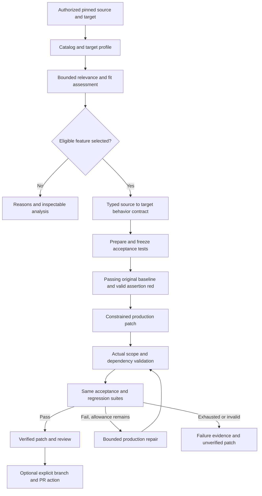

# Upgrade: project status, audits and development plan

Updated October 29, 2026, America/New_York. Original foundation review at commit
`b06d6d3` (`completed f0 and f1`).

This is the single maintained record of completed work, audit findings, verification
and remaining development. It replaces fourteen audit Markdown documents and the
frontend verification receipt. Setup and command guides remain separate; their
status references point here. The technical breakdown and frontend integration plan
retain design detail, while this document owns the current backlog.

**Current delivery:** the local CLI and browser can trace one Scrapy retry feature,
profile the bundled Python/HTTPX crawler and select or reject a proposed adaptation.
Phases 1–3, Stage 4A, F0 remediation and F1 local identity boundaries are implemented.
F3 adds public Python project structure and reviewed native offline test adapters.
F4 adds owner-scoped source catalogs, bounded semantic discovery and immutable continuation.
F5 adds saved target/goal relevance contexts and inference-free all/relevant browsing.
F6 adds local leased job ownership, active cancellation, fair admission, shared resource
accounting, private-code consent records, retention/deletion and offline operator recovery.
F7 adds local verified adaptation for existing synchronous Python functions with JSON
arguments/results and standard MIT source reuse, using frozen controller-generated tests.
All fourteen findings from the three original audits have recorded repairs. GitHub
authorization, repository indexing and opt-in private snapshots are implemented locally;
real-account validation remains pending. Live general-discovery and relevance validation,
production patching and final red-to-green verification remain pending.

The planned product connects GitHub accounts, pins authorized source/target projects,
offers a code-backed feature catalog with all/relevant browsing, and produces one
reviewable verified change. **Connected analysis** delivers supported repository and
catalog analysis; **verified adaptation** adds frozen tests, patching, capped repairs
and change review. Neither full release gate is complete. Sections 4–14 retain the
design and remaining requirements, with implemented parts identified explicitly.
The broader roadmap supersedes the original MVP's account/private-access exclusions.

- [Current implementation and boundaries](#1-current-implementation)
- [Consolidated audit findings and follow-ups](#2-consolidated-audit-findings)
- [Verification history and retained evidence](#3-verification-and-provenance)
- [GitHub and repository development](#5-github-login-credentials-and-repository-access)
- [Adaptation requirements](#12-completing-implementation-and-verification)
- [Package status and next work](#13-development-sequence-and-deliverables)
- [Release acceptance](#14-acceptance-and-release-verification)

## 1. Current implementation

| Area | Delivered behavior | Boundary / next work |
|---|---|---|
| Phase 1: Meta foundation | Strict schemas, structured output, read-only tool protocol, sanitized errors, per-attempt telemetry and shared budgets | Smoke planning uses synthetic inputs; real repository planning is pending |
| Phase 2: crawler and runner | Caller-owned HTTPX client, same-origin breadth-first crawl, canonical URL identity, visit-once and page limits; restricted offline Docker suites | Fetch still makes one GET attempt; the four retry assertions remain red |
| Phase 3: snapshots and evidence | Independent pinned Git storage, clean managed worktree, inventories, bounded reads, Python AST/symbol evidence, citations, coverage and full notices | Tracing supports one bounded Scrapy retry slice, not a general catalog |
| Stage 4 W1 | Exact Git blob export and SHA/prefix/input/image/capture binding; separate ordinary baseline and retry diagnostic | Local working-file baseline and pinned baseline remain distinct workflows |
| Stage 4 W2 | Immutable proposal/profile/assessment/gate/result and baseline-binding contracts | Shape validation does not prove semantic correctness |
| Stage 4 W3–W6 / 4A | Real Target Profiler and Fit Matcher; Python-owned gates/scores/order; `selected`, `no_safe_fit` and sanitized failures | One analyzed candidate; optional 4B comparison is pending; selection applies no patch |
| Frontend and local API | React workspace, SQLite queue/history/events, shared workflow services, evidence inspector, tests/logs, exports and explicit diagnostics | One local API worker; hosted execution and adaptation UI are pending |
| F0 foundations | S4-A01–A06 repaired; strict capture decoding, reliable JSON finalization, physical path checks and common CLI/API execution lock | Hard-stop cleanup and concurrent hostile path replacement remain outside this boundary |
| F1 identity | Numeric GitHub identity, hashed expiring sessions, single-use PKCE state, encrypted credentials, CSRF, transactional refresh/disconnect/admission, owner-scoped results and drafts | Local mocked-provider verification is complete; real GitHub account validation remains deferred |
| F2 local connection | GitHub App sign-in/index, installation states/setup validation, opt-in private pinned snapshots, restricted installation tokens/ephemeral Git broker, signed webhook inbox and provider revocation; fresh access checks and publication fencing | Real-account sign-in/private-grant/rotation/revocation exit checks remain pending; private fetch defaults off; F6 supplies local cancellation while hosted lifecycle remains unverified |
| F3 public projects | Owner-scoped immutable project IDs, root selection, `python-evidence-v1` structural analysis and reviewed `python-pytest-v1` / `python-unittest-v1` native offline adapters; crawler is an explicit example | Public Python profiles only; target relevance uses F5; acceptance-driven adaptation remains F7; incompatible suites retain their failures |
| F4 source catalogs | Owner-scoped SQLite revisions, bounded model hints and corroborated cards, aliases/hierarchy, coverage/spend ledgers, immutable cursor pages, cache and explicit continuation/on-demand traces | Public F3 Python pins only; controlled-provider verification; live semantic discovery and scale receipts remain pending |
| F5 local relevance | Owner-scoped immutable target/goal assessments, explicit shortlists/continuation, saved all/relevant modes, global filters/sorts, signed seek cursors, lazy fit details, URL state and compact polling | Controlled-provider validation; live semantic exit checks remain pending. Baseline, frozen acceptance and approved adaptation gates belong to separate F7 jobs |
| F6 local lifecycle | Fenced leases/heartbeats, fair owner scheduling, active cancellation/revocation, atomic admission/storage reservations, durable provider quotas, registered container recovery, consent/content checks, retention/deletion and backup/restore | Hosted deployment/isolation and real provider/process-termination certification remain exit gates; private model workflows remain disabled |
| F7 local adaptation | Pinned repository planner, versioned behavior contract, independently prepared frozen function acceptance, ordinary green/assertion red, cumulative constrained production patches, native regression and at most three repairs | Existing synchronous JSON-compatible Python functions and standard MIT source notices only; controlled-provider/real Docker verification; live semantic and broader adapter validation remain pending |
| F8 change review | Patch/evidence exports available through F7 | Dedicated lazy diff review and optional explicit PR publishing remain pending |
| F9 verification | Recorded local backend/browser/build checks, live sample selection and public preflight | Full connected-analysis and verified-adaptation release receipts are still required |

Implementation anchors:

- [Meta client](../backend/app/models/meta_client.py), [schema preflight](../backend/app/models/schema.py)
  and [shared budget](../backend/app/models/budget.py).
- [Repositories](../backend/app/tools/repositories.py), [evidence validation](../backend/app/tools/evidence.py),
  [source tracer](../backend/app/tracer.py), [source controller](../backend/app/source_trace.py)
  and [shared model tools](../backend/app/evidence_tools.py).
- [Pinned baseline](../backend/app/pinned_baseline.py), [baseline consumer](../backend/app/selection_baseline.py),
  [Profiler](../backend/app/target_profiler.py), [Matcher](../backend/app/fit_matcher.py)
  and [selection controller](../backend/app/fit_select.py).
- [Publication boundary](../backend/app/report_publication.py), [artifact containment](../backend/app/selection_artifacts.py),
  [execution lock](../backend/app/execution.py), [run store](../backend/app/api/storage.py)
  and [schema migrations](../backend/app/api/migrations.py).
- [Auth store](../backend/app/auth/store.py), [middleware](../backend/app/auth/middleware.py),
  [repository index](../backend/app/auth/repositories.py), [static support inspection](../backend/app/project_support.py)
  and [browser account context](../frontend/src/app/workspace-context.tsx).

The default browser form and `project_analysis` API submit server-owned public project IDs,
with an optional target. Source-only structural analysis needs no target or model key.
The explicit `/example` workflow retains the reviewed `crawler-demo` fit contracts and
retry-specific tracer/profiler/gates. Public project analysis does not select a feature.
F4 uses a separate persistent catalog contract; each discovery response contains at most
eight hints and each deep trace returns one validated card. The legacy eight-card trace
bound is unchanged. Run history links to catalogs and their immutable revisions.

### Selection policy to preserve

Source is pinned to Scrapy `5c7886a3f27dbf8b66f557cc9945dbc4a6aceaac` for the
registered slice. Target execution and analysis use the same committed SHA, monorepo
prefix and exact exported bytes; dirty local changes are excluded and disclosed.
Ordinary baseline green and feature-specific diagnostic red have separate meanings.

The typed [retry-v1 contract](../backend/app/behavior_contracts.py) covers GET/503,
three total attempts, final `raise_for_status`, parsing after success, propagated
transport errors, no backoff and no Retry-After. It describes proposed behavior;
the crawler has not been patched. Broader retry semantics need separately finalized tests.

Python computes `7*gap + 5*isolation + 3*dependency + 3*stack + 2*testability` from
integer ratings 0–5. Eligibility requires total ≥75 and gap/isolation/stack/testability
each ≥3, plus all ten gates: source provenance, target provenance, supported execution,
passing baseline, demonstrable gap, isolated adaptation, existing dependencies,
source-use policy, acceptance readiness and sufficient coverage. Stable order is
`(-total, -isolation, -testability, -dependency_cost, feature_id)`; `top3` contains
only actual eligible entries and may be empty. Model ratings are judgments, not probabilities.

Current selection is sequential, with at most one evidence clarification and a shared
allowance of 32 HTTP attempts, 400,000 returned input tokens, 40,000 returned output
tokens and 1,200 seconds checked at request boundaries. A stage must not reset it.
`selected` and `no_safe_fit` exit 0; specific workflow failures exit 1.
This legacy selection workflow applies no patch. The separate F7 catalog adaptation
workflow records actual scope and post-implementation verification for its supported profile.

Optional 4B needs independent depth and duplicate-filter traces, per-feature notices,
coverage and measured combined usage. The target already suppresses repeated visits;
its page cap is distinct from depth control. Retry acceptance cannot establish a depth
gap. A genuine comparison may yield one eligible entry from three analyzed features.

## 2. Consolidated audit findings

The original reviews were limited code audits, with no Critical/High finding established
in their reviewed scope. Later implementation receipts close the findings below; they
are not a new independent security audit or hosted-product certification. IDs are
qualified by phase because the early reports reused M1/M2/L1.

### Phase 1 and Phase 2

| Finding | Original severity and defect | Recorded repair / verification |
|---|---|---|
| P1-M1 | Medium: repeat setup overwrites `.env` | Conditional creation in README; existing configuration preserved |
| P1-M2 | Medium: smoke orchestration coupled to provider transport | Probe workflow/contracts moved to smoke modules; shared adapter owns provider primitives |
| P1-M3 | Medium: lost failed-generation metadata and invisible retries | Failed calls retain metadata; SDK retries disabled in favor of explicit budgeted attempt ledger; 500/500/200 accounts for three attempts |
| P1-L1 | Low: incompatible strict schemas accepted | Local compatibility preflight rejects defaults/unrestricted objects before network calls |
| P1-L2 | Low: frozen models contain mutable lists | Tuple-backed immutable collections preserve JSON array serialization |
| P2-M1 | Medium: stream I/O failure can leave a successful capture without logs | Logs opened before startup; owned drains propagate faults; completion and both log hashes required; six real-container stream fault probes recorded |
| P2-M2 | Medium: equivalent origin spellings stop traversal | Canonical HTTPX scheme/host/effective-port identities for origin, queue and visited set; five added crawler cases |
| P2-L1 | Low: linked export roots bypass checks | Supplied physical root and ancestors validated before resolution; root/ancestor/child-link regressions |

P1-M1 was repaired in Phase 2; Phase 3 records the remaining closures.
Permanent regression anchors: [audit regressions](../backend/tests/test_audit_regressions.py),
[runner tests](../backend/tests/test_runner.py) and [crawler tests](../examples/crawler-target/tests/test_crawler.py).

### Stage 4 and F0 closure

| Finding | Original severity and defect | Implemented closure and regression evidence |
|---|---|---|
| S4-A01 | Medium: integration citation can disagree with production scope | `src/crawler.py` must occur in proposed production paths; disconnected helper rejected; connected scope accepted |
| S4-A02 | Medium: source recognition substitutes for proposed behavior validation | Exact typed `retry-v1` contract required; eight behavior mismatches rejected despite matching rationale prose |
| S4-A03 | Medium: malformed capture metadata escapes as `TypeError` | Raw digest checked before JSON decoding; strict nested shape validation; missing/extra/type corruption retained as sanitized `invalid_evidence` through CLI/API |
| S4-A04 | Medium: report I/O suppresses structured failure receipt | Required JSON independent of optional Markdown write/render; sidecars registered immediately; outer CLI emits sanitized JSON diagnostic when destination is unwritable |
| S4-A05 | Low: containment rejection occurs after redirected write | Physical roots/ancestors/destinations checked before creation/replacement; junction probes leave outside destination empty |
| S4-A06 | Low: Markdown claims one analyzed feature before analysis | JSON/Markdown/API use recorded analyzed/eligible counts, including zero before inference |

The F0 follow-up extended those repairs beyond selection:

| Follow-up boundary | Delivered result |
|---|---|
| Optional Markdown | `KeyError`, `TypeError`, `RuntimeError` and write denial yield sanitized warnings while required JSON and original outcome survive |
| Source-trace publication | Atomic immediate artifact registration; later sidecar/read-log failure retains intact evidence, model usage and actual counts in failed JSON |
| Pinned-baseline publication | Denied binding write retains failed JSON with captured suites and explicit unavailable binding |
| Artifact roots | Source trace and working-file baseline reject redirected ancestors before run creation, provider access or runner access |
| Custom API storage | Worker and CLI both use workspace `data/execution.lock`; worker waits before claiming queued work |
| Busy CLI | All five CLI entry points return the same sanitized `execution_busy` code |

Regression anchors: [foundation boundaries](../backend/tests/test_foundation_boundaries.py),
[report publication](../backend/tests/test_report_publication.py),
[fit policy](../backend/tests/test_fit_matcher.py), [selection workflow](../backend/tests/test_fit_select.py)
and [web API](../backend/tests/test_web_api.py).

### F1 identity follow-up

| Boundary | Delivered result |
|---|---|
| Failed refresh versus reconnect | Failure cleanup stays under refresh transaction; a subsequent successful authorization survives |
| Disconnect versus queued cancellation | Connection state, credentials/cache and queued cancellation commit or roll back together |
| Disconnect versus admission | GitHub-mode enqueue rechecks connection in the admission transaction |
| Encrypted records | Strict token/expiry/field validation; invalid records require reconnect and settle queued work without exposing input |
| Single-use state | Browser-bound state consumed before decoding; unavailable key or malformed verifier yields sanitized 400 and cannot replay |
| Auth rejection | Private no-store/no-referrer/nosniff headers; malformed non-ASCII CSRF safely rejected |
| Account switching | Results/context clear before new history; owner-keyed workspace remount reads only the new owner's draft |
| Resource access | Populated detail/status/events/references/previews/downloads/excerpts succeed for owner; foreign account receives unknown-resource 404 and cannot search the run |
| Migration | Duplicate-path v1 fixture rolls back unchanged and can be repaired/retried; future schemas rejected; schema v3 and credential formats remain compatible |

Sixteen backend reproductions and both desktop browser reproductions failed before
their respective repairs. Existing replay, expiry, cookie, PKCE, rename, session rotation,
refresh/key-rotation and owner-idempotency cases remain covered. See
[identity boundaries](../backend/tests/test_identity_boundaries.py),
[auth tests](../backend/tests/test_auth.py) and [account browser tests](../frontend/tests/account.spec.ts).

### F2 local private-access lifecycle

October 28 implementation extends F1 without enabling private retrieval in the user's
configuration. The App ID, RSA key path, webhook secret and explicit private-fetch switch
are consumed settings; [GitHub setup](github-setup.md) documents the exact names.
This is an uncommitted follow-up based on `62bbda7345c4a75ec6603bacb91e7e70f5183728`;
the machine manifest identifies its tested source bytes.

| Boundary | Delivered behavior |
|---|---|
| Private Git retrieval | Owner-indexed numeric repository ID, fresh user/App checks, full SHA and role/root binding; repository-scoped Contents-read token, ephemeral askpass channel, credential-free remote/argv/environment and final token revocation attempt |
| Private storage | Bare snapshots and inventories under `data/private-repositories`, outside run exports; owner-only descriptor API rechecks live access and never sends code to Meta |
| Installation state | Bounded user-authorized installation pages, suspended/missing-permission states and setup callback validation; a foreign setup ID creates no grant |
| Provider lifecycle | Raw-body HMAC, bounded payload, durable delivery-ID/body-hash deduplication and atomic invalidation; affected cache cleared, generation advanced and queued work canceled |
| Disconnect | Revokes the user's provider authorization under the refresh/reconnect lock; local access settles even on provider failure, with explicit manual-revocation guidance; no shared App uninstall |
| Current access | Fresh provider checks before private fetch, descriptor access, admission, worker start and publication; generation checks reject mid-fetch and stale-worker results |
| Failure cleanup | Failed/invalidated fetches discard their owned code and broker helpers, including Windows read-only Git objects; incomplete descriptors never publish |
| Migration | Transactional v4 adds access generations, webhook inbox, snapshot descriptors and run authorization bindings; previous owner/run/event records are preserved |

Tests use controlled HTTP responses, generated test RSA keys, real disposable local Git
repositories and isolated desktop/mobile Chrome. They cover token restriction/JWT signatures,
foreign IDs, lost user grants, suspension, renamed repositories, fetch/publication races,
provider-disconnect failure, webhook tamper/replay/rollback and credentials absent from
helper files, Git arguments/environment and retained snapshots. A browser regression exposed
offscreen mobile account actions; the navigation now scrolls.

Machine evidence: [backend JUnit](../audit/full-feature-foundations/f2-connection-tests.xml),
[focused lifecycle/identity JUnit](../audit/full-feature-foundations/f2-lifecycle-tests.xml),
[desktop/mobile JUnit](../audit/full-feature-foundations/f2-browser-tests.xml) and
[source/check manifest](../audit/full-feature-foundations/f2-connection-checks.json).
These are local implementation checks, not a real GitHub private-fetch receipt.

Private fetch is opt-in and remains off by default. The live F2 exit gate still requires
development-account sign-in, a granted private SHA, ungranted/foreign rejection and real
rotation/revocation checks. Snapshots remain browse/index only and cannot enter the existing
model workflows. Active calls settle at their bounded timeout; immediate provider/container
interruption, retention/deletion and private-code consent were deferred to F6 at that
receipt; F6 now supplies those local controls. Hosted isolation remains unverified.
The post-fetch storage check is not an OS disk quota during transfer.

### Remaining risks and incomplete work

No original finding above remains recorded as open. These disclosed limits still need
development and release evidence:

- Path checks do not stop a concurrent hostile local actor replacing checked paths;
  that threat model needs handle-based operations. F6 registers API/CLI containers before
  creation and reconciles them under the workspace lock. Hosted isolation, cross-host
  leases and real hard-termination certification remain unverified.
- Source tests are cited, not executed. Read-backed references and AST overlap establish
  provenance, not semantic completeness; an examined file may have unread lines.
- Scope/dependency gates currently assess a proposal. Actual diff, dependency and
  unchanged-test red-to-green checks now belong to the separate F7 function adapter.
- Real GitHub sign-in/private grants and provider rotation/revocation remain unverified;
  local access checks are implemented. F6 adds controlled local cancellation, consent
  records/content exclusion and retention/deletion; private model workflows remain disabled.
- Live model validation of general discovery, additional executable project profiles,
  target/goal assessment counts and 10,000-row scale checks remain pending. F4 saved
  catalog queries are implemented and perform no model inference.
- Historical tests do not establish a dependency-vulnerability review, every allowed model
  variant, production load behavior or hostile multi-user execution safety.

## 3. Verification and provenance

Results below are dated receipts. For the original documentation consolidation, source inspection
and a fresh hash comparison matched all 128 files in the latest F1 source manifest;
the saved backend/browser JUnit digests and totals also matched. No application suite,
browser, Docker, network fetch or paid inference was rerun for that documentation-only change.
The subsequent F2/F3 implementations have fresh local checks listed below.

| Milestone / date | Recorded result | Retained evidence |
|---|---|---|
| Phase 1 audit, Oct 27 | 46 backend tests; live Spark smoke passed with three calls, 1,938 tokens | Local [checks](../audit/checks.json), [live smoke](../audit/live-smoke.json) |
| Phase 2 implementation/review, Oct 27 | 59 backend tests; 6 isolation and 8 ordinary cases; 4 expected retry assertions / 3 controls; five runner failure probes | Local [review checks](../audit/phase2-audit/checks.json), [baseline](../audit/phase2-audit/baseline.json), [fault reproduction](../audit/phase2-audit/capture-fault.json), [edge probes](../audit/phase2-audit/edge-probes.json), [runner probes](../audit/phase2-audit/runner-probes.json) |
| Phase 3, Oct 27 | 92 backend tests; 6 isolation / 13 ordinary cases; expected retry red; six stream faults; live smoke and source trace | Local [checks](../audit/phase3-checks.json); trace `source-trace-8991ae909e544bf484c2f83e60c348b0` |
| W1, Oct 27 | 116 backend tests; real pinned/local Docker baselines; 31 hashes rechecked | Local [checks](../audit/stage4-w1-checks.json) |
| W2, Oct 27 | 214 backend tests; strict schemas and immutable binding contracts; no live calls | Local [checks](../audit/stage4-w2-checks.json), [JUnit](../audit/stage4-w2-tests.xml), [schemas](../audit/stage4-w2-schemas.json) |
| Stage 4A implementation/review, Oct 27 | 259 backend tests; one selected feature at 93/100; 29 artifacts and 50 citations checked; six audit reproductions | Local [implementation checks](../audit/stage4-checks.json), [JUnit](../audit/stage4-tests.xml), [review checks](../audit/stage4-review/checks.json), [reproductions](../audit/stage4-review/reproductions.json), [artifact recheck](../audit/stage4-review/receipt-recheck.json) |
| Frontend delivery, Oct 28 | 259 existing + 19 API tests; 26 desktop/mobile browser checks; TypeScript/build and HTTP serving passed; fresh API Docker baseline | API run `e80af20ddfcc4e6393b0c3f0b38dc700`; no fresh paid model inference for this delivery |
| First foundation pass, Oct 28 | 342 backend tests; later focused profiler 20 and selection 16; browser 34 plus 2 recorded-result checks; build/lint; fresh Docker baseline and public preflight | Tracked [checks](../audit/full-feature-foundations/checks.json), [backend JUnit](../audit/full-feature-foundations/backend-tests.xml), [browser JUnit](../audit/full-feature-foundations/browser-tests.xml), [recorded-result browser JUnit](../audit/full-feature-foundations/browser-live-tests.xml), [profiler](../audit/full-feature-foundations/profile-v2-tests.xml), [selection protocol](../audit/full-feature-foundations/workflow-v2-tests.xml) |
| F0 follow-up, Oct 28 | 358 backend tests, zero failures/errors/skips; lint/format passed | Tracked [checks](../audit/full-feature-foundations/f0-follow-up-checks.json), [JUnit](../audit/full-feature-foundations/f0-follow-up-tests.xml) |
| F1 follow-up, Oct 28 | 384 backend tests and 36 desktop/mobile browser tests, zero failures/errors/skips; TypeScript/build/lint/format passed | Tracked [checks](../audit/full-feature-foundations/f1-identity-checks.json), [backend JUnit](../audit/full-feature-foundations/f1-identity-tests.xml), [browser JUnit](../audit/full-feature-foundations/f1-browser-tests.xml) |
| F2 local lifecycle, Oct 28 | 423 full backend checks; final 122 auth/lifecycle/API checks after the documented-endpoint and atomic-publication refinements; 42 desktop/mobile browser checks; zero failures/errors/skips; build/lint/format passed | Tracked [checks](../audit/full-feature-foundations/f2-connection-checks.json), [backend JUnit](../audit/full-feature-foundations/f2-connection-tests.xml), [final focused JUnit](../audit/full-feature-foundations/f2-lifecycle-tests.xml), [browser JUnit](../audit/full-feature-foundations/f2-browser-tests.xml) |
| F3 public Python projects, Oct 28 | 437 backend checks, 50 mocked desktop/mobile checks and 2 real public browser-to-worker runs passed; build/TypeScript/lint/format/lock checks passed; final Docker image passed 6 isolation checks, native pytest/conftest and unittest/doctest checks, and retained error/skip failures | Tracked [checks and source hashes](../audit/full-feature-foundations/f3-checks.json), [backend JUnit](../audit/full-feature-foundations/f3-backend.xml), [browser summary](../audit/full-feature-foundations/f3-browser-summary.json), [real browser JUnit](../audit/full-feature-foundations/f3-live-browser.xml), [native adapter checks](../audit/full-feature-foundations/f3-native-checks.json) |

Counts belong to their implementation states; they are neither additive across suites
nor competing current totals. F0/F1 checks used controlled GitHub/Meta/Docker boundaries;
neither follow-up made live GitHub/model calls or executed Docker. Their backend suites
report one existing Starlette/httpx deprecation warning. Windows fixture ACL/helper-spawn
restrictions required normal local execution permissions during recorded verification.

### Live sample runs

- Phase 3 trace: 11 requests, 84,369 input / 13,423 output tokens, eleven references,
  four examined files and 635 unexamined text files; full BSD-3-Clause notice retained.
- Original Stage 4 selection `fit-select-c6e22ed623984ccb9b2838c54df7e911`:
  one analyzed/eligible candidate at **93/100**, fifteen attempts, 109,638 input /
  23,176 output tokens. Target `7cff4a209b665daa7d7bb30eb81619c4b2685b08`,
  prefix `examples/crawler-target`. Preservation and 29 artifacts passed at run time.
  A later verifier's historical-HEAD assertion became false after HEAD advanced;
  the separate review recheck verified pinned artifacts and target bytes without
  claiming a new live run at the later HEAD.
- Foundation run `fit-select-13c9d57aa43d47fab61a1448531e00e6`: source trace
  succeeded, but target profiling cited a related test rather than the exact registered
  one. It failed as `invalid_evidence`, retaining eighteen calls and 24 artifacts.
  The `target-profile-v2` prompt clarified the exact mapping; validators were preserved.
- Separate run `fit-select-6a66d401a31d413bbd9193fcee246c52`: **selected**, one
  analyzed/eligible feature at **91/100**, all ten gates, seventeen calls, 135,440 input /
  24,148 output tokens and 29 rehashed artifacts; source, target and worktree preserved.
  Two browser checks reopened that real result and checked excerpts/download digests.

These are separate accountable runs, not hidden retries. They establish bounded selection
and inspection of saved results, not a production patch or a new connected-analysis release.
Recorded live public-evidence transfer was explicitly authorized at the time; that does
not authorize future private-code transmission.

### Independent public examples

| Role | Repository | Recorded commit | Inventory / capability |
|---|---|---|---|
| Source | urllib3 | `5feb993421a48a508bc70c78e745337cc6415265` | 144 text files, 1,478,408 bytes, 82 Python files; browse/index only |
| Target | HTTPX | `b5addb64f0161ff6bfe94c124ef76f6a1fba5254` | 90 text files, 974,681 bytes, 60 Python files; browse/index only |

Tracked [public-projects.json](../audit/full-feature-foundations/public-projects.json)
records refs, notices, inventory/manifest hashes and `python-static-v1` assessment.
[check_public_examples.py](../scripts/check_public_examples.py) can create a new bounded
preflight; it fetches public snapshots without model inference or repository execution.
This does not demonstrate general discovery, executable support or safe adaptation.

F3's fresh real browser runs analyzed **ItsDangerous** source
`672971d66a2ef9f85151e53283113f33d642dabd` and **more-itertools v10.8.0** target
`8c1a6ef241b51ff055e89219f050ccf4f15f37f6`, with no crawler integration point and
zero model requests. Both desktop and mobile completed through the real API queue/worker,
opened a stored citation and retained exact source/target identities. Those structural
runs did not request native baseline execution. Receipts:
[desktop](../audit/full-feature-foundations/f3-live-desktop.json) and
[mobile](../audit/full-feature-foundations/f3-live-mobile.json).

Separately, original native suites were executed on public more-itertools snapshots.
Current head `4aeb4338ae1407d8da9723e86da99efeb446f719` ran 929 cases but hit the
existing 64-PID/thread limit; v10.8.0 ran 859 cases with one skipped compatibility test.
Both remained `baseline_failed`; no skipped test or resource failure was converted into
green evidence. These exploratory receipts retain their original image identities.
Final-image success/failure controls use explicitly generated independent Git repositories,
including a non-crawler module and a conftest-dependent test, native `load_tests` doctest,
class setup failure and skipped-test cases. They establish adapter behavior, not a green
public more-itertools baseline. Reproduce with `scripts/check_project_adapters.py` after
building the runner. No source/target setup or test code was executed on the host.

### Original review identities and document consolidation

Phase 1 reviewed `5564d346853cf419c1aa0e976834ca803aee7e5a`; Phase 2 reviewed
`f50bcfec17546148b7a6b4e222ef32e804952316`. Stage 4 design/research inspected
`39ca2381cce0853e93c5b789607ad880a4da0391`; the later Stage 4 audit bound unchanged
reviewed bytes across the transition to `07ed18dd5b323f1fc2d7cb46137ad18eb916fb8a`.
The foundation receipt used base `9d0ea7297d0844070d7706ca1cb7a2e92c09fb08`;
F0/F1 used base `bedf27e1daf824228144e0ede272dc1687ca0758`. Their manifests bind
the then-uncommitted tested bytes, now committed in the reviewed `b06d6d3` history.
Original source manifests, dates and reproduction JSON/XML were not rewritten.

Merged sources: the audit README; Phase 1 audit; Phase 2 completion and review;
Phase 3 completion; Stage 4 plan, research, W1, W2, completion and review;
foundation, F0 and F1 receipts; and frontend verification. Findings, meaningful
scope decisions, verification outcomes and remaining work are reconciled here.

Exact original Markdown, including the prior version of this plan, is backed up in
local `audit/historical-documents-2026-10-28.zip`, with a filename/SHA-256 manifest.
That archive, early audit machine receipts and runtime `data/artifacts/` remain ignored
local history and may be absent in a fresh clone. Foundation JSON/XML receipts and this
document are tracked. Generated reports inside reproduction fixtures remain untouched.
Future changes update this document and add machine evidence when needed; do not create
another parallel status or closure Markdown file.

### Historical Stage 4 research retained

The research was performed October 27; its external links are context from that review,
not freshly verified provider documentation. Durable implementation decisions were:
strict schema preflight and tuple-backed immutability; bounded registered read tools;
independent clones plus managed worktrees; fixed offline Docker execution; TOML parsing
as data; separate distribution/import identities; and code-backed notices/coverage.

The research register's primary references are preserved: [Meta schemas](https://dev.meta.ai/docs/structured-output),
[tools](https://dev.meta.ai/docs/tool-calling), [Chat Completions](https://dev.meta.ai/docs/protocols/chat-completions),
[Pydantic immutability](https://docs.pydantic.dev/latest/concepts/models/#faux-immutability),
[Git clone](https://git-scm.com/docs/git-clone), [worktrees](https://git-scm.com/docs/git-worktree),
[Docker runtime](https://docs.docker.com/engine/containers/run/),
[HTTPX transports](https://www.python-httpx.org/advanced/transports/),
[pytest JUnit](https://docs.pytest.org/en/stable/how-to/output.html#creating-junitxml-format-files),
[Python 3.12 TOML](https://github.com/python/cpython/blob/v3.12.0/Doc/library/tomllib.rst),
[package/import distinction](https://packaging.python.org/en/latest/discussions/distribution-package-vs-import-package/)
and [name normalization](https://packaging.python.org/en/latest/specifications/name-normalization/).
Exact source behavior comes from pinned Scrapy
[retry](https://github.com/scrapy/scrapy/blob/5c7886a3f27dbf8b66f557cc9945dbc4a6aceaac/scrapy/downloadermiddlewares/retry.py),
[depth](https://github.com/scrapy/scrapy/blob/5c7886a3f27dbf8b66f557cc9945dbc4a6aceaac/scrapy/spidermiddlewares/depth.py)
and [duplicate-filter](https://github.com/scrapy/scrapy/blob/5c7886a3f27dbf8b66f557cc9945dbc4a6aceaac/scrapy/dupefilters.py)
code and cited tests. The initial 4A estimate is historical; remaining packages need
new estimates after adapter and hosting scope are chosen.

## 4. What to reuse from `.research/Graft`

Historical research checkout: `a386620842c34f1f731bf6ffc91bdb1b101f31ba`.
Research is local reference material and is ignored by Git; it is not an installed
Upgrade dependency or evidence that Upgrade has these capabilities.

| Graft reference | What it actually does | Use in Upgrade |
|---|---|---|
| [FeatureSidebar.jsx](../.research/Graft/graft-frontend/src/components/FeatureSidebar.jsx) | URL plus optional password-style token field; renders every feature with `features.map(...)` | Reuse the list/detail separation as an idea; replace manual token onboarding and whole-list rendering |
| [models/requests.py](../.research/Graft/graft-backend/models/requests.py) | Accepts an optional `github_token` in ingestion requests | Evidence of manual token support, not an OAuth login/session system |
| [github_service.py](../.research/Graft/graft-backend/services/github_service.py) | Uses request token or server `GITHUB_TOKEN`, fetches metadata, puts token in a clone URL | Reuse metadata/access-state ideas; implement a separate credential broker without tokens in URLs/arguments/remotes |
| [session_store.py](../.research/Graft/graft-backend/store/session_store.py) | Stores analysis sessions and raw token references in an in-memory dictionary | Do not reuse as user authentication, durable storage or tenant authorization |
| [claude_service.py](../.research/Graft/graft-backend/services/claude_service.py) | Extracts feature hints from README and chunks large trace inputs | Use bounded discovery followed by code corroboration; preserve explicit partial coverage rather than treating README claims or truncated files as proof |
| [App.jsx](../.research/Graft/graft-frontend/src/App.jsx) | Holds feature/trace/token state and ingestion actions in one app component | Keep Upgrade's typed API and routed features instead of copying monolithic state |

No GitHub authorization/callback flow or per-user repository authorization layer was
found in the inspected Graft routes/frontend. Its `session_id` identifies an analysis
session, not an authenticated browser account. Graft's `ANTHROPIC_API_KEY` belongs to
its historical provider implementation; Upgrade continues using its existing Meta
adapter and `MODEL_API_KEY`. Do not introduce an Anthropic requirement for this plan.
Preserve [Graft's MIT notice](../.research/Graft/LICENSE.md) if source code is reused.

## 5. GitHub login, credentials and repository access

### Decision: GitHub App plus a backend-owned browser session

Use one GitHub App for user authorization and repository installation. Users sign in
on GitHub; Upgrade never collects GitHub passwords or asks ordinary users to generate
personal access tokens. Start with read-only repository access. GitHub Apps support
fine-grained permissions and repository selection, which match this product's needs.
[GitHub App/OAuth comparison](https://docs.github.com/en/apps/oauth-apps/building-oauth-apps/differences-between-github-apps-and-oauth-apps).

Signing in and installing/granting repository access are separate states. A user may
be signed in with no installation, with only some repositories selected, or while
organization approval is pending. Do not promise access to every repository visible
in their GitHub account. List the repositories both that user and the app can access.
[User access and installation intersection](https://docs.github.com/en/apps/creating-github-apps/authenticating-with-a-github-app/generating-a-user-access-token-for-a-github-app).

### Credentials and configuration needed

Current settings are `AUTH_MODE`, `APP_BASE_URL`, `GITHUB_CLIENT_ID`,
`GITHUB_CLIENT_SECRET`, `GITHUB_APP_SLUG`, `GITHUB_APP_ID`, `GITHUB_PRIVATE_KEY_PATH`,
`GITHUB_WEBHOOK_SECRET`, `GITHUB_PRIVATE_FETCH_ENABLED`, `TOKEN_ENCRYPTION_KEYS` and the existing
Meta settings; see [GitHub setup](github-setup.md) for exact consumed names and rotation.
The table describes implemented local configuration; private fetch defaults off.
Credential values belong only in local configuration or the deployment secret store.

| Item | Who supplies it | Purpose and storage |
|---|---|---|
| `AUTH_MODE` | Operator; implemented | `local` default or configured GitHub preview |
| `GITHUB_APP_ID` | App owner | Numeric App identity for installation tokens |
| `GITHUB_APP_SLUG` | App owner | Non-secret identifier used to build installation/settings links |
| `GITHUB_CLIENT_ID` | App registration | Non-secret identifier used by the authorization flow |
| `GITHUB_CLIENT_SECRET` | App owner generates it | Backend-only authorization-code exchange/refresh credential |
| `GITHUB_PRIVATE_KEY_PATH` | App owner generates a private key | Backend signs RS256 App JWTs; keep the PEM outside repository/artifacts |
| `GITHUB_WEBHOOK_SECRET` | Operator generates it | Authenticate webhook deliveries; separate from client/session secrets |
| `GITHUB_PRIVATE_FETCH_ENABLED` | Operator; false by default | Explicitly enables private snapshot retrieval after setup |
| `TOKEN_ENCRYPTION_KEYS` | Operator; implemented | Newest-first authenticated-encryption keyring; retained older keys support rotation |
| `APP_BASE_URL` | Operator; implemented | Validated origin; callback derived as `/api/auth/github/callback`; no separate `GITHUB_CALLBACK_URL` setting |
| `MODEL_API_KEY` | Operator; existing setting | Meta inference only; not a GitHub credential and never forwarded to target runners |
| Session identifier and CSRF secret | Generated by Upgrade | Opaque random per-session browser credential; store only session-token hashes server-side |
| GitHub user/refresh tokens | Issued after each user's authorization | Encrypted backend-only credentials; never returned in API DTOs |
| Installation access token | F2 broker mints per fetch | Short-lived, one-repository Contents-read credential; discarded and revocation attempted afterward |

A separate OAuth App is unnecessary for this design. A user-supplied `GITHUB_TOKEN`
is unnecessary for normal sign-in. If a developer-only PAT fallback is later needed,
keep it opt-in and separate from normal product onboarding and owner authorization.

Use expiring user tokens. GitHub currently documents eight-hour user tokens and
six-month refresh tokens; refresh replaces the old pair. Installation tokens expire
after one hour. Persist the returned expiration timestamps and treat token strings as
opaque; never assume a fixed length or prefix.
[User-token refresh](https://docs.github.com/en/apps/creating-github-apps/authenticating-with-a-github-app/refreshing-user-access-tokens),
[installation-token generation](https://docs.github.com/en/apps/creating-github-apps/authenticating-with-a-github-app/generating-an-installation-access-token-for-a-github-app).

### App registration and permissions

Create separate development and production registrations/configuration. Register the
exact authorization callback and post-install setup URL. For Vite development, choose
one canonical origin, for example `http://127.0.0.1:5173`, and proxy `/api` so callback
and session cookies use that origin. Do not alternate casually between `localhost`
and `127.0.0.1`. Production uses its HTTPS origin. Webhook development can use an
explicitly configured relay/tunnel; authentication must not depend solely on delivery
of a webhook to the developer machine.

| Permission | Initial analysis release | Later verified publishing |
|---|---|---|
| Repository metadata | Required baseline metadata access | Retain |
| Contents | Read | Add write only for publishing branches/commits |
| Pull requests | Not needed to analyze code | Write for explicit PR creation |
| Organization members, administration, workflows, secrets | Not requested by default | Add only for a separately justified implemented capability |
| Account email | Not needed for identity; use numeric GitHub user ID | Optional only if a product requirement appears |

Request the minimum supported permissions. A permission upgrade needs the affected
installation's approval; a user with insufficient repository rights cannot publish
just because the app has a write permission.
[Choosing GitHub App permissions](https://docs.github.com/en/apps/creating-github-apps/registering-a-github-app/choosing-permissions-for-a-github-app).

### Login and session flow

The local flow is implemented and tested with controlled provider responses. Real
GitHub account validation remains F2 exit work. Provider disconnect/revocation is
implemented locally and verified with controlled responses.

1. `GET /api/auth/github/start` creates a short-lived, single-use server-side auth
   transaction containing random state, PKCE verifier, expiry and an allowlisted
   relative return destination; redirect to GitHub using PKCE S256.
2. `GET /api/auth/github/callback` validates transaction expiry, state, browser binding
   and single use, then exchanges the code on the backend with the verifier and client
   secret. Abort on denial, replay, mismatch or provider error. GitHub documents the
   web application flow and PKCE parameters.
   [GitHub user authorization](https://docs.github.com/en/apps/creating-github-apps/authenticating-with-a-github-app/generating-a-user-access-token-for-a-github-app).
3. Retrieve the authenticated profile. Upsert identity by immutable numeric GitHub
   user ID; treat login/display name as changeable attributes. Do not auto-link by email.
4. Encrypt the credential pair and expiry values. Rotate the application session ID;
   place only an opaque session cookie in the browser, never a GitHub bearer token.
5. Use `HttpOnly`, host-only, `SameSite=Lax` cookies and `Secure` on HTTPS; allow the
   documented loopback HTTP exception only in development. Enforce server-side expiry,
   logout invalidation, session rotation and CSRF validation for state-changing actions.
6. `GET /api/session` returns safe user and connection state. Show **Connect repositories**
   if signed in without a usable grant; preserve the unfinished source/target/goal form.
7. Refresh expiring GitHub credentials on the server under a per-user lock. Replace the
   stored token pair atomically; refresh failure requires reconnecting rather than an
   infinite retry loop. Keep application-session expiry independent of provider expiry.
8. Separate **Sign out** from **Disconnect GitHub**. Sign out invalidates that browser
   session. Local disconnect removes stored authorization/cache, blocks admission and
   cancels queued work transactionally. Provider revocation is attempted with explicit
   failure guidance; F6 adds local active-call cancellation and explicit owner deletion.
   It must not uninstall an organization's shared app for everybody.

Implemented local policy: auth transactions expire after ten minutes; application
sessions have a seven-day absolute expiry and a 24-hour idle expiry.
Reject untrusted redirect destinations; redact callback codes and sensitive headers
from proxy/access logs. Login, list browsing and result reopening must not trigger Meta.

### Installation, repository discovery and private Git access

Repository intersection sync/search and the local private-access lifecycle are implemented.
The requirements below describe that design and the remaining live/F6 release checks.

- Use user-authorized `GET /user/installations` and
  `GET /user/installations/{installation_id}/repositories` to establish the user's
  accessible intersection. Validate any installation ID returned through a setup URL
  against that identity; a callback query parameter is not proof of ownership.
  [Installation API](https://docs.github.com/en/rest/apps/installations).
- Follow GitHub's pagination until an explicitly bounded sync completes; store sync
  progress and continuation. Search the authorized local index on the server. A picker
  page containing 30 results must not imply that only 30 repositories exist.
  [GitHub pagination](https://docs.github.com/en/rest/using-the-rest-api/using-pagination-in-the-rest-api).
- Offer owner/organization, repository-name and visibility filters, accessible refresh,
  last-sync time, private badges and **Manage repository access**. Distinguish no grants,
  admin approval pending, repository not granted, archived/read-only and rate-limited.
- Key repositories by numeric GitHub repository ID, not just `owner/name`; handle
  rename, transfer, deletion, access loss and account-switch invalidation.
- Recheck current user entitlement and installation permissions before enqueue, private
  fetch, job start, publishing results and PR creation. Background installation tokens
  have broader capabilities than a particular user, so never use installation membership
  alone as authorization. Mint tokens restricted to the required repository IDs.
- Extend the current credential-free Git wrapper through one controlled broker. Keep
  canonical remotes credential-free; supply a short-lived credential through a dedicated
  ephemeral askpass/credential channel. Do not put tokens in clone URLs, command arguments,
  `.git/config`, reports, tracebacks or shared environment. Destroy broker state afterward.
  GitHub supports installation tokens for HTTPS Git with Contents permission.
  [Installation Git authentication](https://docs.github.com/en/apps/creating-github-apps/authenticating-with-a-github-app/authenticating-as-a-github-app-installation).
- Implement signed webhook handling for installation changes, repository grant changes,
  relevant repository changes and authorization revocation. Verify the raw-body HMAC
  with constant-time comparison, deduplicate delivery IDs and enqueue processing.
  [Webhook validation](https://docs.github.com/en/webhooks/using-webhooks/validating-webhook-deliveries).
- On revocation/suspension, invalidate access and cached grants immediately when known.
  Also use bounded freshness/reconciliation checks so missed webhooks cannot preserve
  authorization indefinitely. Affected in-flight jobs must settle safely and cannot
  publish through stale permissions. Reauthorize access to existing private artifacts;
  being their original requester must not bypass current repository access policy.
- Handle primary and secondary rate limits using returned headers, backoff and bounded
  retries; coalesce refreshes. Rate limits vary by authentication type and endpoint.
  [GitHub rate limits](https://docs.github.com/en/rest/using-the-rest-api/rate-limits-for-the-rest-api).

## 6. Supporting real target and source projects

**F3 local implementation:** the default **Analyze public projects** form pins a full
GitHub commit SHA separately for each role, shows inspected manifest roots and support
reasons, and submits immutable owner-scoped project IDs. `POST /api/projects` and
`GET /api/projects/{id}` persist the URL, requested SHA, resolved SHA, role, root,
inventory digest, manifest digest and capability assessment in schema v5. Only full
commit SHAs are accepted; branch/tag lookup is not performed or replayed by a worker.
The worker reopens the independent Git storage, rechecks inventory/HEAD/object integrity
and recomputes current adapter support. Original checkouts and dirty files are not inputs.

`python-evidence-v1` reports bounded Python definitions, test definitions, imports,
read-backed symbol citations, explicit project/repository-relative paths, full notices
and partial coverage. It performs no model calls and makes no semantic feature/relevance
claim. Missing/invalid manifests, syntax/index limits and unsupported roots are explained
before admission. Analysis is capped at 200 Python files / 2 MiB, a 24 KiB manifest,
10 seconds of indexing checked between files, 80 production and 80 test definitions,
20-line definition windows and the existing 500,000-byte evidence allowance. Repository
inventory limits remain 4,000 entries / 50 MiB text / 2 MiB per file; Git operations have
120-second timeouts and retrieval has a 200 MiB post-fetch storage check. F6 adds local
disk reservations and polling during transfer; these are not OS disk quotas. Hosted
validation remains pending.

For compatible targets, explicit baseline execution uses the prepared Python 3.12 image.
Runtime dependencies are empty or exactly `httpx==0.28.1`; declared test requirements
must fit prepared versions. `python-pytest-v1` loads the original `conftest.py` and
reviewed native `pyproject.toml` options, without plugin autoload. Native `load_tests`
selects `python-unittest-v1`, which includes doctests and records all collected cases;
mixed pytest/unittest collection is rejected. No setup/build/install command is run.
Every suite uses the existing credential-free offline limits. Skips, expected failures,
collection errors and resource failures remain unsuccessful. Baseline binding records
the target ID/SHA/root, inventory/manifest, adapter/image, exact exported inputs and captures.
`verified_adaptation` is reserved and never emitted: `analysis-only-v1` preserves notices
and blocks reuse/adaptation until feature-specific allowed-use and acceptance review.

Implementation: [contracts](../backend/app/project_contracts.py),
[public project store](../backend/app/projects.py),
[adapters](../backend/app/project_adapters.py),
[shared workflow](../backend/app/project_analysis.py),
[CLI](../backend/app/project_cli.py), and
[native unittest capture](../sandbox/unittest_runner.py).
The requirements below remain the design boundary for additional profiles and downstream
discovery/adaptation; existing crawler gates are preserved in the explicit example.

Replace the sample-only registration with an authorized repository snapshot contract:
repository ID, owner scope, role (`source`/`target`), requested ref, resolved SHA,
project-root prefix, manifest hashes and supported analysis/execution profile. Resolve
refs once at submission and persist the actual SHA; display branch and SHA together.
Never silently switch an active run to a newer branch head.

Repository authorization and executable support are independent. A connected repository
may be readable but unsupported for tests or adaptation. Implement three capability
levels: **browse/index**, **evidence-backed analysis**, and **verified adaptation**.
Show the actual level and blocking reason before a user spends model budget.

Implementation work:

1. Add typed repository/project selection and a stable server-owned target identifier.
   Replace hard-coded target values across form state, request schemas, worker dispatch,
   Git registration, profiler, baseline binding, score gates, tests and examples.
   Source-only discovery/trace requests must work without a target; target selection
   becomes required only for target relevance, fit assessment and adaptation.
2. Support monorepo root selection from inspected manifests. Preserve repository-relative
   versus project-relative paths explicitly and include the prefix in every binding.
3. Introduce versioned target adapters: manifest parser, supported language/runtime,
   entry-point discovery, dependency checks, baseline registration, prepared runner and
   acceptance capabilities. Begin with reviewed Python profiles and a second independent
   Python repository that has no `Crawler.fetch` integration point.
4. Keep the sample adapter as a regression fixture and **Try an example** option. It
   must not masquerade as the user's default connected project.
5. Bound fetch storage, object size, files, text bytes, AST parsing and wall time. The
   present inventory defaults cap 4,000 entries and 50 MiB text; record exclusions and
   limits instead of bypassing them to make a large repository appear supported.
6. Preserve commit pinning, independent clones/worktrees, secret/binary/link/submodule
   exclusions, physical containment and safe reads. Source code is analyzed as data.
7. Do not execute repository setup commands, Dockerfiles, hooks, arbitrary scripts or
   package-manager lifecycle hooks on the host. Dependencies need a separate reviewed,
   isolated preparation/build path, pinned inputs and network policy; the execution
   phase remains credential-free and offline for the initial profiles.
8. Validate actual baseline coverage for each profile; disabling `conftest`/plugins as
   the fixture does may make another project's tests unsupported. Report unsupported
   requirements instead of skipping them and declaring green.
9. Generalize source notices and adaptation policy with a versioned allowed-use policy.
   GitHub visibility is not reuse permission. Unknown/incompatible notices block
   adaptation while an analysis view may still explain the restriction.

Do not generalize by deleting current hard gates. Introduce profile-specific evidence
and behavior registrations, then demonstrate equivalent rejection and preservation
properties on independent projects.

## 7. Feature discovery and the meaning of “all features”

The product lists behavior-level capabilities, such as request retry or command parsing.
It must not turn every function, class or README bullet into a supported feature.
Broad capabilities can contain related subfeatures, but parent/child entries need
explicit grouping so the list is not inflated by duplicates.

**All features** means all entries discovered in the selected catalog snapshot and
scope. Display **All discovered features** in the explanatory text. A bounded automated
scan cannot guarantee that it found every semantic capability in a large repository.
The UI must show the scan's scope, completion state, exclusions and continuation.

### F4 local implementation

**Discover features** on the public-source form explicitly creates a source-only job.
`POST /api/catalogs` binds the F3 source SHA/root/inventory/manifest/profile, owner scope,
analyzer/prompt/schema versions and requested model identity. The worker reopens and
verifies the pin, statically indexes Python symbols/imports and source-test paths, then
submits bounded module/document packets through the existing read-only Meta tools.
Repository code is never executed for discovery. Private F2 snapshots cannot enter it.

Each response contains at most eight behavior hints, not one feature per symbol. Hints
retain read-validated discovery references and stay **Unverified** until a separate trace
validates a FeatureCard. Shared production-symbol identity plus the cited behavior key
deduplicates entries; aliases and module groups remain explicit. Parent links resolve
within each batch and cycles are rejected. Matching names alone do not merge different
code identities. Documentation-only, partial, unsupported and failed evidence remain
distinct. Supported cards require actual production symbols. Missing tests/notices are
disclosed; source tests are cited, never claimed executed. Reuse/adaptation are unapproved.

Defaults are 32 discovery files, at most 500 new records and eight deep traces per job;
file admission accepts at most 256 files, catalogs at most 5,000 entries. Packets contain
at most eight files, 60-line/6,000-byte heads per file and 40 static symbols. Unread bodies
and truncated indexes remain explicit. The cumulative evidence allowance is 500,000 bytes
with existing 200-line/24,000-byte windows. One job shares 32 model attempts, 400,000
returned input tokens, 40,000 returned output tokens and 1,200 seconds across discovery,
tools, retries and traces. Options can lower those allowances. These are caps, not
measured throughput or completeness claims.

Schema v6 admits queue entry, revision and owner-scoped idempotency record atomically.
Batches checkpoint candidates/cards, failure reasons, examined/remaining paths and actual
usage. Finished revisions cannot be overwritten. Interrupted/disconnected jobs settle
without inference replay. **Continue discovery** creates a new revision, copies previous
results and scans remaining supported paths under a new explicit allowance. A continuation
with `trace_feature_ids` and `max_files: 0` performs on-demand corroboration. Per-job and
cumulative spend and batch ancestry remain inspectable; failed packets stay unprocessed.
At the catalog cap, adding entries stops but explicitly selected traces remain possible.
Unsupported/unread areas retain limit messages rather than an exhaustive-scan promise.

`GET /api/catalogs/{id}` returns versioned scope/counts/limits. Revision-required feature
pages contain 25 summaries by default, at most 100, with global saved search, status/category
filters and stable `(casefolded name, feature_id)` ordering. HMAC cursors bind owner,
catalog/revision, normalized query, filters and page size. Details load separately with
hash-checked read-backed evidence. The browser preserves revision/query/page/detail in
its URL and polls compact run status while work is active. Reopening, searching and paging
perform zero model calls. Full notices and attempt/call receipts remain in job exports.
Optional sidecar failure preserves required JSON and usage. `deeply_traced` counts trace
attempts, including failures; `trace_state` and evidence status distinguish their outcomes.

Caches are owner-scoped and bind source/analyzer/model/scope/options identity; changed SHA
or version cannot reuse old evidence. F5 supplies target/goal relevance and all/relevant
modes as described in section 8; adaptation eligibility still requires the F7 gates. F6 owns private-code consent, hosted isolation
and retention; F7 owns acceptance tests and verified changes. A supported source card
establishes validated citation provenance, not semantic completeness or safe transfer.

Implementation: [contracts](../backend/app/catalog_contracts.py),
[discovery/corroboration](../backend/app/catalog_discovery.py),
[revision store](../backend/app/catalog_store.py),
[workflow](../backend/app/catalog_workflow.py), [API](../backend/app/catalog_routes.py)
and [browser](../frontend/src/features/catalog/Catalog.tsx).
Local checks use real disposable Git snapshots and controlled Meta responses, not paid
live discovery or release-scale scans. See [F4 checks](../audit/full-feature-foundations/f4-checks.json),
[backend JUnit](../audit/full-feature-foundations/f4-backend-junit.xml) and
[desktop/mobile JUnit](../audit/full-feature-foundations/f4-browser-junit.xml).
The design pipeline below remains the boundary for future profiles and broader validation.

### Discovery and validation pipeline

1. Build a pinned, bounded inventory and deterministic indexes of manifests, symbols,
   routes/commands, tests and documentation. Do not send the entire repository to a model.
2. Generate candidate hints from README/docs and structural entry points. Persist each
   hint's discovery references and label it **Unverified** until code corroborates it.
3. Group candidates by capability and module. Deduplicate using entry-point/symbol
   identity and cited behavior, not name similarity alone; retain aliases and hierarchy.
4. Trace bounded batches against code, tests, dependency imports and notices. Preserve
   current read-window and SHA/path/symbol validation. A documentation-only claim stays
   unverified/partial; a source-test citation does not claim the test was executed.
   If configuration requirements are extracted, extend the schema with cited variable
   names and uncertainty only, never values. Graft's environment-variable output is
   not an implemented Upgrade capability, and absent metadata does not prove no setup
   is needed. Dependency lists likewise do not prove complete dependency closure.
5. Publish validated FeatureCards separately from lightweight discovery candidates.
   Store per-feature coverage, missing evidence and failure reason. One failed trace
   need not discard other valid catalog entries, but cannot become an eligible candidate.
6. Freeze an immutable catalog revision with completed batches, counts and exclusions.
   A scan can be queued, running, complete-for-declared-scope, partial, failed or canceled.
   Store budget/limit/unsupported reasons separately from semantic evidence status.
7. Offer an explicit **Continue discovery** action for unexamined areas within supported
   limits. It creates an accountable job/revision with a stated additional budget; it
   never silently restarts or overwrites an earlier successful catalog.

Catalog identity includes source repository ID/SHA, owner/access scope, inventory and
analyzer versions, discovery scope, prompt/schema versions and returned model identity.
Feature identity is stable within this lineage and is not just a mutable display slug.
Changed-SHA versions may record correspondence, but must revalidate evidence. Never
reuse citations or relevance decisions merely because two features have the same name.

### Bounded work and cache rules

- Keep the current maximum-eight structured trace/assessment batches. Add a separate
  paginated catalog contract instead of raising the legacy `SourceTrace` cap and
  making one enormous model response.
- Proposed initial defaults: discovery publishes at most 500 candidate records per
  job, a catalog supports up to 5,000 entries, and one deep assessment job handles at
  most eight candidates. These are engineering starting limits to benchmark, not
  claims that model discovery has achieved that scale. Reaching a cap yields explicit
  partial coverage and the applicable supported continuation/limit message.
- Rank lightweight hints first; deep trace the initial bounded shortlist or an
  explicitly requested feature. All mode can show unverified hints, with their status,
  without paying for a deep trace of every entry just to populate a list.
- Cache safe source-only artifacts by the complete identity above. Target analysis
  also includes target SHA/prefix, adapter and baseline/runner identity. Relevance and
  fit include normalized goal, policy and assessment versions.
- Private caches are owner/access-scoped and encrypted as required. No cross-user cache
  hit, repository title, feature count, excerpt or existence check may disclose a private
  repository. Public reuse requires a deliberately public artifact, not a private run
  whose source happens to be public.
- Reopening or filtering saved results performs zero model calls. Retrying discovery,
  expanding scope or changing a goal is a distinct explicit operation with its own
  request fingerprint, stage ledger and visible relationship to earlier spend.

## 8. “All features” versus “Relevant to your project”

Use one catalog and separate target-specific assessment records. Avoid two independently
generated feature lists that drift apart or lose membership when the user toggles modes.

| Concern | All features | Relevant to your project |
|---|---|---|
| Membership | All discovered entries in the selected catalog revision and filters | Entries meeting the declared relevance rule for this target snapshot and goal |
| Default ordering | Category/name, with stable ID tie-break | Assessed relevance descending, then documented stable tie-break |
| Information | Name, short behavior, category, evidence state, trace availability | Same summary plus a concise reason and target/goal assessment state |
| Counts | Exact discovered/filter count for the frozen revision; scan status separately | Relevant count, assessed count, unassessed count and any shortlist/budget limit |
| Work on toggle | Read-only query | Read-only query; never initiate hidden profiling/reranking |
| Missing context | Fully usable without a target/goal | Prompt for target/goal, or explicitly label an existing goal-only assessment |
| Eligibility | Not implied | Relevance alone does not imply transfer eligibility or verification |

Relevance is a reason to investigate; fit eligibility additionally requires evidence,
compatible execution, a defensible target gap, scope/dependency limits, source-use policy
and acceptance readiness. A relevant feature can already exist in the target or fail
every adaptation gate. Show those facts instead of hiding them behind a high score.

Use lightweight retrieval to shortlist likely matches, followed by bounded evidence-based
assessment. Keep `unassessed`, `relevant`, `less_relevant` and `assessment_failed`
distinct. If only eight of 240 catalog entries were deeply assessed, say **8 assessed;
232 not yet assessed**. Do not label the other 232 irrelevant. Offer **Assess more** or
assessment of a selected entry; never silently exclude unexplored candidates from a
claim of global best fit.

Assessment identity includes catalog revision, target SHA/prefix, exact goal fingerprint,
profile/baseline identity and policy/model versions. Changing any of these creates a
new assessment context and marks older results as belonging to their earlier context.
Changing search, category, page size or list mode only changes the view.

Keep the current controller's arithmetic, threshold rules, stable ordering and complete
rejections for deeply assessed candidates. A top-three recommendation contains at most
three actual eligible entries; it can contain one or zero. A catalog-wide relevance score
must have a separately defined policy and must not reuse the 93/100 sample result as a
default or present model judgments as success probabilities.

### F5 local implementation

**Assess relevance** explicitly creates a queued `relevance_assessment` job for a frozen
catalog revision and exact goal; the target is optional and absence is labeled goal-only.
Schema v7 adds owner-scoped assessment/operation records and saved per-feature summary/detail
projections. Admission, quota enforcement and job creation commit together. Existing runs,
projects, catalogs, credentials and cursor signing keys survive migration.

The `relevance-v1` policy shortlists at most eight saved summaries using exact goal-token
overlap, source evidence state and stable feature ID. It then obtains separate bounded,
read-backed semantic judgments using pinned source excerpts, a target packet of at most
twelve file heads and registered read-only range tools. The threshold is 3 of 5 for
**Relevant**, independent of fit-v1. These are model judgments, never probabilities.
Every returned citation must match the pinned repository/SHA, a read window and any named
AST symbol. Positive relevance needs production source evidence; relevant target judgments
also need production target evidence. Source tests are cited, never executed in this job.
The exact selected IDs, per-job/cumulative actual usage and requested/returned model IDs
remain recorded. Default allowance is 32 attempts, 400,000 input / 40,000 output tokens
and 1,200 seconds shared by the entire job, including retries and clarification.

Assessment identity binds catalog revision/source identity, target origin/SHA/root/inventory,
manifest/profile/adapter versions, exact goal fingerprint, policy/prompt/model versions and
explicit `not_run` baseline identity. Changing context creates a new assessment. **Assess
more** copies saved results into a new immutable context with a fresh disclosed budget;
explicit selected reassessment replaces only that feature in the new context. Earlier
contexts remain readable. Failed features remain `assessment_failed`; unprocessed features
remain `unassessed`. Finished/interrupted/canceled jobs never replay automatically. GitHub
mode uses existing connection-generation admission, checkpoint and result-publication fences.
Private F2 snapshots still cannot enter this public-project/model workflow.

All/Relevant query the same catalog membership through a saved assessment join. Counts
separate successful assessments, failed assessments, unassessed entries, relevant entries
and eligible entries. Search/category/evidence/assessment/fit filters are global. All sorts
by `(category, casefolded name, feature_id)` by default; Relevant sorts by descending
relevance, then `(casefolded name, feature_id)`. Name ordering is also available. Signed
seek cursors bind owner/catalog/revision/assessment/mode/all filters/sort/page size. List
queries read only safe summaries; one selected feature loads source and fit detail lazily. Alias lists stay in detail;
assessment evidence previews cap at 24 references / 60,000 UTF-8 text bytes and retain
hash-checked excerpts. Per-feature exports also feed the existing evidence inspector.
Browser URL state preserves context, mode, filters, cursor and feature. Search is debounced
300 ms, stale requests are aborted, mobile details have Back/Escape/focus return, and job
polling uses the existing compact run-status endpoint.

Saved F5 assessments retain **zero eligible adaptations**: fit-v1 arithmetic and
thresholds are reused, all ten controller gates and complete rejections are saved, but no
bound ordinary baseline, frozen assertion-red acceptance, approved scope/dependency plan or
approved source-use policy is fabricated. An already-present feature explicitly fails the
gap gate, even at 100/100 fit ratings. F7 starts a separate explicitly selected preparation
job and supplies the missing baseline, frozen acceptance, source-use and scope evidence.
It does not rewrite earlier F5 judgments or claim that relevance establishes verification.
Recommendation rows contain only actual eligible IDs in their saved assessment context.

Implementation: [contracts](../backend/app/relevance_contracts.py),
[store](../backend/app/relevance_store.py), [judgment and fit policy](../backend/app/relevance_analysis.py),
[workflow](../backend/app/relevance_workflow.py), [saved queries](../backend/app/catalog_query.py)
and [browser](../frontend/src/features/catalog/AssessmentPanel.tsx).
Controlled-provider regressions and local seeded scale/browser checks validate this boundary;
no real-account or live Meta relevance receipt is claimed. October 28 verification retained
[the source/hash manifest](../audit/full-feature-foundations/f5-checks.json),
[469 full backend checks](../audit/full-feature-foundations/f5-tests.xml), followed by
[55 passing final affected-suite checks](../audit/full-feature-foundations/f5-focused-tests.xml).
There were 70 passing controlled/offline browser checks and two passing recorded-result
read-only checks, including eight F5 checks across desktop/mobile plus tablet keyboard
coverage. Two explicit F3 live-public-fetch checks remained opt-in skips. The recorded-result
checks were rerun successfully after starting their required local backend, with model
credentials and the worker disabled. Build, TypeScript, Ruff and diff checks passed.
[Scale measurements](../audit/full-feature-foundations/f5-scale.json) used 30 queries at
each size; the 10,000-row case measured 34.437 ms p95 and a 10,792-byte default summary page.
The 10,000-row fixture deliberately
exceeds discovery's 5,000-entry cap and does not represent a paid discovery run. Query timings
exclude network latency; representative browser main-thread profiling and multi-user fairness
remain release checks.

## 9. Page design that remains usable with many entries

### Browsing layout

Use the existing run workspace rather than adding a dashboard full of competing panels.
The Features view contains:

1. A compact context strip: source/ref/SHA, target/ref/SHA if selected, goal and catalog
   coverage state. Long repository names wrap; technical provenance can expand.
2. A visible two-option control: **Relevant to your project** / **All features**, with
   counts whose meaning is clear. Relevant is the default when a matching assessment
   exists; otherwise All explains how to request relevant analysis.
3. Search, category, evidence/assessment filters and sort. Keep advanced filters in a
   labeled disclosure; do not render thousands of tags or a huge native dropdown.
4. Up to three real recommendations as compact rows, followed by the paginated list.
   Avoid duplicating full recommendation cards and their full detail in the same view.
5. A single selected-feature detail panel with behavior, why relevant, target status,
   evidence, dependencies/notices, cited configuration requirements when available,
   and next action. Defer code, raw logs and full gate rationale to expandable sections
   or the existing evidence inspector.

Each result row shows a title, at most two lines of behavior, category and concise state.
One row action opens details. Place deeper actions inside the detail view so every row
does not carry several competing buttons. Distinguish **Trace feature**, **Assess fit**
and **Build change** by actual backend capability and prerequisites.

On desktop, use list/detail columns only when sufficient width exists. On mobile, open
details as a routed view with Back restoring filters, page and scroll position. Keep
search/control labels accessible and show result changes through a restrained live
region. Support keyboard navigation, focus return, Escape where applicable, reduced
motion, long names, large font sizes and color-independent status labels.

### Pagination, payloads and rendering

- Use indexed server-side search/filter/sort. Default to 25 summary rows per page,
  optionally 50, with an API maximum of 100. Do not fetch the whole catalog and hide
  most entries with CSS or client filters.
- Use opaque cursor pagination bound to owner, catalog/assessment revision, normalized
  filters and sort. Seek by the actual sort tuple plus stable ID. Freeze the queried
  revision so background discovery cannot reorder results under an active cursor.
- Preserve mode, filters, sort, cursor and selected feature in URL state. A changed
  query resets its cursor; abort or ignore stale responses so an older search cannot
  overwrite a newer one. Debounce text search around 300 ms.
- Fetch one detail object on selection. Load citations/excerpts, dependency evidence,
  tests, artifacts and logs through separate bounded routes; no 5,000-card RunDetail.
- Poll compact run progress/revisions and bounded event pages. Do not reload all cards,
  model calls, references and test arrays each second. Bound the in-memory event list;
  earlier events remain available through pagination.
- Start with conventional paged semantic lists/tables. Virtualize only if a measured
  dense view needs it, with a tested accessible paged alternative. Virtualization does
  not solve an oversized network response or unbounded database scan.
- Keep catalog search global across the queried snapshot. Run-history search already
  follows this rule; **no matches on the loaded page** must not look like a global no-result.
- Revalidate selection after filtering. If a selected item is outside current filters,
  disclose that state or close its detail; never silently show another feature under
  the previous deep link. Refresh or Back must preserve stable feature identity.

### Required empty, partial and failure states

Distinguish: no repository connection; pending organization approval; no catalog yet;
scan in progress; partial scan at a limit; no discovered entries; no matches for filters;
no relevant assessed entries; many unassessed entries; no safe adaptation fit; already
present; unsupported target; stale assessment; missing model configuration; budget/rate
limit; revoked access; failed evidence; and interrupted/canceled work. Each state should
name the cause and one useful next action. A provider failure is not an empty catalog.

## 10. Backend contracts, storage and ownership

### API boundaries: implemented versus planned

Implemented routes include session/auth, `/api/auth/disconnect`, repository list/sync,
`/api/github/installations`, `/api/github/setup`, `/api/repository-snapshots`,
`/api/repository-snapshots/{id}` and `/api/webhooks/github`,
capabilities/targets, run submission/history/detail, compact `/api/runs/{id}/status`,
events, references and artifact list/text/download. The table also describes planned
contracts. Installations/setup, snapshot create/descriptor, signed webhooks and F4 catalog
create/detail/features/continuations now exist. On-demand source tracing uses a continuation
with explicit `trace_feature_ids` and `max_files: 0`. F5 adds relevance submission,
assessment/detail reads and catalog assessment queries. F6 adds explicit cancellation,
owner usage, deletion receipts and pinned private-model disclosure/consent endpoints.
`/progress`, refs, adaptation and PR endpoints remain planned.
Generate frontend types from actual
OpenAPI, and preserve CLI/domain contracts through versioned adapters.

| Route | Purpose |
|---|---|
| `GET /api/session` | Safe identity, connection/access state and CSRF bootstrap |
| `GET /api/auth/github/start`, `GET /api/auth/github/callback` | Server-owned GitHub authorization flow |
| `POST /api/auth/logout`, `POST /api/auth/disconnect` | Separate local session exit from user-authorization disconnection |
| `GET /api/github/installations` | User-authorized installations and grant state |
| `GET /api/repositories?q=...&owner=...&cursor=...` | Paginated authorized repository index and sync completeness |
| `POST /api/repositories/sync` | Idempotent bounded refresh, without model inference |
| `GET /api/repositories/{id}/refs` | Bounded authorized branch/tag selection |
| Implemented `POST /api/repository-snapshots` | Pin a full SHA and project root to an authorized browse/index snapshot; branch/tag resolution remains planned |
| `POST /api/catalogs` | Explicit budgeted discovery/index job for a source snapshot |
| `GET /api/catalogs/{id}` | Revision, progress, counts, coverage, limits and versions |
| Implemented `GET /api/catalogs/{id}/features?revision=N&assessment_id=...&mode=...&q=...&status=...&category=...&sort=...&cursor=...` | Bounded safe summaries, exact revision/context counts, evidence/assessment/fit filters, category/name/relevance sorting; no inference |
| Implemented `GET /api/catalogs/{id}/features/{feature_id}?revision=N` | One candidate/card with saved source evidence; target-specific details use the separate assessment feature route |
| `POST /api/catalogs/{id}/continuations` | Explicit additional discovery scope/budget; new revision |
| `POST /api/features/{id}/traces` | Bounded on-demand trace of a discovered candidate |
| Implemented `POST /api/relevance-assessments` | Explicit budgeted target/goal-specific relevance and conservative fit job; `base_assessment` assesses more, `feature_ids` requests selected reassessments |
| Implemented `GET /api/relevance-assessments/{id}` and `/{id}/features/{feature_id}` | Saved context/counts/shortlist/usage and lazy feature judgment, controller fit gates and complete rejection reasons |
| `POST /api/runs`, `GET /api/runs?...` | Owner-scoped jobs/history, global search, typed kinds and query-level cursors |
| Implemented `GET /api/runs/{id}/status` | Compact state/revision/counts without full evidence arrays |
| Existing detail/events/references/artifact routes | Enforce owner/current repository access; add bounded collection routes |
| Implemented `POST /api/runs/{id}/cancel` | Owner/CSRF-checked idempotent queued cancellation or active cancellation request; controller publishes the terminal result |
| Implemented `GET /api/usage` | Owner-only queue/storage reservations, daily usage/allowances and explicit disabled private-analysis/hosting flags |
| Implemented `DELETE /api/privacy/data`, `GET /api/privacy/deletions/{id}` | Delete this owner's saved workspace and inspect a deletion receipt; unfinished jobs block deletion |
| Implemented `POST /api/privacy/model-disclosure`, `POST /api/privacy/model-consent` | Fresh-access-checked disclosure/decision bound to owner, exact snapshot SHA/root/inventory, endpoint and policy; does not enable private analysis |
| `POST /api/webhooks/github` | Signed provider deliveries; separate from cookie/CSRF browser routes |
| `POST /api/adaptations`, later `POST /api/adaptations/{id}/pull-request` | Capability-gated implementation and explicitly reviewed publishing |

All nested identifiers must be resolved within the authorized owner/context. Reject a
feature ID from a different catalog, a relevance context from a different target, or a
foreign artifact ID. An opaque ID or cursor is not permission. Unauthorized private
resource errors must not leak whether another account's record exists.

Example proposed list envelope, using illustrative IDs/counts and a one-item page:

```json
{
  "catalog_id": "catalog_123",
  "catalog_revision": 4,
  "assessment_id": "assessment_456",
  "mode": "relevant",
  "items": [
    {
      "feature_id": "http-retry-bounded",
      "name": "Bounded HTTP retries",
      "summary": "Retries temporary HTTP failures within an attempt limit.",
      "category": "resilience",
      "evidence_status": "supported",
      "relevance_status": "relevant",
      "fit_status": "eligible"
    }
  ],
  "counts": {
    "discovered": 240,
    "code_supported": 12,
    "deeply_assessed": 8,
    "relevant": 3,
    "eligible": 1,
    "unassessed": 232,
    "matching_filter": 3
  },
  "coverage_state": "partial",
  "limit_reasons": ["deep_assessment_budget"],
  "next_cursor": "opaque_continuation_cursor"
}
```

In implemented responses item/page counts must agree. Count each distinct entity once,
publish counts transactionally with its revision, and use null/unknown where a total has
not been established. Returned row status and counts must describe the same assessment
scope. The example's remaining matching entries are available through its cursor.

### Persistence and migrations

Transactional schema v8 adds job leases, owner scheduling, resource ownership, artifact
journals, model consent and deletion receipts. Existing owner-scoped runs/idempotency,
auth, project, catalog and relevance records are preserved. A separate schema-v1
`usage.sqlite3` durably charges provider attempts outside authorization transactions,
including failed refresh/disconnect operations. F1 rollback/future-schema protections
remain covered. Back up both databases and verify existing data before migrations.

Logical records to retain or add as the remaining packages land:

- Users, GitHub identities, hashed sessions, auth transactions and encrypted credential
  versions/expiries.
- Installations, user-installation access, repository grants, sync watermarks and webhook
  delivery deduplication.
- Repository/project snapshots with SHA, prefix, profile and owner/access classification.
- Catalog revisions, discovery batches, candidate hierarchy/aliases, validated cards and
  separate lazy evidence/notice records.
- Relevance contexts, per-feature assessments, fit gates/scores/rejections and their
  catalog/target/goal/policy bindings.
- Owner-scoped jobs/runs, idempotency fingerprints, leases/attempts, sequenced events,
  artifact manifests and retention/deletion status.

Index owner/repository/revision plus the actual list sort/filter keys. Retain owner-scoped
idempotency and add operation-specific identity for future endpoints. Use indexed queue/count
queries rather than decoding every historical summary.
Build materialized safe list/detail projections from validated artifacts; verify artifact
bytes when evidence is consumed, without reparsing the entire corpus per list request.

Keep SQLite for a single-user/local stage if appropriate. A hosted multi-user deployment
needs a deliberate transactional database, private artifact storage and separate leased
workers; choose and migrate that boundary before public rollout. Do not require a cache,
vector database or extra broker merely to paginate a normal catalog.

Legacy reports are private under `local-workspace` ownership; historical auto-import
runs only in local mode. Any later account assignment requires an explicit operator
action. Keep global auto-import disabled in hosted mode. Preserve historical
provenance and never backfill a user identity by guessing from a repository name.

## 11. Jobs, privacy, budgets and operational readiness

### F6 local implementation

F6 extends the existing local execution boundary; it does not enable multi-user hosting.
The worker, CLI, model transport, Git and runner share a typed execution context carrying
owner, job/lease identity, artifact root, access epoch, cancellation, runtime and storage
limits. API claims remain under the workspace `data/execution.lock`, even with custom
API storage. One worker OS lock per store prevents duplicate local executors.

| Boundary | Implemented behavior |
|---|---|
| Claims and fairness | Atomic claim plus unpredictable lease token, configurable 30-second expiry and independent heartbeat thread. Least recently served owner precedes its backlog; FIFO within an owner. Default unfinished limits are four per owner and sixteen globally. |
| Stale work and restart | Progress/result publication and catalog/assessment checkpoints validate the live lease in their write transaction. Expired/abandoned claims become `interrupted`; they cannot be reclaimed or replay paid work. Explicit retry/continuation requires a new operation and budget. |
| Cancellation and access loss | Owner/CSRF-checked cancellation immediately settles queued work; running work gets a durable request. A watchdog cancels async provider tasks, Git checks cancellation while draining bounded output, and Docker stops/removes its owned container. Disconnect/webhook generation changes stop active work and fence publication. Shutdown interrupts active work and waits for owned cleanup. |
| Evidence | Artifact digests are journaled when adopted. Cancellation can publish a bounded partial report referencing only previously registered, still hash-valid artifacts. Changed artifacts are excluded; unknown in-flight model usage remains explicit. Stale executors cannot publish a successful or terminal replacement. |
| Quotas | Queue admission and 200 MiB artifact-space reservations commit together, including catalog/relevance continuations. Pins reserve 200 MiB before retrieval. Default owner/global storage allowances are 2/8 GiB; completed API/CLI artifact reservations shrink to actual bytes, including recovery after terminal publication. Queued/active jobs keep their full reservation. Provider attempts are atomically charged per owner and globally, including retries and CLI calls. Actual returned tokens are recorded independently of estimates. |
| Runtime and output | Default job runtime is 1,200 seconds. Canonical model budgets still bound attempts and returned usage. Git output is spooled with byte/time checks; owned code/artifact trees are checked during execution and before artifact writes. A clone can briefly exceed its storage allowance between polling checks; returned token usage can exceed a threshold on its last response. |
| Container recovery | API and CLI record generated container identities before creation. Worker/CLI startup and offline reconciliation remove only registered exact names under execution ownership. Failed cleanup retains its recovery record and blocks new work. No claim of real hostile-container isolation or hard-kill certification is made. |
| Private transmission | Fresh-access-checked disclosure identifies exact source/optional target snapshots, SHA/root/inventory, Meta endpoint and policy `meta-private-excerpts-v1`. Consent is owner/context/policy-bound and revocable. Every attempt, including retries, checks consent and rejects likely embedded secrets before reserving or charging an attempt. Private snapshots remain browse-only and cannot enter the public project/catalog/relevance workflows. Pattern checks are not proof that all secrets can be detected. |
| Retention/deletion | Default private snapshot lifetime is 30 days. Public saved workspace/code data expires after 30 days without a saved operation; browsing does not extend that lifetime. Unfinished owner jobs defer cleanup. Explicit owner deletion removes pinned copies, run exports, catalog/assessment rows, artifact journals, caches and consents after path validation, and returns a receipt. Current daily spend counters survive deletion so deletion cannot reset quotas. |
| Observability and recovery | Owner usage is available in System checks. Offline operator commands report queue/outcome, usage/latency/runtime, reserved storage and cleanup metadata; no code, credentials or model reasoning is exported as metrics. Backup includes both SQLite databases and managed code/artifact trees with file hashes. Restore requires a new directory, validates integrity, interrupts unfinished work, and reapplies newer deletion receipts from the current data root. |

Defaults are configurable in [the environment example](../backend/.env.example).
Owner daily allowances are 1,000 GitHub requests, 128 model attempts and 1,600,000/160,000
returned input/output tokens; shared daily allowances are 4,000 requests, 512 attempts
and 6,400,000/640,000 returned tokens. Days use UTC. A failed or canceled provider request
may have unknown token usage; limits are admission/request boundaries, not billing guarantees.
GitHub-mode paid Meta diagnostics require an explicit numeric `OPERATOR_GITHUB_IDS` grant;
ordinary authorized analysis still uses its disclosed budget. Provider/deployment settings
have no browser mutation API.

Cleanup runs at idle worker startup/intervals or through the offline operator command.
Backups remain operator-managed private copies: expire them within 30 days, keep encryption
keys separately, and retain the current deletion receipts when restoring an older backup.
The restore tool rejects backups older than 30 days. Restore without the current data root
cannot recover deletion decisions made after that backup. Recovery does not reconstruct
missing encryption keys, resume inference or certify a hosted deployment.

Implementation: [execution context](../backend/app/jobs/control.py),
[leases](../backend/app/jobs/leases.py), [quotas](../backend/app/jobs/quotas.py),
[resource ownership](../backend/app/jobs/resources.py), [retention](../backend/app/jobs/retention.py),
[privacy/API](../backend/app/jobs/routes.py), [operator tools](../backend/app/jobs/operations.py)
and [worker](../backend/app/api/worker.py). Verification is controlled/offline; retained
[backend results](../audit/full-feature-foundations/f6-tests.xml),
[browser results](../audit/full-feature-foundations/f6-browser-tests.xml) and
[source/check manifest](../audit/full-feature-foundations/f6-checks.json) describe the tested boundary.

October 29 verification recorded 495 passing full backend checks, then 163 passing final
affected-suite checks. The controlled/offline browser suite passed 76 checks across desktop
and mobile, with two opt-in public-fetch skips; the six F6 browser cases passed again after
visual review. Recorded-result read-only browser checks were excluded from this pass.
Production build/TypeScript, Ruff and diff checks passed. The
[offline operator receipt](../audit/full-feature-foundations/f6-operator-checks.json)
records all five commands against a disposable fixture, preserved source bytes and a
hash-matching restore without replay. The final
[114 passing cleanup regressions](../audit/full-feature-foundations/f6-cleanup-tests.xml) additionally
cover quota-blocked token cleanup, cancellation before container creation and unresolved
container admission. These are controlled local checks, not live-provider or hosting receipts.

The October 29 completion review at base commit `847ba79` found that F6 was already
included in the commit labeled F5. It repaired three uncovered lifecycle gaps: CLI
artifact reservations now settle on success/failure; worker startup, offline reconciliation
and restore settle reservations left behind after terminal publication; and model retries
recheck revocable private-code consent before charging or transmitting. CLI startup also
reconciles registered containers and blocks execution if cleanup fails. Nine new backend
regressions cover those cases and preservation of active/queued reservations; seven
reproduced failures before the repairs. Fresh receipts are retained separately from the
original implementation evidence in [the completion manifest](../audit/full-feature-foundations/f6-completion-checks.json),
[backend results](../audit/full-feature-foundations/f6-completion-tests.xml) and
[desktop/mobile browser results](../audit/full-feature-foundations/f6-completion-browser-tests.xml).
The completion suite passed all 510 backend checks and all six F6 desktop/mobile browser
checks; production build/TypeScript, Ruff formatting/lint and diff checks passed.
Recheck the current source and receipt hashes without inference using
`python audit/full-feature-foundations/verify_f6.py --manifest f6-completion-checks.json`.

### Remaining hosted release gates

`DEPLOYMENT_MODE` currently accepts only `local`. Cross-host worker/storage ownership,
an independently reviewed untrusted-execution boundary, real-account/provider cancellation,
real hard-process termination/container recovery and deployment load/rollback certification
remain required before hosting. Local SQLite leases do not establish those guarantees.

The present shared model allowance is 32 HTTP attempts, 400,000 returned input tokens,
40,000 returned output tokens and 1,200 seconds checked at request boundaries. A historical
single-candidate run already used 109,638 input and 23,176 output tokens. Do not multiply
that work across thousands of features or assume the same allowance accommodates all of
Phase 5. Benchmark representative jobs, reserve stage headroom and display scope/limits
before a costly operation. Provider-reported usage remains distinct from an estimate or
hard billing guarantee; in-flight requests and unknown failure usage remain explicit.

Per-user and global quotas must bound queued/active jobs, GitHub requests, clone storage,
model attempts/tokens, runtime and artifact bytes. Admission/charging checks must be atomic
and shared by retries, continuations and worker replicas. Restrict paid smoke checks and
deployment/provider settings to authorized operators.

Before enabling private analysis, connect the F6 disclosure/consent guard to its supported
private project adapter and browser analysis action. GitHub authorization alone is not
model-transmission consent. Login/sync send no code to Meta. Organization policy controls,
expanded secret detection and real private-analysis validation remain release work.

Other release requirements:

- HTTPS, exact trusted origins/hosts, CSRF protection, safe cookie/proxy configuration,
  sanitized errors and no secrets in frontend environment variables, analytics or logs.
- Every run, catalog, reference, preview, event and download checks owner/current access.
  Private responses are not publicly cached; logs use IDs and metadata instead of code.
- Target/source text remains untrusted data. No model-requested unrestricted shell,
  credential reads, remote URL expansion or host code execution.
- For hosted untrusted execution, use an independently reviewed worker isolation boundary;
  the existing local Docker fixture is not evidence that hostile multi-user execution is
  safe. Keep the Docker control plane, host sockets and credentials outside test workers.
- Carry the local F6 retention/deletion policy into hosted storage, database replicas,
  backups and caches; add private-run expiry when private analysis is implemented.
- Connect F6 metadata metrics to hosted operational monitoring and verify provider latency,
  queue age, revocation and cleanup behavior under multi-user load. Keep model reasoning private.
- Certify backup/restore, key rotation, deployment migration/rollback, real process termination
  and orphan-container cleanup on the chosen deployment. Keep hosted secrets in a managed
  store and preserve the documented reconnect path when an encryption key is unavailable.

## 12. Completing implementation and verification

Catalog browsing and relevant ranking do not complete the original adaptation goal.
Build the remaining pipeline on validated selected-feature artifacts:



Required work:

1. Connect a real repository planner to pinned inventories and supported adapters. The
   smoke `RunPlan` is not this implementation. Lock selected feature ID, source/target
   identities, integration files, allowed production scope and execution profile.
2. Finalize a typed versioned behavior contract from source evidence and goal. Record
   included/excluded behavior, exact failure semantics, dependencies and notice obligations.
   Preserve the typed S4-A02 selection fix and generalize acceptance binding through
   reviewed adapters; the current `retry-v1` contract is not a general planner.
3. Prepare acceptance tests independently before production patching. Require meaningful
   assertion red on the pinned unmodified target and a passing ordinary baseline. Collection
   errors, missing packages, unrelated exceptions, skips/xfails and timeouts are not red.
   If acceptance is already green, report already-present/no-gap rather than rewriting tests.
4. Freeze test/contract/runner hashes. The Implementer can read selected bounded source
   evidence and relevant target code, and propose production patches through the controller.
   It cannot change original/source repositories, protected tests, runner or policy code.
5. Validate the actual diff: initially at most five production files, one new production
   file, 400 changed lines and zero new runtime dependencies; preserve the explicit
   integration requirement. Reject path traversal, links, unexpected deletions, binaries,
   executable-mode changes, manifests/lockfile edits and out-of-scope cleanup.
6. Run unchanged frozen acceptance plus regression suites against exact patch bytes in
   the supported isolated runner. Check case identities, input/capture hashes, notices,
   original-target preservation and actual production scope before `verified` is possible.
7. Permit one initial implementation and at most three production-only repair rounds,
   under one aggregate allowance. Fixer input is a bounded failure packet and relevant
   target files; additional reads are justified and bounded. Do not switch to a different
   feature automatically when the selected one fails.
8. Publish actual patch, before/after mapping, red/green/regression captures, repair count,
   final verdict and notices. A failed/exhausted patch remains explicitly unverified.
9. In F8, add the real Changes UI: reviewable diff with lazy large-file loading, protected-test
   status, evidence links and an honest result. Keep `selected` separate from `verified`.
10. F7 supplies exact patch/evidence downloads; in F8, for explicit PR publishing, recheck current user/app write
    rights and base SHA, create a unique branch in the authorized repository, and make
    publishing idempotent. If the base moved, mark stale and revalidate; do not silently
    rebase an old green patch. Existing default branches are never force-pushed or merged.

### F7 local implementation

`verified_adaptation` is an explicit owner-scoped `/api/runs` request containing a saved
`assessment_id`, its `feature_id`, and optional bounded `options`. The chosen catalog
revision, source/target full SHAs and roots, goal, adapter and feature identity are locked.
Admission requires supported source code/test evidence, relevance and fit thresholds,
a native offline target adapter and the reviewed MIT source-use profile. Preparation
is separate from eligibility: the ordinary baseline and frozen assertion red must both
pass their respective checks before implementation. Already-green acceptance returns
`already_present`, with no implementation request. No alternative feature is substituted.

The initial `python-function-plan-v1` / `python-function-acceptance-v1` adapter supports
existing module-level synchronous functions, JSON positional/keyword arguments, JSON
return comparisons, and exact ValueError/TypeError/KeyError/IndexError semantics. A real
planner reads the pinned target through bounded evidence tools. A separate model call
prepares declarative cases from the finalized source-backed included/excluded behavior
and failure semantics. The controller generates the Python tests; models cannot submit
arbitrary test code. Every included rule must have an acceptance case. Source code,
target integration symbols and citation windows are checked against pinned inventories.
Async/HTTP interactions, new integration APIs and other licenses need additional reviewed
adapters. The existing typed retry-v1 selection validation is unchanged.

The controller freezes contract/spec/test bytes, complete source notices, original target
inputs, runner/controller definitions, image receipt and image ID before testing. The
standard MIT grant is matched against the complete pinned notice; all source notices are
exported and carried as comments in the actual tested integration patch. Unexpected
exceptions, collection failures, missing packages, skipped/xfail cases and timeouts cannot
establish red. Native pytest/unittest suites and six isolation checks use the existing
credential-free, network-disabled Docker runner; source tests never run and no target
code runs on the host.

Production proposals replace only approved Python files and bind to current preimage
hashes. The actual cumulative base diff is limited to five production files, one new file,
400 changed lines including notices, and zero new external runtime dependencies. Protected
tests, manifests, lockfiles, binary/empty files, traversal, links, executable file modes,
definition deletions, dynamic imports/code and missing integration changes are rejected.
Each published diff is applied by Git to a fresh disposable base and its resulting bytes
must match the verified mapping. That exact export runs unchanged frozen acceptance and
the native regression suite, with stable case identities and authenticated log/JUnit
captures. One aggregate budget covers planning, acceptance, implementation and at most
three production-only repairs. Fixers receive bounded failure packets and the allowed
target files; no further repository read tools are exposed after freezing.

Results retain each proposal, actual patch, before/after hashes, freeze binding, source
notices, red/green/regression captures, model attempts/usage, repair count and an explicit
`verified`, `already_present` or `unverified` verdict. Exhaustion and failures keep available
evidence. Worker leases, cancellation, access fencing, quotas and owner-only artifact APIs
are reused. The browser exposes **Verify adaptation** from saved feature assessment detail,
shows the verdict/protected-test status and phase-specific captures, and links to exact
patch exports. Dedicated lazy diff review and PR publishing remain F8.

Implementation: [contracts](../backend/app/adaptation_contracts.py),
[planner/model stages](../backend/app/adaptation_models.py),
[acceptance adapter](../backend/app/adaptation_acceptance.py),
[actual patch policy](../backend/app/adaptation_policy.py),
[capture verifier](../backend/app/adaptation_runner.py),
[implementation/repair](../backend/app/adaptation_implementation.py) and
[workflow](../backend/app/adaptation_workflow.py). Verification receipts are recorded
under `audit/full-feature-foundations/f7-*`; controlled model responses are explicitly
distinct from live Meta semantic validation and hosted certification.

October 29 local verification: the full backend run before final review passed 547 tests
(one explicit Docker case skipped); the final affected F7 suite passed 39 (that Docker
case skipped there and passed separately). Desktop/mobile browser checks passed 38,
with four final export/verdict checks additionally validating the patch response digest.
The TypeScript/Vite build, Ruff lint, formatting of all 143 checked Python files and
`git diff --check` passed. [Machine receipt](../audit/full-feature-foundations/f7-checks.json)
records the tested source hashes, environment, exact scope and remaining exit gates.
The [retained Docker report](../audit/full-feature-foundations/f7-docker-report.json)
records separate disposable source/target Git repositories, six passing isolation cases,
one ordinary baseline green, one frozen assertion red changing to green, and the unchanged
native regression green. The actual patch changes one production file / 25 lines including
notices, with zero repairs. Its [evidence archive](../audit/full-feature-foundations/f7-docker-run.zip)
retains exact inputs, generated tests, patch, mappings, bindings and captures; independent
hash/case checks match the final controller bytes. Target code/tests are archived to avoid
accidental host-side test collection. GitHub fetching and Meta responses are controlled in
this receipt; it is real isolated target execution, not live semantic/provider certification.

## 13. Development sequence and deliverables

Use these packages as the implementation checklist. F0/F1 and the local F2-F6 foundations
are implemented; continue with the outstanding live/hosted gates, broader F7 adapters and F8. Update
this document with reviewed behavior and machine evidence as each package lands. Work
that does not depend on another package can proceed independently, but release gates
still require the listed prerequisites.

| Package | Current state | Deliverable | Depends on | Exit evidence |
|---|---|---|---|---|
| F0: reconcile and repair foundations | Complete locally | Close S4-A01–A06, canonical failure/capture handling, truthful counts/status docs and common execution ownership | Existing implementation | Six regression reproductions closed; CLI/API sanitized failures and preservation checks |
| F1: identity and owner boundaries | Complete locally | Migrations, users/sessions, auth transactions, encrypted credentials, CSRF and owner-aware existing APIs/artifacts | F0 for release | Two users cannot read each other's data; legacy reports stay private; session/replay tests |
| F2: GitHub connection | Implemented locally; live exit gate pending | App guide/config, authorization, installation states, repository picker, opt-in private fetch broker, webhook/revocation and access fencing | F1 | Controlled-provider/Git/browser checks recorded; real development-account sign-in, granted private fetch and provider rotation/revocation still required |
| F3: supported real repositories | Implemented locally for public Python structural analysis and reviewed native suites | Owner-scoped pinned project/root contracts, capability levels, versioned pytest/unittest adapters; sample is optional | F0, F2 | Independent public source/target structural analysis and native-suite receipts; unsupported projects explained without inference; see section 6 for profile limits |
| F4: persistent source catalog | Implemented locally for public Python; live model exit validation pending | Semantic hints, independently corroborated cards, hierarchy/aliases, bounded shared budgets, atomic revisions/cache, signed cursor pages, continuation and on-demand traces | F3 | Real disposable pinned Git fixtures with controlled Meta responses; supported/documentation-only/failed/no-test cases, immutable pages and two-account checks; retained F4 receipts |
| F5: relevance and scalable browsing | Implemented locally; live semantic validation pending | Goal/target assessments, all/relevant modes, server query/filter/sort, lazy details, URL state and compact polling | F4 | Honest assessed/unassessed/eligible counts; zero model calls on view changes; scale/accessibility checks |
| F6: job/hosting hardening | Implemented locally; hosted exit gate pending | Fenced leases/heartbeats, fair scheduling, active cancellation/revocation, shared quotas/storage reservations, private-code consent/content checks, retention/deletion, metrics and offline recovery/backup/restore | Starts with F1; required before multi-user release | Controlled restart/cancel/revocation/tenant/quota/deletion/restore cases and browser controls; real hard-stop/provider and hosted isolation/load/deployment receipts remain required |
| F7: verified adaptation | Implemented locally for the reviewed synchronous Python function / standard MIT profile; live semantic and broader adapters pending | Real planner, behavior contract, frozen red acceptance, constrained exact patches, actual limits, regression green and capped repairs | F0, F3, F5; F6 for hosting | Controlled-provider Git/negative-path checks and real offline Docker red-to-green receipt; failed/exhausted cases retain evidence |
| F8: change review and optional PR | Pending | Diff/review UI, patch download, notice export, explicit idempotent publishing | F7; GitHub write permission only for PR | Downloaded patch digest matches verified result; stale/unauthorized/repeated publishing behaves correctly |
| F9: release validation and docs | Local receipts only | Fresh complete workflows, security/performance checks, setup/operations and reconciled status pages | All packages needed by the chosen release | Dated receipt tied to commit/build, environment, actual inputs, limits and retained artifacts |

Connected analysis requires F0–F6 and the applicable F9 checks. Verified adaptation
requires F7/F8 patch review in addition. PR publishing may remain disabled until its
permission and live integration checks pass; patch download remains useful independently.
Multi-user hosting remains disabled until F6 is complete. Estimate calendar effort only
after F3's initial adapter and hosting target are chosen; previous frontend-only estimates
excluded this account/catalog/adaptation expansion.

## 14. Acceptance and release verification

Extend existing tests where behavior is material. Do not replace historical failures with
new fixtures that merely mirror implementation. Unit/integration suites use controlled
GitHub/Meta responses; real-account/provider checks are separate explicit integration runs.

| Area | Required scenarios/results |
|---|---|
| Login | Success, denial, expired/missing state, mismatched browser, code replay, PKCE failure, provider outage, account switch and renamed login |
| Session/CSRF | Cookie flags, session rotation/expiry/logout, forged cross-site mutation, open redirect rejection, callback/log redaction |
| Tokens | Expiry, atomic concurrent refresh, lost/expired refresh token, key rotation, provider revocation, no raw token in browser/DTO/URL/remote/log/artifact |
| Installations | No installation, selected repositories, all-repository grant, org approval pending, missing permission, suspension/uninstall, forged setup installation ID |
| Repository access | Public/private, collaborator/org access, multiple pages, rename/transfer/deletion, branch moved, absent SHA, monorepo root and cache invalidation |
| Ownership | Two accounts against every list/detail/event/reference/preview/download, guessed IDs, foreign cursors and cross-tenant cached private content |
| Migration | Existing SQLite/run data preserved, legacy ownership protected, per-owner idempotency, failed migration/restore and no automatic public import |
| Discovery | README-only claims, hidden code-backed capability, duplicates/hierarchy, partial/unsupported evidence, no source tests, cap reached, failed batch and explicit continuation |
| Relevance | No target/goal, unrelated goal, already-present feature, high relevance with failed gates, unassessed remainder, zero/one/multiple eligible entries, changed target/goal |
| Query correctness | Global search beyond first page, category/status intersections, exact same-revision counts, equal-score ordering, no cursor duplicates/omissions, invalid/stale cursor |
| View behavior | Toggle/search/sort/page/reopen/deep-link causes no model calls; stale requests cannot overwrite current view; Back restores context |
| Evidence | Changed capture bytes, malformed metadata, bad SHA/path/symbol/read window, missing notices, invalid private grants and each S4-A01–A06 regression |
| Jobs | Double submission, retry fingerprint conflict, queue quota/fairness, API/CLI exclusion, worker loss, stale lease, no paid replay, cancel and orphan cleanup |
| Adaptation | Ordinary baseline failure, valid assertion red, already-green acceptance, malicious/out-of-scope patch, changed frozen tests, actual dependency/scope rejection |
| Verification | Real unchanged-test red-to-green/regression, valid case identities, one initial plus at most three repairs, exhaustion, timeout/output-limit and retained failure evidence |
| Publishing | Patch digest and notices, explicit write action, insufficient rights, moved base, duplicate request, provider failure and no merge/force push |
| Privacy/retention | Private-code consent absent/present, sensitive content excluded, disconnect/revocation, per-owner deletion, active-run protection, cache copies and restore policy |
| Accessibility | Keyboard-only use, focus return, screen-reader counts, long strings, zoom/large text, reduced motion, empty/error/loading and 390/768/1440 px views |
| Operations | Allowed origins/proxy config, unauthorized diagnostics, dependency review, encrypted-secret recovery, backup/restore, deploy rollback and load limits |

### Initial performance acceptance targets

These are proposed release budgets to measure on a documented reference environment,
not measurements of today's implementation:

- Seed 100, 1,000, 5,000 and 10,000 summary entries for query/UI stress checks; the
  10,000 fixture tests behavior beyond the initial discovery cap without paid inference.
- Default 25-item summary response stays at or below 100 KiB uncompressed and contains
  no code excerpts/full gate arrays. Details/logs remain separate and bounded.
- Warm indexed feature search/filter/page requests have p95 server latency at or below
  300 ms with 10,000 seeded rows; report network latency separately.
- Input remains responsive while searching; typing/selecting should not create main-thread
  tasks above 50 ms in the representative browser trace. If this fails, fix projection,
  rendering or indexing before adding richer presentation.
- Browser memory/DOM size remain bounded by the visible page, selected detail, bounded
  cache and event window after browsing many pages; no ever-growing hidden result list.
- Run history and repository picker return matches beyond the first loaded page. Multi-user
  load verifies quotas, fair progress and access isolation rather than relying on a
  single local benchmark.

### Fresh release receipts

Before calling connected analysis complete, record a fresh browser-driven run using the
new login, a granted real target, a multi-feature source catalog, both browsing modes,
and real Meta analysis where enabled. Independently verify input SHAs, catalog/assessment
membership, counts, usage, notices and artifact hashes. Include negative authorization
and unsupported-project cases. Do not substitute an old sample receipt or seeded UI.

Before calling verified adaptation complete, additionally retain one real supported
source-to-target patch with pre-patch ordinary green, meaningful frozen assertion red,
unchanged acceptance green, regression green, scope/dependency checks and original-target
preservation. Show actual repair history, including zero repairs if none were needed.
Mark remaining unsupported profiles and untested provider/deployment combinations explicitly.

## 15. Next implementation and documentation policy

The **F2 private-access lifecycle is implemented locally**. Its remaining exit work is
real development-account sign-in, granted/ungranted private-fetch checks and provider
rotation/revocation validation. Private retrieval remains off by default while local mode
is preferred. F3 now supplies public-project structural analysis and native offline
adapters. F6 supplies local active-call interruption and lifecycle controls; hosted
isolation and real provider/hard-stop exit checks remain pending. Do not treat
controlled-provider receipts as live private-access or hosting evidence.

F4 supplies persistent discovery and F5 supplies target/goal assessments and honest
all/relevant browsing on pinned F3 public Python projects. Live discovery and relevance
validation remain exit checks. F6 lifecycle hardening is implemented locally; the next
implementation package is F8 change review. F7 supplies local verified adaptation within
its reviewed function/MIT profile; live semantic and broader adapter checks remain open.
F6's hosted exit gates remain a release dependency for multi-user hosting.
Optional 4B remains a bounded comparison extension, not a substitute for these packages.

Keep current status, resolved findings, remaining exit criteria and verification history
in this document. Add JSON/XML/hash evidence alongside the existing receipts as needed.
Update [frontend.md](frontend.md) for actual workflow/startup changes and
[github-setup.md](github-setup.md) for implemented settings/migration/rotation. Preserve
machine receipt dates and tested identities; a documentation edit is not new live evidence.

[README](../README.md) is the entry point. [Technical breakdown](../tech_breakdown.md)
and [frontend integration plan](frontend-integration-plan.md) retain architecture/design
detail. Command references remain [Phase 3](phase3.md), [W1](stage4-w1.md),
[W2](stage4-w2.md), [Stage 4](stage4.md) and [runner boundary](../sandbox/README.md).
Future status references should link to this document's sections instead of opening
another audit/status Markdown file.
